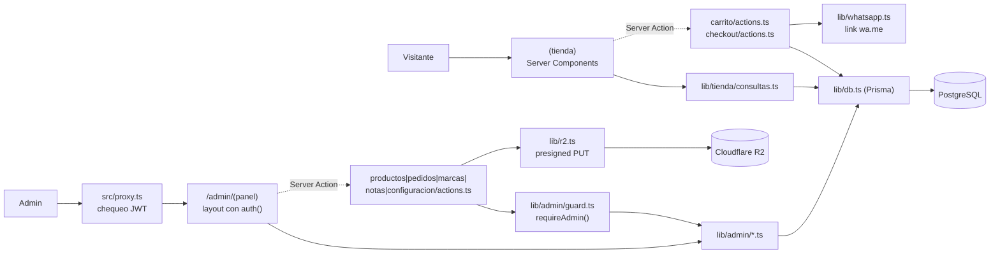

# Documentación técnica — Parfam MDQ

Mapa técnico del sistema, reconstruido leyendo el código (no el README ni los
comentarios). Cada afirmación apunta al archivo que la sostiene.

> **Nivel de evidencia.** A lo largo de estos documentos se marca
> **[Observado]** (confirmado en el código), **[Inferido]** (deducido de varias
> piezas) y **[No determinado]** (sin evidencia suficiente). Sin marca = observado.

---

## 1. Qué es el sistema

Tienda online de perfumería (Mar del Plata, es-AR) con **checkout por WhatsApp**
y un **panel de administración** para una sola persona.

El sistema **no cobra**: el "checkout" persiste un pedido en la base, genera un
número correlativo (`PM-0042`) y devuelve un link `wa.me` con el pedido ya
escrito. El pago y la entrega se arreglan por chat.
Ver [`flows/crear-pedido.md`](flows/crear-pedido.md).

Tres capas de datos conviven en la misma base
([`persistence.md`](persistence.md)):

| Capa           | Qué es                                 | Quién la escribe                  | ¿La ve el cliente?     |
| -------------- | -------------------------------------- | --------------------------------- | ---------------------- |
| **Referencia** | 69.948 fragancias de Fragrantica (CSV) | `scripts/import-fragrantica.ts`   | **No** — sólo el panel |
| **Tienda**     | `Product` + variantes, fotos, notas    | El admin desde `/admin/productos` | Sí                     |
| **Operación**  | `Order`, `SiteSetting`, `User`         | El checkout y el panel            | Parcial                |

La regla de negocio que atraviesa todo: **las imágenes y descripciones de
Fragrantica nunca se publican**. Las fotos son propias (Cloudflare R2) y los
textos se escriben en español desde el panel.

---

## 2. Stack

| Capa           | Tecnología                                                                 | Dónde se configura                                          |
| -------------- | -------------------------------------------------------------------------- | ----------------------------------------------------------- |
| Framework      | Next.js **16.3.5** (App Router, Server Actions)                            | `next.config.ts`                                            |
| UI             | React 19.2.8, Tailwind v4, shadcn/ui preset `radix-nova`, Lucide           | `components.json`, `src/app/globals.css`                    |
| Datos          | Prisma **7.10** + driver adapter `@prisma/adapter-pg` sobre PostgreSQL     | `prisma/schema.prisma`, `prisma.config.ts`, `src/lib/db.ts` |
| Auth           | Auth.js v5 (`next-auth@5.0.0-beta.32`), JWT, provider Credentials + argon2 | `src/lib/auth.ts`, `src/lib/auth.config.ts`                 |
| Estado URL     | `nuqs` (filtros del catálogo y del panel)                                  | `src/lib/tienda/filtros.ts`                                 |
| Estado cliente | `zustand` + `persist` (carrito en `localStorage`)                          | `src/lib/carrito.ts`                                        |
| Validación     | `zod` v4, mismo schema en cliente y servidor                               | `src/lib/validations/`                                      |
| Formularios    | `react-hook-form` + `@hookform/resolvers/standard-schema`                  | —                                                           |
| Storage        | Cloudflare R2 vía `@aws-sdk/client-s3` + presigned URLs                    | `src/lib/r2.ts`                                             |
| Deploy         | Docker multi-stage → GHCR → Dokploy                                        | `Dockerfile`, `.github/workflows/deploy.yml`                |

Package manager: **pnpm 12.4.2**. Es una **aplicación única**, no un monorepo
(`pnpm-workspace.yaml` sólo declara `allowBuilds`, sin `packages:`).

---

## 3. Arquitectura en una pantalla



Patrón dominante: **feature-based sobre App Router**, con una capa de consultas
separada de las rutas. No hay repositories ni Clean Architecture — Prisma se
usa directo desde `src/lib/**` y las Server Actions son la capa de aplicación.
Detalle en [`architecture.md`](architecture.md).

---

## 4. Superficies de entrada

| Tipo                    | Cuántas                                                            | Dónde                                                        |
| ----------------------- | ------------------------------------------------------------------ | ------------------------------------------------------------ |
| Rutas públicas (tienda) | 10                                                                 | [`routes.md`](routes.md#tienda)                              |
| Rutas del panel         | 9 (+ login)                                                        | [`routes.md`](routes.md#panel-de-administración)             |
| Route Handlers HTTP     | 2 (`/api/health`, `/api/auth/[...nextauth]`)                       | [`api.md`](api.md#route-handlers)                            |
| Server Actions          | 23                                                                 | [`api.md`](api.md#server-actions)                            |
| Metadata routes         | `robots.ts`, `sitemap.ts`, `icon.tsx`, 10 × `opengraph-image.tsx`  | [`routes.md`](routes.md#rutas-de-metadata)                   |
| Proxy (ex middleware)   | 1, matcher `/admin/:path*`                                         | [`authentication.md`](authentication.md)                     |
| Scripts CLI             | 4 (`db:seed`, `db:seed-dev`, `db:import-fragrantica`, test manual) | [`modules/datos-referencia.md`](modules/datos-referencia.md) |

**No hay** webhooks entrantes, colas, cron jobs ni workers.

---

## 5. Casos de uso reales

Reconstruidos desde las acciones que el sistema realmente expone, no desde los
nombres de carpeta.

**Visitante**

1. [Explorar el catálogo y filtrar](flows/ver-catalogo.md)
2. [Ver una ficha de producto](flows/ver-catalogo.md#ficha-de-producto)
3. [Agregar al carrito y reconciliarlo](flows/agregar-al-carrito.md)
4. [Cerrar el pedido por WhatsApp](flows/crear-pedido.md)
5. Consultar por WhatsApp sin pedido (ficha sin variantes, footer, `/contacto`)

**Admin** 6. [Entrar al panel](flows/login.md) 7. [Crear/editar y publicar un producto](flows/publicar-producto.md) — incluye
[adoptar una fragancia de referencia](flows/publicar-producto.md#paso-1--adoptar-una-referencia) 8. [Subir fotos a R2](flows/subir-imagen.md) 9. [Seguir y cambiar el estado de un pedido](flows/gestionar-pedido.md) 10. Traducir notas olfativas (`/admin/notas`) 11. Corregir nombres de marca (`/admin/marcas`) 12. [Editar la configuración del sitio](modules/configuracion-sitio.md)

**Operador / mantenimiento** 13. [Importar el dataset de Fragrantica](modules/datos-referencia.md) 14. [Deploy](deployment.md)

---

## 6. Mapa de la documentación

| Documento                                      | Respondé acá                                                                |
| ---------------------------------------------- | --------------------------------------------------------------------------- |
| [`architecture.md`](architecture.md)           | Capas, módulos, boundaries, patrones, qué depende de qué                    |
| [`project-structure.md`](project-structure.md) | Qué hay en cada carpeta y por qué                                           |
| [`routes.md`](routes.md)                       | Toda ruta: archivo, layout, auth, datos, navegación                         |
| [`api.md`](api.md)                             | Server Actions y Route Handlers: entrada, validación, persistencia, errores |
| [`user-flows.md`](user-flows.md)               | Índice y resumen de los flujos end-to-end                                   |
| [`data-flow.md`](data-flow.md)                 | Cómo viaja el dato: UI → estado → acción → base → UI. Caché y revalidación  |
| [`authentication.md`](authentication.md)       | Login, sesión JWT, proxy, guards, matriz de permisos                        |
| [`persistence.md`](persistence.md)             | Modelo de datos, relaciones, índices, migraciones                           |
| [`integrations.md`](integrations.md)           | R2, WhatsApp, Google, Umami, GHCR/Dokploy                                   |
| [`deployment.md`](deployment.md)               | Docker, CI, migraciones en runtime, healthcheck                             |
| [`glossary.md`](glossary.md)                   | Vocabulario del dominio y del código (es/en)                                |
| [`findings.md`](findings.md)                   | **Hallazgos**: riesgos, código muerto, contradicciones                      |
| [`modules/`](modules/)                         | Un documento por módulo                                                     |
| [`flows/`](flows/)                             | Un documento por caso de uso end-to-end                                     |

### Módulos

- [`modules/tienda-catalogo.md`](modules/tienda-catalogo.md) — catálogo, filtros, ficha
- [`modules/carrito-checkout.md`](modules/carrito-checkout.md) — carrito, reconciliación, pedido
- [`modules/admin-productos.md`](modules/admin-productos.md) — alta/edición/publicación
- [`modules/admin-referencias.md`](modules/admin-referencias.md) — buscador difuso de las 70k
- [`modules/admin-pedidos.md`](modules/admin-pedidos.md) — bandeja de pedidos
- [`modules/configuracion-sitio.md`](modules/configuracion-sitio.md) — `SiteSetting` y su caché
- [`modules/seo.md`](modules/seo.md) — metadata, JSON-LD, sitemap, OG images
- [`modules/almacenamiento-imagenes.md`](modules/almacenamiento-imagenes.md) — R2 de punta a punta
- [`modules/datos-referencia.md`](modules/datos-referencia.md) — CSV, diccionarios, importador

### Flujos

- [`flows/login.md`](flows/login.md)
- [`flows/ver-catalogo.md`](flows/ver-catalogo.md)
- [`flows/agregar-al-carrito.md`](flows/agregar-al-carrito.md)
- [`flows/crear-pedido.md`](flows/crear-pedido.md)
- [`flows/publicar-producto.md`](flows/publicar-producto.md)
- [`flows/subir-imagen.md`](flows/subir-imagen.md)
- [`flows/gestionar-pedido.md`](flows/gestionar-pedido.md)

---

## 7. "¿Dónde toco para cambiar X?"

| Quiero cambiar…                                                   | Empezá por                                                                                                                                                         |
| ----------------------------------------------------------------- | ------------------------------------------------------------------------------------------------------------------------------------------------------------------ |
| Un texto del sitio (marca, envío, tagline, plantilla de WhatsApp) | **No es código**: `/admin/configuracion` → `SiteSetting`. Ver [`modules/configuracion-sitio.md`](modules/configuracion-sitio.md)                                   |
| El número de WhatsApp                                             | Ídem: `SiteSetting.whatsappNumber`. En código sólo está el fallback en `src/lib/site.ts`                                                                           |
| Los filtros del catálogo (nuevo filtro, rango de precios)         | `src/lib/tienda/filtros.ts` + `src/lib/tienda/consultas.ts` (`wherePublico`) + `src/components/tienda/catalogo/controles-filtro.tsx`                               |
| El orden / paginado del catálogo                                  | `src/lib/tienda/consultas.ts` → `listarCatalogo()` (ordena y pagina **en memoria**)                                                                                |
| Qué se muestra en la tarjeta del catálogo                         | `src/lib/tienda/consultas.ts` → `aTarjeta()` + `src/components/tienda/tarjeta-producto.tsx`                                                                        |
| Reglas para publicar un producto                                  | `src/lib/validations/producto.ts` (`superRefine`) **y** `src/app/admin/(panel)/productos/actions.ts` → `cambiarEstadoProducto()` — son dos caminos al mismo estado |
| El mensaje de WhatsApp del pedido                                 | Plantilla en `SiteSetting`; el formato de cada línea en `src/lib/tienda/mensaje-pedido.ts`                                                                         |
| El formato del número de pedido                                   | `src/app/(tienda)/checkout/actions.ts` (`PM-` + `padStart(4)`) + la secuencia de `prisma/migrations/20260917122409_numero_pedido_secuencia/`                       |
| Los estados de un pedido                                          | Enum `OrderStatus` en `prisma/schema.prisma` + etiquetas en `src/lib/admin/pedidos.ts` (`ESTADO_PEDIDO`)                                                           |
| El buscador de referencias (relevancia)                           | `src/lib/admin/referencias.ts` — pesos `PESO_PARECIDO`/`PESO_POPULARIDAD`, `VOTOS_PREVIOS`                                                                         |
| El host público de las fotos                                      | Variable `R2_PUBLIC_URL`. **Requiere rebuild de la imagen** (ver [`deployment.md`](deployment.md))                                                                 |
| Metadata / SEO por página                                         | `src/lib/seo.ts` (`metadataDePagina`, `productoJsonLd`)                                                                                                            |
| La imagen de vista previa (OG)                                    | `src/app/(tienda)/opengraph-image.tsx`; el resto la reexporta                                                                                                      |
| Protección de una nueva sección de admin                          | Nada: el matcher `/admin/:path*` la cubre. Pero **toda Server Action nueva necesita `requireAdmin()` explícito**                                                   |

---

## 8. Cómo levantar el proyecto

```bash
pnpm install              # corre `prisma generate` en postinstall
pnpm db:up                # Postgres local en el puerto 5433
pnpm db:migrate           # aplica migraciones
pnpm db:seed              # usuario admin (si hay ADMIN_SEED_*) + SiteSetting
pnpm db:import-fragrantica -- --limit 2000   # catálogo de referencia (opcional)
pnpm db:seed-dev          # 6 productos de ejemplo (necesita R2 configurado)
pnpm dev
```

Variables de entorno: copiar `.env.example` a `.env`. Las obligatorias son
`DATABASE_URL`, `AUTH_SECRET` y `NEXT_PUBLIC_SITE_URL`; el resto se valida como
opcional en `src/lib/env.ts`. Detalle en [`integrations.md`](integrations.md).

Verificación: `pnpm typecheck` y `pnpm lint` pasan limpios en el commit `2e8ef56`
(comprobado durante esta auditoría). **No hay test runner instalado** — ver
[`findings.md`](findings.md#f-09).

---

## 9. Antes de confiar en esto

Esta documentación se escribió **contra el código**, no contra un plan previo.
`PLAN.md` se borró a propósito una vez terminado, y las referencias que el
código todavía le hacía ya se limpiaron junto con el vocabulario de "Fase N"
(ver [`F-01`](findings.md#f-01)).

Queda un resto del mismo tipo: **32 comentarios citan `design/*.dc.html`**,
borrado en el mismo commit. No afecta el comportamiento, pero es una referencia
a un archivo que no existe.
