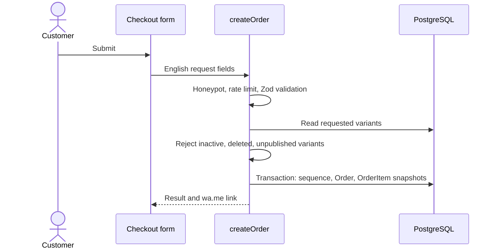

# API surface

The application does not expose a product REST API. Its programmatic surface is
Next Server Actions and two Route Handlers. Server Actions must treat every
argument as untrusted input.

## Route Handlers

| Method       | Route                     | Implementation                          | Contract                                                  |
| ------------ | ------------------------- | --------------------------------------- | --------------------------------------------------------- |
| `GET`        | `/api/health`             | `src/app/api/health/route.ts`           | Executes `SELECT 1`; returns `{ status, database, sha }`. |
| `GET`/`POST` | `/api/auth/[...nextauth]` | Auth.js handlers from `src/lib/auth.ts` | Auth.js protocol endpoint.                                |

`/api/health` is dynamic, returns `Cache-Control: no-store`, and is used by
Docker/Dokploy health checks.

## Public actions

| Export               | File                                  | Responsibility                                                                            |
| -------------------- | ------------------------------------- | ----------------------------------------------------------------------------------------- |
| `validateCartAction` | `src/app/(store)/carrito/actions.ts`  | Rechecks cart variants and returns current availability, labels, and price.               |
| `createOrder`        | `src/app/(store)/checkout/actions.ts` | Validates checkout, creates `Order` and `OrderItem` records, and returns a WhatsApp link. |

`createOrder` accepts `customerName`, `customerPhone`, `items`, and the hidden
`company` honeypot. It returns `orderNumber` and `link` on success, or a Spanish
customer message plus English `fieldErrors` and `invalidItems` keys on failure.
A client price is never used to persist an order.

## Admin actions

Admin action files are under `src/app/admin/`. Each begins with
`await requireAdmin()`.

| Area               | Files                                                | Responsibilities                                                                                                                                                                                                                                                                 |
| ------------------ | ---------------------------------------------------- | -------------------------------------------------------------------------------------------------------------------------------------------------------------------------------------------------------------------------------------------------------------------------------- |
| Product management | `productos/actions.ts`, `productos/image-actions.ts` | `searchReferencesAction` (results include `existingProducts`), `adoptReferenceAction`, autocomplete actions, `saveProduct`, `changeProductStatus`, `updateVariantPrice`, `setVariantActive`, `duplicateProduct`, `deleteProduct`, `requestUploadUrl`, and `deleteUploadedImage`. |
| Orders             | `pedidos/actions.ts`                                 | `changeOrderStatus` and `saveOrderNotes`.                                                                                                                                                                                                                                        |
| Brands             | `marcas/actions.ts`                                  | `updateBrand` (name and country; slug is immutable).                                                                                                                                                                                                                             |
| Settings           | `configuracion/actions.ts`                           | `saveSettings`.                                                                                                                                                                                                                                                                  |
| Session            | `(panel)/actions.ts`, `login/actions.ts`             | `signOutAdmin` and `authenticate`.                                                                                                                                                                                                                                               |

The common admin envelope is `ActionResult<T>` with `data`, `message`, and
`fieldErrors` fields. Message values displayed to administrators remain Spanish.

## Checkout sequence

The transaction obtains `Order_number_seq`, totals with `Prisma.Decimal`,
and stores snapshots before the WhatsApp message is built. Invalid variants are
reported so the client can remove them from the persisted cart.

## Contract rules

Public URL segments and query keys, database fields and enum values, R2 keys,
browser storage, environment values, and WhatsApp template placeholders are
contracts. Check their consumers and provide compatibility or a deliberate
data reset before changing them.
