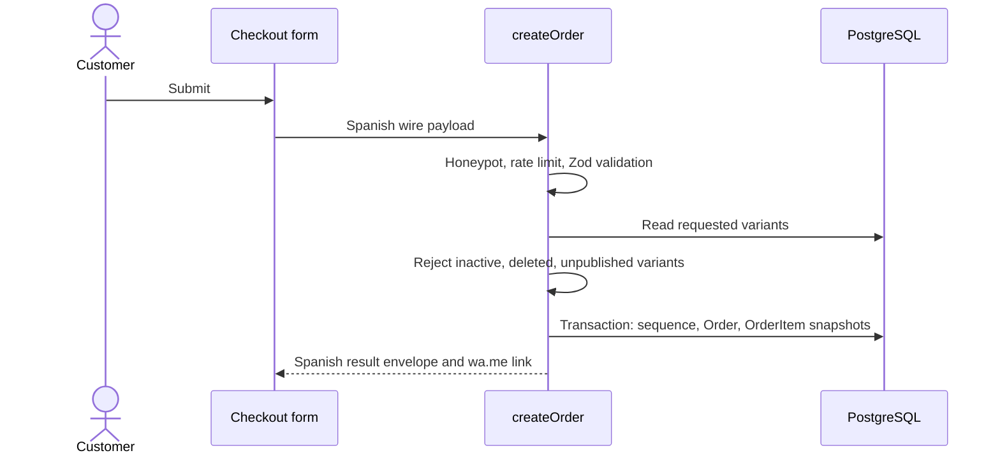

# API surface

The application does not expose a product REST API. Its programmatic surface is
Next Server Actions and two Route Handlers. Server Actions must treat every
argument as untrusted input.

## Route Handlers

| Method       | Route                     | Implementation                          | Contract                                                                             |
| ------------ | ------------------------- | --------------------------------------- | ------------------------------------------------------------------------------------ |
| `GET`        | `/api/health`             | `src/app/api/health/route.ts`           | Executes `SELECT 1`; retains `{ estado, base }` Spanish response keys for operators. |
| `GET`/`POST` | `/api/auth/[...nextauth]` | Auth.js handlers from `src/lib/auth.ts` | Auth.js protocol endpoint.                                                           |

`/api/health` is dynamic, returns `Cache-Control: no-store`, and is used by
Docker/Dokploy health checks.

## Public actions

| Export               | File                                  | Responsibility                                                                            |
| -------------------- | ------------------------------------- | ----------------------------------------------------------------------------------------- |
| `validateCartAction` | `src/app/(store)/carrito/actions.ts`  | Rechecks cart variants and returns current availability, labels, and price.               |
| `createOrder`        | `src/app/(store)/checkout/actions.ts` | Validates checkout, creates `Order` and `OrderItem` records, and returns a WhatsApp link. |

`createOrder` deliberately preserves its Spanish request/result wire fields:
`nombre`, `telefono`, `empresa`, `numero`, `mensaje`, `errores`,
`invalidos`, and `razon`. It maps them to English local values immediately.
A client price is never used to persist an order.

## Admin actions

Admin action files are under `src/app/admin/`. Each begins with
`await requireAdmin()`.

| Area               | Files                                                | Responsibilities                                                                                                                                                                                  |
| ------------------ | ---------------------------------------------------- | ------------------------------------------------------------------------------------------------------------------------------------------------------------------------------------------------- |
| Product management | `productos/actions.ts`, `productos/image-actions.ts` | `searchReferencesAction`, `adoptReferenceAction`, autocomplete actions, `saveProduct`, `changeProductStatus`, `duplicateProduct`, `deleteProduct`, `requestUploadUrl`, and `deleteUploadedImage`. |
| Orders             | `pedidos/actions.ts`                                 | `changeOrderStatus` and `saveOrderNotes`.                                                                                                                                                         |
| Brands             | `marcas/actions.ts`                                  | `updateBrand`.                                                                                                                                                                                    |
| Notes              | `notas/actions.ts`                                   | `translateNote` and `clearNoteTranslation`.                                                                                                                                                       |
| Settings           | `configuracion/actions.ts`                           | `saveSettings`.                                                                                                                                                                                   |
| Session            | `(panel)/actions.ts`, `login/actions.ts`             | `signOutAdmin` and `authenticate`.                                                                                                                                                                |

The common admin envelope is `ActionResult<T>`, while its raw fields remain
`datos`, `mensaje`, and `errores` so existing client calls are compatible.

## Checkout sequence

The transaction obtains `Order_number_seq`, totals with `Prisma.Decimal`,
and stores snapshots before the WhatsApp message is built. Invalid variants are
reported so the client can remove them from the persisted cart.

## Contract rules

Do not silently rename public URL segments, query keys, Server Action payloads,
database fields, enum values, localStorage keys, R2 prefixes, environment
variables, or WhatsApp template placeholders. Introduce a mapper or explicit
migration when one must change.
