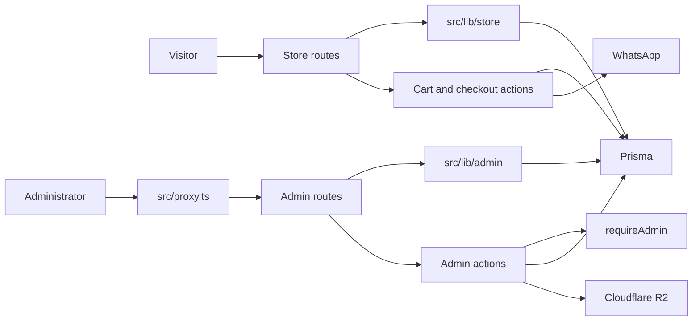

# Architecture

## Application boundaries

The App Router provides two surfaces:

- `src/app/(store)/` renders the public store. The route group name is internal;
  public URL segments remain Spanish, for example `/producto` and `/carrito`.
- `src/app/admin/` renders the login and administrative panel.

Pages orchestrate server-side queries and pass serializable data to Client
Components. Public queries live in `src/lib/store/`; panel queries live in
`src/lib/admin/`. Neither area imports the other. Shared code belongs in
`src/lib/`.

## Shared modules

Values used by both surfaces have one definition in `src/lib/`. These modules
do not import Prisma at runtime, so Client Components may use them:

- `src/lib/site.ts`: brand defaults (`siteDefaults`, also the seed and fallback
  for editable settings), `SITE_LOCALE`, `brandColors`, and `SITE_SETTINGS_ID`.
- `src/lib/catalog.ts`: Spanish enum labels, `getVariantLabel`,
  `formatArsPrice`, `PRICE_CURRENCY`, and `getProductPath`.
- `src/lib/utils.ts`: `cn` (class merging, from the `cn` package) and
  `FOCUS_VISIBLE`.

Server-only shared modules: `src/lib/db.ts` (Prisma client), `src/lib/env.ts`
(validated environment), `src/lib/settings.ts` (cached `SiteSetting`),
`src/lib/r2.ts`, `src/lib/image-trim.ts`, `src/lib/rate-limit.ts`, and
`src/lib/seo.ts`.

## Selected libraries

Reuse these before adding a dependency or writing an equivalent utility:

| Need                       | Library                                               |
| -------------------------- | ----------------------------------------------------- |
| UI primitives              | shadcn/ui on `radix-ui` (`src/components/ui/`)        |
| Icons                      | `lucide-react`                                        |
| Class merging and variants | `cn` via `@/lib/utils`, `class-variance-authority`    |
| Command palette / combobox | `cmdk`                                                |
| Carousel                   | `embla-carousel-react`                                |
| Toasts                     | `sonner`                                              |
| File drop zone             | `react-dropzone`                                      |
| URL state                  | `nuqs`                                                |
| Client state (cart)        | `zustand`                                             |
| Forms and validation       | `react-hook-form`, `@hookform/resolvers`, `zod`       |
| Environment validation     | `@t3-oss/env-nextjs`                                  |
| Phone numbers              | `libphonenumber-js`                                   |
| Slugs                      | `slugify` via `toSlug` in `src/lib/slug.ts`           |
| In-memory rate limiting    | `lru-cache` via `src/lib/rate-limit.ts`               |
| Image processing           | `sharp`                                               |
| Object storage (R2)        | `@aws-sdk/client-s3`, `@aws-sdk/s3-request-presigner` |
| Password hashing           | `@node-rs/argon2`                                     |
| Database                   | Prisma with `@prisma/adapter-pg` and `pg`             |

No date library is installed; `src/lib/date.ts` covers relative admin
timestamps.

## Data and rendering

Prisma access remains server-only. Client Components never import a module that
imports Prisma. Prisma `Decimal` values are converted to strings at the server
boundary before being passed to Client Components.

The catalog uses `nuqs` parsers in `src/lib/store/filters.ts`. Internal field
names are English, while `catalogFilterUrlKeys` deliberately retains existing
Spanish query keys and values. Cart state is a persisted Zustand store in
`src/lib/cart.ts`; its storage key is also a compatibility contract.

## Admin panel shell

`src/app/admin/(panel)/layout.tsx` renders the sidebar (`admin-sidebar.tsx`)
and, below `md`, a fixed bottom nav (`admin-bottom-nav.tsx`) with Inicio,
Pedidos (pending badge), Productos and "Más", which opens the sidebar sheet
for Marcas, Configuración and the user menu. Both read the shared `NAV`.

## Server Actions

Server Actions are public POST endpoints. Admin actions therefore call
`requireAdmin()` as their first operation. The `/admin` layout and
`src/proxy.ts` improve navigation but do not authorize an action request.

Public checkout validates the request, reads authoritative prices and
availability from PostgreSQL, creates an order inside a transaction, then
builds a WhatsApp link. It never processes a payment.

## Naming and localization

Implementation names, comments, logs, test names, and developer documents are
English. Spanish remains in customer-visible UI, accessibility text, emails,
SEO text, and public contracts. `es-AR`, ARS formatting, and voseo are product
behavior, not implementation terminology.

## Cache boundaries

`getSiteSettings()` is tagged and invalidated after settings updates. Public
product routes are revalidated after product, brand, or note changes. The
sitemap uses a tagged `unstable_cache` because it is dynamic and needs its own
invalidation path. See [data-flow.md](data-flow.md).
