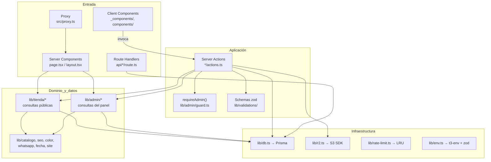
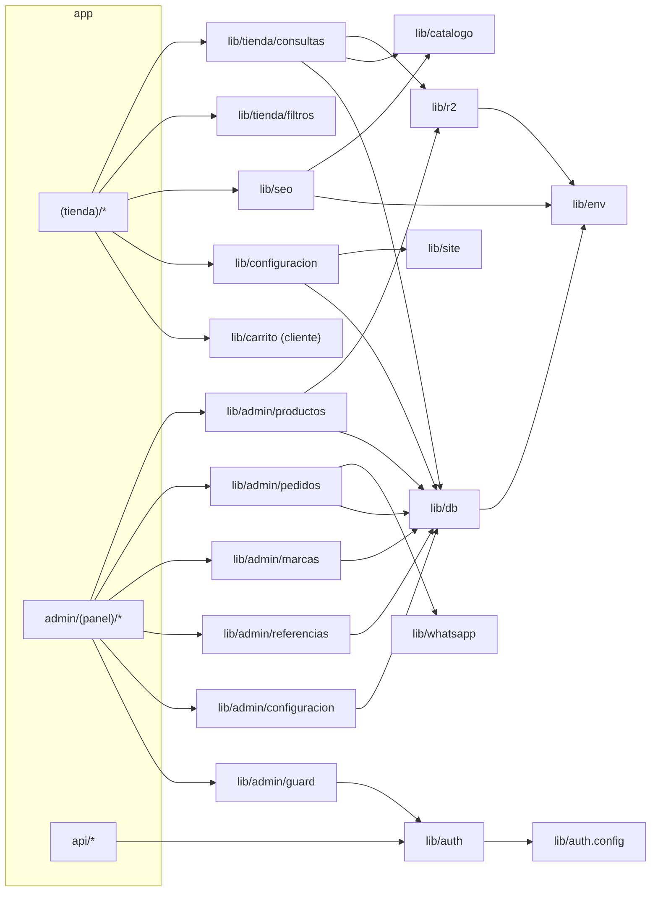

# Arquitectura

Reconstruida desde el código. Ver [`project-structure.md`](project-structure.md)
para el mapa de carpetas y [`data-flow.md`](data-flow.md) para el recorrido del dato.

---

## 1. Forma del sistema

**Aplicación única** (no monorepo, no microservicios). Un solo proceso Node
sirve la tienda pública y el panel: `next start` sobre el output `standalone`.

`pnpm-workspace.yaml` existe pero **no declara `packages:`** — sólo la lista
`allowBuilds` (qué dependencias pueden correr scripts de instalación). No hay
paquetes internos.

```
1 aplicación Next.js (App Router)
├── superficie pública   → src/app/(tienda)/
├── superficie privada   → src/app/admin/
├── superficie HTTP      → src/app/api/
└── superficie CLI       → scripts/ + prisma/seed.ts
        ↓
1 base PostgreSQL  ·  1 bucket Cloudflare R2  ·  0 servicios propios
```

Estilo dominante: **feature-based sobre App Router**, con una capa de acceso a
datos por dominio (`src/lib/**`). No hay Clean Architecture, hexagonal, CQRS ni
event-driven: **[Observado]** no existe ninguna interfaz de repositorio, ningún
bus de eventos ni ningún puerto/adaptador salvo el de R2, que es un wrapper
fino del SDK de S3.

---

## 2. Capas reales



| Capa                | Dónde                                                           | Responsabilidad                                                    | Regla observada                                                    |
| ------------------- | --------------------------------------------------------------- | ------------------------------------------------------------------ | ------------------------------------------------------------------ |
| **Entrada**         | `src/app/**/page.tsx`, `layout.tsx`, `route.ts`, `src/proxy.ts` | Resolver params, orquestar consultas, renderizar                   | Los `page.tsx` **no** hablan con Prisma salvo dos excepciones (§6) |
| **Aplicación**      | `src/app/**/actions.ts`                                         | Autorizar → validar → escribir → revalidar                         | Toda acción del panel abre con `requireAdmin()`                    |
| **Dominio/datos**   | `src/lib/tienda/`, `src/lib/admin/`                             | Consultas tipadas; serializar `Decimal`→`string`; armar URLs de R2 | Lo que sale de acá ya está listo para un Client Component          |
| **Infraestructura** | `src/lib/db.ts`, `r2.ts`, `rate-limit.ts`, `env.ts`             | Clientes y validación de entorno                                   | Singletons perezosos                                               |

---

## 3. Boundaries que el código respeta a propósito

Cada uno está documentado en el propio archivo y **fue verificado**:

| Boundary                                                                | Por qué existe                                                                               | Archivo                                                             |
| ----------------------------------------------------------------------- | -------------------------------------------------------------------------------------------- | ------------------------------------------------------------------- |
| `auth.config.ts` separado de `auth.ts`                                  | `proxy.ts` importa sólo la config: no arrastra Prisma ni el binario de argon2 a cada request | `src/lib/auth.config.ts:3-9`                                        |
| `lib/site.ts` separado de `lib/configuracion.ts`                        | `site.ts` lo importan Client Components (header, sidebar): no puede traer Prisma             | `src/lib/configuracion.ts:10-12`                                    |
| `ESTADO_PEDIDO` vive en `lib/admin/pedidos.ts`, no en `lib/catalogo.ts` | `catalogo.ts` lo comparte la tienda pública, que no muestra estados de pedido                | `src/lib/admin/pedidos.ts:17-19`                                    |
| Las etiquetas de estado viajan **como prop** al `SelectorEstado`        | Importarlas desde `lib/admin/pedidos.ts` metería Prisma en el bundle del browser             | `src/app/admin/(panel)/pedidos/_components/selector-estado.tsx:1-6` |
| `urlPublica()` es la única función que conoce `R2_PUBLIC_URL`           | La base guarda la **clave**, no la URL: cambiar de dominio no toca ninguna fila              | `src/lib/r2.ts:86-98`                                               |
| Los `Decimal` se convierten a `string` en la capa de consultas          | No son serializables hacia un Client Component, y nunca deben pasar por `float`              | `src/lib/tienda/consultas.ts:18-31`                                 |

### El boundary más importante: referencia vs. tienda

`FragranceRef` (70k filas, con `descriptionEn`, `ratingValue`, `ratingCount`,
`url` de Fragrantica) **nunca se selecciona en una consulta pública**.
Verificado: `src/lib/tienda/consultas.ts` no menciona `fragranceRef` en ningún
`select`. Sólo `src/lib/admin/referencias.ts` y `src/lib/admin/productos.ts` la
leen, y ambos viven detrás de `requireAdmin()` / del layout del panel.

---

## 4. Módulos

Un documento por módulo en [`modules/`](modules/). Resumen:

| Módulo                                              | Ubicación                                                                                                                                     | API interna principal                                                                                                                        | Consumidores                                                                | Entidades                                                              |
| --------------------------------------------------- | --------------------------------------------------------------------------------------------------------------------------------------------- | -------------------------------------------------------------------------------------------------------------------------------------------- | --------------------------------------------------------------------------- | ---------------------------------------------------------------------- |
| [Catálogo público](modules/tienda-catalogo.md)      | `src/lib/tienda/consultas.ts`, `filtros.ts`, `src/components/tienda/catalogo/`                                                                | `listarCatalogo`, `opcionesDeFiltro`, `productoPorSlug`, `relacionados`, `marcaPorSlug`, `urlsDelSitio`, `cargarFiltros`                     | `/`, `/catalogo`, `/marca/[slug]`, `/producto/[slug]`, `sitemap.ts`         | `Product`, `Brand`, `ProductVariant`, `ProductImage`, `Note`, `Accord` |
| [Carrito y checkout](modules/carrito-checkout.md)   | `src/lib/carrito.ts`, `lib/tienda/carrito-servidor.ts`, `usar-reconciliacion-carrito.ts`, `mensaje-pedido.ts`, `(tienda)/checkout/actions.ts` | `useCarrito`, `revalidarItemsCarrito`, `useReconciliacionCarrito`, `crearPedido`, `armarMensajePedido`                                       | drawer, `/carrito`, `/checkout`, `/pedido/[number]/gracias`                 | `ProductVariant`, `Product`, `Order`, `OrderItem`                      |
| [Productos (panel)](modules/admin-productos.md)     | `src/lib/admin/productos.ts`, `slug.ts`, `(panel)/productos/actions.ts`, `imagenes-actions.ts`                                                | `listarProductos`, `productoParaEditar`, `listarAcordes`, `guardarProducto`, `cambiarEstadoProducto`, `duplicarProducto`, `eliminarProducto` | `/admin/productos*`                                                         | Todas las de tienda                                                    |
| [Referencias](modules/admin-referencias.md)         | `src/lib/admin/referencias.ts`                                                                                                                | `buscarReferencias`, `referenciaParaAdoptar`                                                                                                 | formulario de producto                                                      | `FragranceRef` y sus join tables                                       |
| [Pedidos (panel)](modules/admin-pedidos.md)         | `src/lib/admin/pedidos.ts`, `(panel)/pedidos/actions.ts`                                                                                      | `listarPedidos`, `pedidoPorId`, `cambiarEstadoPedido`, `guardarNotasPedido`                                                                  | `/admin/pedidos*`                                                           | `Order`, `OrderItem`                                                   |
| [Configuración](modules/configuracion-sitio.md)     | `src/lib/configuracion.ts`, `lib/admin/configuracion.ts`, `(panel)/configuracion/actions.ts`                                                  | `obtenerConfiguracionSitio` (cacheada), `obtenerConfiguracionEditable` (cruda), `guardarConfiguracion`                                       | root layout, footer, hero, ficha, checkout, gracias, contacto, como-comprar | `SiteSetting`                                                          |
| [SEO](modules/seo.md)                               | `src/lib/seo.ts`, `src/app/sitemap.ts`, `robots.ts`, `opengraph-image.tsx`                                                                    | `metadataDePagina`, `jsonLd`, `productoJsonLd`, `migasJsonLd`, `urlAbsoluta`                                                                 | todas las páginas públicas                                                  | `Product`, `Brand`                                                     |
| [Imágenes / R2](modules/almacenamiento-imagenes.md) | `src/lib/r2.ts`, `imagenes-actions.ts`, `panel-imagenes.tsx`                                                                                  | `urlDeSubida`, `urlPublica`, `borrarObjeto`, `esClaveDeProducto`, `r2Configurado`                                                            | panel de productos, todas las fotos públicas                                | `ProductImage`                                                         |
| [Datos de referencia](modules/datos-referencia.md)  | `scripts/`, `data/`, `prisma/seed.ts`                                                                                                         | `readAndMergeFragrantica`, parsers, diccionarios                                                                                             | CLI                                                                         | `FragranceRef`, `Brand`, `Note`, `Accord`, `Perfumer`                  |

### Módulos transversales (sin doc propio)

| Archivo                 | Responsabilidad                                                                     | Consumidores                                                  |
| ----------------------- | ----------------------------------------------------------------------------------- | ------------------------------------------------------------- |
| `src/lib/catalogo.ts`   | Etiquetas es-AR de los enums, `etiquetaVariante()`, `precioArs()`, `nombrePropio()` | tienda **y** panel **y** mensaje de WhatsApp                  |
| `src/lib/whatsapp.ts`   | `linkWhatsappA()`, `linkInstagramA()`, `telefonoVisible()`                          | footer, contacto, ficha, checkout, gracias, detalle de pedido |
| `src/lib/color.ts`      | `colorDeChip()`: corrige el hex del acorde hasta llegar a 4,5:1 WCAG AA             | `ChipAcorde`                                                  |
| `src/lib/rate-limit.ts` | Ventana deslizante en memoria (LRU)                                                 | login y `crearPedido`                                         |
| `src/lib/fecha.ts`      | `hace()`: tiempo relativo en es-AR                                                  | tablas del panel                                              |
| `src/lib/env.ts`        | Validación de entorno con `@t3-oss/env-nextjs`                                      | `db.ts`, `r2.ts`, `seo.ts`, páginas del panel                 |
| `src/lib/utils.ts`      | Reexporta `cn` del paquete `cn`                                                     | todo el UI                                                    |

---

## 5. Grafo de dependencias (nivel módulo)



**[Observado]** el grafo es acíclico. Un único acoplamiento cruzado notable:
`src/lib/validations/configuracion.ts` importa `telefono` de
`validations/checkout.ts` y `textoOpcional` de `validations/producto.ts` —
deliberado y documentado en el propio archivo (mismo criterio de validación
para el mismo tipo de dato).

`src/lib/validations/producto.ts` importa `esClaveDeProducto` de `lib/r2.ts`;
esa función es pura (no toca el SDK), así que el schema puede correr en el
cliente sin arrastrar el S3 client — el cliente de S3 se crea perezosamente
(`src/lib/r2.ts:51-64`).

---

## 6. Excepciones a las capas

Dos rutas consultan Prisma directamente, sin pasar por `src/lib/admin/`:

| Ruta                                   | Qué hace                                                      | Nota                                                                                                                                        |
| -------------------------------------- | ------------------------------------------------------------- | ------------------------------------------------------------------------------------------------------------------------------------------- |
| `src/app/admin/(panel)/page.tsx`       | `getStats()`: cinco `count()` para las tarjetas del dashboard | Consulta local a la página, no reutilizada                                                                                                  |
| `src/app/admin/(panel)/notas/page.tsx` | `findMany` + tres `count()` sobre `Note`                      | El comentario de `:33-35` explica que el filtro debe quedar como `nameEs: null` para que el índice parcial `Note_untranslated_idx` lo cubra |

**[Inferido]** no parece un descuido sino una decisión de proporción: ninguna
de las dos consultas tiene un segundo consumidor. Registrado como
[`F-12`](findings.md#f-12) por consistencia, no como defecto.

---

## 7. Comunicación entre componentes

No hay red interna: todo es in-process.

| Mecanismo                                      | Uso                                                                         | Ejemplo                                                 |
| ---------------------------------------------- | --------------------------------------------------------------------------- | ------------------------------------------------------- |
| **Server Action** (POST RPC generado por Next) | Cliente → servidor, 23 endpoints                                            | `crearPedido`, `guardarProducto`                        |
| **Props de Server → Client Component**         | Datos ya serializados (`Decimal`→`string`, URLs armadas)                    | `<Comprar whatsappNumber={...}>`                        |
| **URL (`nuqs`)**                               | Filtros del catálogo y de las tablas del panel                              | `?genero=MEN&precio=hasta-50000`                        |
| **`localStorage` (zustand persist)**           | Carrito, clave `parfam-carrito` v1                                          | `src/lib/carrito.ts:90`                                 |
| **Caché de Next**                              | `unstable_cache` con tag para `SiteSetting`; `revalidatePath` tras escribir | ver [`data-flow.md`](data-flow.md#caché-y-revalidación) |
| **`cache()` de React**                         | Dedupe de `listarCatalogo` dentro del mismo render                          | `src/components/tienda/catalogo/grilla.tsx:11`          |
| **HTTP externo**                               | PUT directo del browser al presigned URL de R2                              | ver [`flows/subir-imagen.md`](flows/subir-imagen.md)    |
| **Link `wa.me`**                               | Salida hacia WhatsApp; no hay API, sólo una URL                             | `src/lib/whatsapp.ts`                                   |

---

## 8. Side effects por módulo

| Módulo                     | Escribe en base                                                          | Escribe en R2                              | Invalida caché                                                                   | Red externa                     |
| -------------------------- | ------------------------------------------------------------------------ | ------------------------------------------ | -------------------------------------------------------------------------------- | ------------------------------- |
| `checkout/actions.ts`      | `Order`, `OrderItem`, `nextval()`                                        | —                                          | —                                                                                | — (sólo arma el link)           |
| `carrito/actions.ts`       | — (sólo lee)                                                             | —                                          | —                                                                                | —                               |
| `productos/actions.ts`     | `Product` + 5 tablas hijas, `Brand` (upsert), `Note`/`Perfumer` (upsert) | —                                          | `/`, `/catalogo`, `/sitemap.xml`, `/producto/*`, `/marca/*`, `/admin/productos*` | —                               |
| `imagenes-actions.ts`      | —                                                                        | **firma** PUT; **borra** objeto descartado | —                                                                                | S3 API (presign + DeleteObject) |
| `pedidos/actions.ts`       | `Order.status`, `Order.adminNotes`                                       | —                                          | `/admin/pedidos*`                                                                | —                               |
| `marcas/actions.ts`        | `Brand.name`                                                             | —                                          | `/`, `/catalogo`, `/marca/*`, `/producto/*` (uno por producto de la marca)       | —                               |
| `notas/actions.ts`         | `Note.nameEs`                                                            | —                                          | `/admin/notas`                                                                   | —                               |
| `configuracion/actions.ts` | `SiteSetting`                                                            | —                                          | `revalidateTag("site-settings", { expire: 0 })`                                  | —                               |
| `login/actions.ts`         | —                                                                        | —                                          | —                                                                                | — (escribe la cookie de sesión) |
| `api/health`               | — (`SELECT 1`)                                                           | —                                          | —                                                                                | —                               |

Detalle de qué invalida qué (y qué **no**): [`data-flow.md`](data-flow.md#caché-y-revalidación).

---

## 9. Decisiones estructurales con consecuencias

1. **El precio siempre se recalcula contra la base.** El carrito de
   `localStorage` es un snapshot de presentación. `crearPedido` vuelve a leer
   `ProductVariant.priceArs` y arma el total con `Prisma.Decimal`, nunca con
   `Number` (`src/app/(tienda)/checkout/actions.ts:179-182`).
2. **El pedido guarda snapshot.** `OrderItem` copia `productName`,
   `variantLabel` y `unitPriceArs`. Las FK a `Product`/`ProductVariant` son
   opcionales con `onDelete: SetNull`: borrar un producto no rompe un pedido,
   sólo le saca el link de navegación.
3. **El catálogo se ordena y pagina en memoria.** `listarCatalogo()` trae todas
   las filas que matchean y ordena en JS, porque "ordenar por precio" es el
   mínimo de una tabla hija y Prisma no lo expresa en `orderBy`. Documentado
   como aceptable hasta unos cientos de productos
   (`src/lib/tienda/consultas.ts:219-228`). Ver [`F-13`](findings.md#f-13).
4. **El buscador de referencias es SQL crudo.** `pg_trgm` + promedio bayesiano;
   Prisma no puede expresarlo. Ver [`modules/admin-referencias.md`](modules/admin-referencias.md).
5. **El número de pedido sale de una `SEQUENCE`.** Atómica por diseño; dos
   checkouts concurrentes nunca colisionan (`prisma/migrations/20260917122409_numero_pedido_secuencia/migration.sql`).
6. **`connection()` en `obtenerConfiguracionSitio()`** corta el prerender de
   todas las rutas que leen configuración — que son todas, porque el
   `generateMetadata()` del root layout la lee. Eso es lo que permite buildear
   **sin Postgres** en CI (`src/lib/configuracion.ts:85-105`).
7. **El proxy es optimista.** `src/proxy.ts` sólo valida el JWT de la cookie; la
   autorización real la hacen el layout del panel y `requireAdmin()` en cada
   Server Action. Ver [`authentication.md`](authentication.md).
