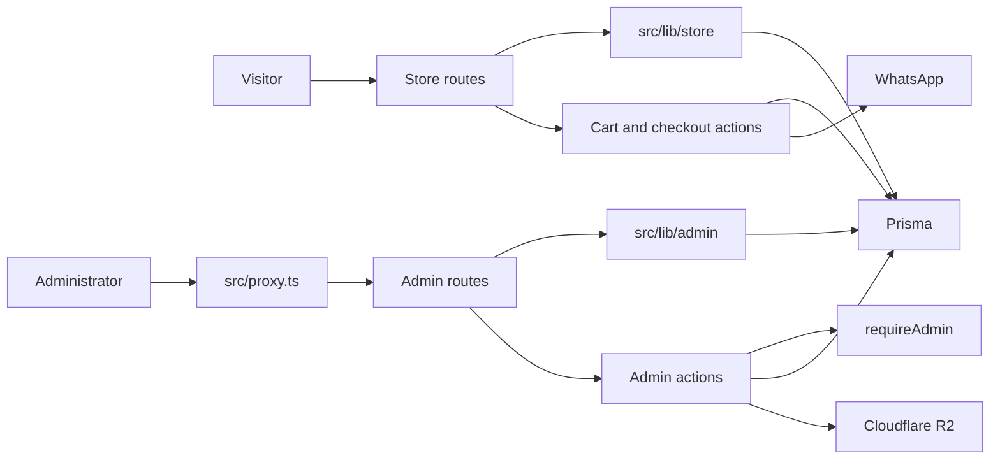

# Architecture

## Application boundaries

The App Router provides two surfaces:

- `src/app/(store)/` renders the public store. The route group name is internal;
  public URL segments remain Spanish, for example `/producto` and `/carrito`.
- `src/app/admin/` renders the login and administrative panel.

Pages orchestrate server-side queries and pass serializable data to Client
Components. Public queries live in `src/lib/store/`; panel queries live in
`src/lib/admin/`. Neither area imports the other. Shared code belongs in
`src/lib/`.

## Data and rendering

Prisma access remains server-only. Client Components never import a module that
imports Prisma. Prisma `Decimal` values are converted to strings at the server
boundary before being passed to Client Components.

The catalog uses `nuqs` parsers in `src/lib/store/filters.ts`. Internal field
names are English, while `catalogFilterUrlKeys` deliberately retains existing
Spanish query keys and values. Cart state is a persisted Zustand store in
`src/lib/cart.ts`; its storage key is also a compatibility contract.

## Server Actions

Server Actions are public POST endpoints. Admin actions therefore call
`requireAdmin()` as their first operation. The `/admin` layout and
`src/proxy.ts` improve navigation but do not authorize an action request.

Public checkout validates the request, reads authoritative prices and
availability from PostgreSQL, creates an order inside a transaction, then
builds a WhatsApp link. It never processes a payment.

## Naming and localization

Implementation names, comments, logs, test names, and developer documents are
English. Spanish remains in customer-visible UI, accessibility text, emails,
SEO text, and public contracts. `es-AR`, ARS formatting, and voseo are product
behavior, not implementation terminology.

## Cache boundaries

`getSiteSettings()` is tagged and invalidated after settings updates. Public
product routes are revalidated after product, brand, or note changes. The
sitemap uses a tagged `unstable_cache` because it is dynamic and needs its own
invalidation path. See [data-flow.md](data-flow.md).
