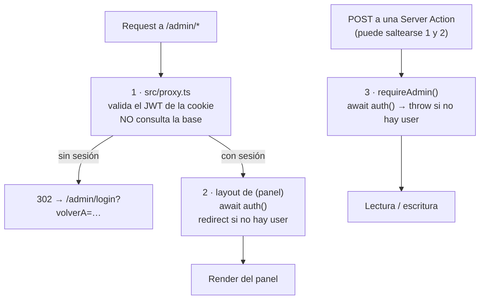

# Autenticación y autorización

Hay **un solo tipo de usuario autenticado**: el admin. La tienda es
completamente anónima — no hay registro, ni cuentas de cliente, ni recuperación
de contraseña. El "cliente" de un pedido es un nombre y un teléfono guardados en
`Order`, no un `User`.

Piezas:

| Archivo                            | Rol                                                                                        |
| ---------------------------------- | ------------------------------------------------------------------------------------------ |
| `src/lib/auth.config.ts`           | Config base de Auth.js **sin** base de datos ni argon2                                     |
| `src/lib/auth.ts`                  | `NextAuth()` con el provider Credentials → exporta `handlers`, `auth`, `signIn`, `signOut` |
| `src/proxy.ts`                     | Redirección optimista (ex `middleware.ts`)                                                 |
| `src/app/admin/(panel)/layout.tsx` | **Control de acceso real** para lo que se renderiza                                        |
| `src/lib/admin/guard.ts`           | `requireAdmin()` — control de acceso real para los datos                                   |
| `src/app/admin/login/actions.ts`   | Server Action `login()` + rate limit                                                       |
| `src/app/admin/(panel)/actions.ts` | `cerrarSesion()`                                                                           |
| `src/lib/rate-limit.ts`            | Ventana deslizante en memoria                                                              |
| `prisma/seed.ts`                   | Crea el usuario admin inicial                                                              |

---

## Registro: no existe

**[Observado]** no hay ninguna ruta, acción ni formulario que cree un `User`.
La única forma de que exista un admin es `prisma/seed.ts`, que lee
`ADMIN_SEED_EMAIL` y `ADMIN_SEED_PASSWORD` del entorno, hashea con
`@node-rs/argon2` y crea la fila **sólo si ese email no existe**. Sin esas dos
variables, el seed imprime un aviso y sigue.

Consecuencia: **no hay forma de cambiar la contraseña desde la aplicación.**
Se hace corriendo el seed contra una base sin ese usuario, o a mano.

---

## Login

```mermaid
sequenceDiagram
    actor A as Admin
    participant LF as LoginForm (cliente)
    participant SA as login() (Server Action)
    participant RL as rate-limit (LRU)
    participant NA as Auth.js signIn
    participant DB as PostgreSQL

    A->>LF: email + contraseña (<form action={formAction}>)
    LF->>SA: FormData
    SA->>SA: zod: email válido + password no vacío
    SA->>RL: rateLimit("login:<ip>:<email>", 5 / 10 min)
    alt superó el límite
        RL-->>SA: { ok:false, retryAfter }
        SA-->>LF: "Demasiados intentos. Probá de nuevo en N minutos."
    else
        SA->>NA: signIn("credentials", { redirect:false })
        NA->>DB: User.findUnique({ email: email.toLowerCase() })
        alt email inexistente
            NA->>NA: verify(DUMMY_HASH, password)   ← iguala el tiempo de respuesta
            NA-->>SA: null → AuthError
        else contraseña incorrecta
            NA->>NA: verify(user.passwordHash, password) === false
            NA-->>SA: null → AuthError
        else OK
            NA->>NA: jwt(): token.id = user.id ; token.role = "ADMIN"
            NA-->>SA: cookie de sesión firmada (JWT)
            SA->>RL: resetRateLimit(key)
            SA->>A: redirect(volverA ?? "/admin")
        end
    end
```

### Detalles verificados

- **Mensaje genérico a propósito.** Cualquier fallo de credenciales devuelve
  `"Email o contraseña incorrectos."` (`login/actions.ts:20`): no se revela si
  el email existe.
- **Defensa temporal.** Si el email no existe, `authorize()` igual corre
  `verify(DUMMY_HASH, password)` contra un hash argon2id descartable, para que
  la respuesta tarde lo mismo (`src/lib/auth.ts:13-20,39-42`). Sin eso, la
  diferencia de tiempos permitiría enumerar emails.
- **Email case-insensitive** en la búsqueda (`email.toLowerCase()`), pero
  `prisma/seed.ts` guarda el email **tal cual viene de la variable de entorno**.
  Ver [`F-08`](findings.md#f-08).
- **`volverA` acotado**: sólo se acepta si `startsWith("/admin")`
  (`login/actions.ts:50-54`), lo que cierra el open redirect.
- **Rate limit por IP + email**: 5 intentos cada 10 minutos, y se **resetea**
  tras un login exitoso.

---

## Sesión

`src/lib/auth.config.ts`

| Parámetro            | Valor                         | Nota                                                                                                                                                                                             |
| -------------------- | ----------------------------- | ------------------------------------------------------------------------------------------------------------------------------------------------------------------------------------------------ |
| Estrategia           | `jwt`                         | No hay tabla de sesiones ni adapter de Prisma                                                                                                                                                    |
| `maxAge`             | `60 * 60 * 24 * 30` (30 días) | "Es un panel interno de una sola persona"                                                                                                                                                        |
| Página de login      | `/admin/login`                |                                                                                                                                                                                                  |
| Firma                | `AUTH_SECRET`                 | Obligatoria; `src/lib/env.ts` exige `min(32)`                                                                                                                                                    |
| Confianza en el host | `AUTH_TRUST_HOST=true`        | **No la valida `env.ts`**: la lee Auth.js de `process.env`. Sin ella, detrás del Traefik de Dokploy el login "entra" pero la navegación siguiente rebota a `/admin/login` (`.env.example:10-16`) |

Callbacks:

```ts
jwt({ token, user }) {           // sólo la primera vez, cuando viene `user`
  if (user) { token.id = user.id; token.role = "ADMIN"; }
  return token;
}
session({ session, token }) {
  if (session.user) session.user.id = token.id as string;   // ← `role` NO se copia
  return session;
}
```

> `token.role` se escribe pero **nunca se lee**: la sesión no lo expone y ningún
> archivo lo consulta. Ver [`F-03`](findings.md#f-03).

Cookies: las estándar de Auth.js v5 (`authjs.session-token`, `HttpOnly`,
`SameSite=Lax`, `Secure` en HTTPS). **[Inferido]** — el proyecto no las
configura, usa los defaults de la librería.

No hay refresh tokens ni rotación: el JWT vive 30 días o hasta el logout.

---

## Logout

`src/app/admin/(panel)/actions.ts` → `signOut({ redirectTo: "/admin/login" })`,
invocado desde `UserMenu` en el pie del sidebar. Borra la cookie y redirige.

---

## Las tres capas de protección



| Capa                       | Qué protege                                       | Qué NO protege                                                                                                                                      |
| -------------------------- | ------------------------------------------------- | --------------------------------------------------------------------------------------------------------------------------------------------------- |
| **1. `src/proxy.ts`**      | UX: redirige rápido sin tocar la base             | Nada de verdad. Es "un chequeo optimista" según su propio comentario (`:9-11`). No corre para invocaciones directas de Server Actions con otro path |
| **2. Layout de `(panel)`** | Lo que se **renderiza**                           | Las Server Actions, que son endpoints HTTP independientes                                                                                           |
| **3. `requireAdmin()`**    | Los **datos**: cada lectura y escritura del panel | Nada más: es el borde real                                                                                                                          |

Matcher del proxy: `["/admin/:path*"]`. Cubre `/admin/login` (por eso el propio
proxy trata ese path como caso especial y redirige a `/admin` si ya hay sesión).
**[Inferido]** cubre también `/admin` a secas, porque `:path*` matchea cero
segmentos — el resultado visible es el mismo con o sin ello, porque el layout
corta igual.

`requireAdmin()` **lanza** (`throw new Error("No autorizado.")`) en vez de
devolver un resultado: una acción invocada sin sesión no devuelve
`{ ok: false }`, falla con el error genérico de Server Action de Next.

---

## Protección a nivel de datos

Además del guard, hay reglas que viven **dentro de las consultas** y que valen
aunque alguien invoque una acción pública:

| Regla                                                          | Dónde                                                                                       | Efecto                                                            |
| -------------------------------------------------------------- | ------------------------------------------------------------------------------------------- | ----------------------------------------------------------------- |
| Sólo `PUBLISHED` en la tienda                                  | `wherePublico()`, `productoPorSlug()`, `relacionados()`, `marcaPorSlug()`, `urlsDelSitio()` | Un borrador no es alcanzable ni por slug directo                  |
| Sólo variantes `isActive`                                      | ídem + `crearPedido` + `revalidarItemsCarrito`                                              | Una variante desactivada no se puede comprar                      |
| Los datos de Fragrantica nunca se seleccionan en público       | `src/lib/tienda/consultas.ts` no menciona `fragranceRef`                                    | `descriptionEn`, ratings y la URL original quedan en el panel     |
| `productId` en el `where` de los updates de variantes/imágenes | `productos/actions.ts:306-308, 345-347`                                                     | Un id de otro producto no entra por ahí                           |
| `esClaveDeProducto()` sobre toda clave que venga del cliente   | `lib/r2.ts:108-114`, `validations/producto.ts:86-90`, `imagenes-actions.ts:97`              | No se puede borrar ni referenciar un objeto fuera de `productos/` |
| `/pedido/[number]/gracias` no consulta la base                 | `_gracias-cliente.tsx:10-18`                                                                | Adivinar `PM-0043` no revela nada del pedido                      |
| El precio se relee de la base en el checkout                   | `checkout/actions.ts:104-152`                                                               | El cliente no puede fijar su propio precio                        |

---

## Matriz de permisos

Sólo existen dos sujetos. El enum `UserRole` tiene un único valor (`ADMIN`), así
que **no hay RBAC**: tener sesión es tener todo.

| Recurso / acción                                         | Anónimo                    | Admin autenticado   |
| -------------------------------------------------------- | -------------------------- | ------------------- |
| Ver catálogo, ficha, marca, páginas de contenido         | ✅                         | ✅                  |
| Ver un producto en `DRAFT`                               | ❌ (404)                   | ✅ (desde el panel) |
| Ver datos de Fragrantica (`descriptionEn`, ratings, URL) | ❌                         | ✅                  |
| Revalidar el carrito (`validarCarritoAction`)            | ✅                         | ✅                  |
| Crear un pedido (`crearPedido`)                          | ✅ (rate limit + honeypot) | ✅                  |
| Ver `/pedido/:n/gracias`                                 | ✅ (sin datos del pedido)  | ✅                  |
| Listar / ver pedidos, teléfono del cliente               | ❌                         | ✅                  |
| Cambiar estado o notas de un pedido                      | ❌                         | ✅                  |
| Crear / editar / publicar / duplicar / borrar producto   | ❌                         | ✅                  |
| Subir o borrar imágenes en R2                            | ❌                         | ✅                  |
| Buscar / adoptar referencias                             | ❌                         | ✅                  |
| Crear notas y perfumistas, traducir notas                | ❌                         | ✅                  |
| Renombrar marcas                                         | ❌                         | ✅                  |
| Editar `SiteSetting`                                     | ❌                         | ✅                  |
| `GET /api/health`                                        | ✅                         | ✅                  |

---

## Rate limiting

`src/lib/rate-limit.ts`: ventana deslizante sobre un `LRUCache` (`max: 5.000`
claves, TTL 15 min).

| Consumidor      | Clave                | Límite                           |
| --------------- | -------------------- | -------------------------------- |
| `login()`       | `login:<ip>:<email>` | 5 / 10 min, se resetea al entrar |
| `crearPedido()` | `checkout:<ip>`      | 5 / 10 min                       |

La IP sale de `x-forwarded-for` (primer valor) o `x-real-ip`, o `"desconocida"`.
**[Inferido]** detrás del Traefik de Dokploy el header llega correcto; en una
topología con otro proxy delante, `x-forwarded-for` es falsificable y todo el
tráfico sin ese header comparte el bucket `"desconocida"`.

**Es en memoria**: funciona porque la app corre con **una sola réplica**. El
propio archivo lo dice (`:3-7`). Con dos instancias, el límite efectivo se
duplica. Ver [`F-07`](findings.md#f-07).
