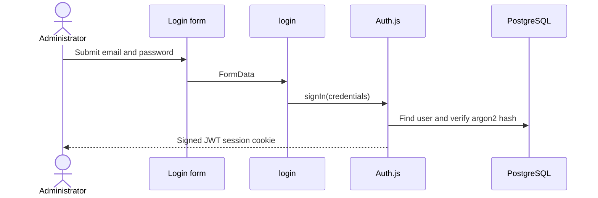

# Authentication and authorization

The only authenticated account type is the administrator. Store customers do not
have accounts: order contact details are stored on the order.

## Session lifecycle

Credentials login is implemented in `src/lib/auth.ts` and
`src/app/admin/login/actions.ts`. Auth.js uses JWT sessions and the
Credentials provider. Passwords are verified with argon2. The JWT stores the
user ID; there is no active role hierarchy because the application has one
administrator role. The session cookie (`session.maxAge` in
`src/lib/auth.config.ts`) lasts 7 days, bounding how long a stolen token stays
usable since JWT sessions cannot be revoked server-side. Rotating
`AUTH_SECRET` is the emergency revocation: it invalidates every session
immediately.

The rate limit is enforced inside `authorize()` in `src/lib/auth.ts`, before
the user is looked up, so it also covers `POST /api/auth/callback/credentials`
requests that bypass the login Server Action.

## Route protection

`src/proxy.ts` matches `/admin/:path*`. An unauthenticated request is sent to
`/admin/login?returnTo=…`. Old `volverA` links remain accepted. The admin
layout calls `auth()` again and redirects when no user is
present. The proxy is only an optimistic navigation guard.

Every admin Server Action starts with `requireAdmin()` from
`src/lib/admin/guard.ts`. It throws when no session exists because actions are
public Next POST endpoints and can be invoked without rendering the layout.

## Authorization rules

| Rule                                       | Enforcement                                                          |
| ------------------------------------------ | -------------------------------------------------------------------- |
| Only published products are public         | Store queries constrain `Product.status` to `PUBLISHED`.             |
| Only active variants are purchasable       | Store queries, cart reconciliation, and checkout require `isActive`. |
| Reference data remains private             | Public queries do not select `fragranceRef` fields.                  |
| Product-owned children stay scoped         | Product updates include the parent `productId`.                      |
| R2 paths stay scoped                       | `isProductStorageKey()` validates every client-provided product key. |
| Order thank-you page reveals no order data | It renders from route/query input and does not query the database.   |

## Permission matrix

| Capability                                                           | Visitor | Administrator |
| -------------------------------------------------------------------- | ------: | ------------: |
| Browse published catalog                                             |     Yes |           Yes |
| Reconcile a cart or create an order                                  |     Yes |           Yes |
| See draft products                                                   |      No |           Yes |
| Manage products, reference data, brands, notes, settings, and orders |      No |           Yes |
| Upload or delete product images                                      |      No |           Yes |

## Rate limits

`src/lib/rate-limit.ts` is an in-memory, process-local limiter. It protects
checkout by an IP-derived key, and login by an IP+email key checked inside
`authorize()` in `src/lib/auth.ts` — the shared entry point for both the login
Server Action and the Auth.js credentials callback route, so a scripted POST
to `/api/auth/callback/credentials` is throttled the same way. It is suitable
for the current single application process; a horizontally scaled deployment
needs shared storage to provide a global limit.

Both callers derive the IP with `getClientIp()`, which reads only
`CF-Connecting-IP`. Production traffic is Cloudflare → Traefik → app, and the
origin firewall accepts new connections to 80/443 only from Cloudflare's IP
ranges (see "Runtime configuration" in `docs/deployment.md`), so that header
is always the real client IP and cannot be spoofed by a request that reaches
the app. `X-Forwarded-For` and `X-Real-IP` are deliberately not consulted:
either can be set directly by the client, which previously let a script
rotate a fake value per request to get a fresh bucket. Without Cloudflare in
front (local development), every request shares the "unknown" bucket.
