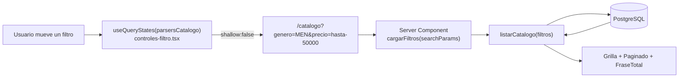
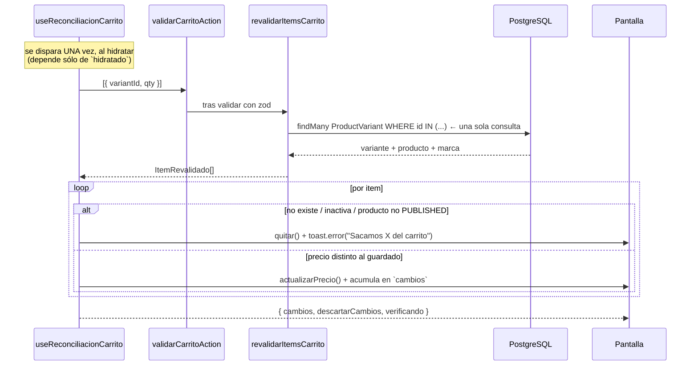
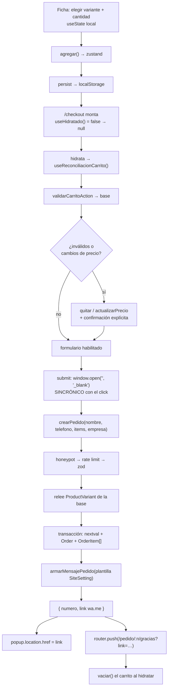

# Estado y flujo de datos

Cuatro lugares guardan estado. Ninguno se superpone por accidente.

| Dónde                                  | Qué                                                                                        | Vida                              | Archivo                                |
| -------------------------------------- | ------------------------------------------------------------------------------------------ | --------------------------------- | -------------------------------------- |
| **La URL** (`nuqs`)                    | Filtros del catálogo y de las tablas del panel                                             | Compartible, sobrevive al refresh | `src/lib/tienda/filtros.ts`            |
| **`localStorage`** (zustand `persist`) | El carrito                                                                                 | Por navegador, indefinida         | `src/lib/carrito.ts`                   |
| **React local** (`useState`)           | Efímero: variante elegida, cantidad, drawer abierto, texto del buscador antes del debounce | Un render                         | componentes de cliente                 |
| **PostgreSQL**                         | Todo lo demás                                                                              | Permanente                        | ver [`persistence.md`](persistence.md) |

Sobre ellos, **la caché de Next** (ver §5).

---

## 1. Por qué los filtros viven en la URL

`AGENTS.md` lo pide, y `src/lib/tienda/filtros.ts:9-18` explica el mecanismo: los
parsers se definen **una sola vez** y los usan las dos puntas.



- `shallow: false` → cada cambio vuelve al servidor; el filtrado es server-side.
- `clearOnDefault: true` → el parámetro desaparece de la URL al volver a su
  default, así "limpiar filtros" deja una URL limpia.
- `scroll: false` → no salta al tope al filtrar.

Si los parsers estuvieran duplicados, un default distinto de cada lado daría
resultados distintos a los que muestra la UI. Por eso son un solo objeto.

**Dedupe**: `listarCatalogo` se envuelve en `cache()` de React
(`src/components/tienda/catalogo/grilla.tsx:11`). La grilla, el contador del
encabezado y el paginado la llaman con el mismo objeto de filtros durante el
mismo render, y `cache()` colapsa las tres en una sola consulta.

**El buscador de texto** (`catalogo/buscador.tsx`) es la excepción: el input
queda controlado por estado local y empuja a la URL con un debounce manual. Al
revés (atar el input al valor de la URL) traba al tipear, porque la URL tarda
uno o dos renders en volver.

---

## 2. El carrito: snapshot, no verdad

`src/lib/carrito.ts` — zustand + `persist`, clave `parfam-carrito`, versión 1.

```ts
type ItemCarrito = {
  variantId;
  productSlug;
  productName;
  brandName;
  variantLabel;
  unitPriceArs: string; // ← string, nunca float
  imagen: string | null;
  qty: number; // qty ≤ 99
};
```

Operaciones: `agregar`, `quitar`, `actualizarCantidad`, `actualizarPrecio`
(la usa la reconciliación), `vaciar`.

### La trampa de la hidratación

`localStorage` no existe en el servidor. Si el badge del carrito leyera el store
en el primer render del cliente, el HTML no coincidiría con el del servidor.

```ts
export function useHidratado(): boolean {
  return useSyncExternalStore(
    sinSuscripcion,
    () => true,
    () => false,
  );
}
```

`false` en el servidor **y en la hidratación** (React usa `getServerSnapshot`
también ahí), `true` desde el render siguiente. Se hace con
`useSyncExternalStore` y no con `useEffect` porque la regla
`react-hooks/set-state-in-effect` de React 19 marca eso como **error**, no
warning. El mismo motivo explica `src/hooks/use-mobile.ts`.

Consumidores: `useCantidadCarrito()` devuelve 0 hasta hidratar;
`FormularioCheckout` y `GraciasCliente` devuelven `null`;
`ContenidoCarrito` condiciona el resumen.

---

<a id="3-reconciliación-el-punto-donde-el-cliente-y-la-base-se-vuelven-a-mirar"></a>

## 3. Reconciliación: el punto donde el cliente y la base se vuelven a mirar

El carrito puede tener variantes que el admin desactivó, productos
despublicados, filas borradas o precios viejos. La reconciliación es lo único
que sabe qué hay realmente disponible hoy.



Dos casos, dos tratamientos (`usar-reconciliacion-carrito.ts:9-23`):

- **Inválido** → se saca solo, con un toast explicando por qué. No hay nada que
  confirmar. Los motivos son `inactiva` / `eliminada` / `despublicado`.
- **Precio distinto** → se actualiza y se junta en `cambios`; la pantalla lo
  muestra y **pide confirmación explícita** antes de dejar avanzar
  (`puedeEnviar = cambios.length === 0 && !verificando`).

El efecto depende sólo de `hidratado`, **no de `items`**: si dependiera de
`items`, cada `+1`/`-1` del stepper repetiría el viaje a la base.

> Esto es cortesía de UX. El único borde real es `crearPedido`, que vuelve a
> hacer la misma verificación con la misma lógica antes de escribir.

Montaje: en `/carrito` y en el drawer lo dispara `ListaItems`; en `/checkout`
lo dispara `FormularioCheckout` directamente. Ver [`F-16`](findings.md#f-16).

---

## 4. El recorrido completo de un pedido



### Las dos trampas que el código resuelve a propósito

1. **El popup se abre sincrónico con el click**, antes de cualquier `await`
   (`formulario-checkout.tsx:86`). Si se abriera después de la Server Action,
   Safari y Chrome en modo estricto lo bloquearían. Arranca en blanco y recién
   recibe destino cuando vuelve el resultado; si el formulario es inválido o la
   acción falla, se cierra.
2. **El carrito se vacía en `/gracias`, no en `/checkout`**
   (`_gracias-cliente.tsx:32-39`). Si no se vaciara, un F5 en `/checkout`
   mandaría el mismo pedido dos veces.

### El teléfono, de punta a punta

| Paso                   | Formato                                                                | Dónde                                |
| ---------------------- | ---------------------------------------------------------------------- | ------------------------------------ |
| El cliente tipea       | `223 616 3910` (sólo local; el `+54 9` es un prefijo fijo en la UI)    | `formulario-checkout.tsx:29,216-225` |
| Validación de cliente  | sólo `min(6)` — validar con región AR acá daría falso negativo siempre | `checkoutClienteSchema`              |
| Se envía               | `"+54 9 " + valor`                                                     | `formulario-checkout.tsx:93`         |
| Validación de servidor | `isValidPhoneNumber(v, "AR")` de `libphonenumber-js`                   | `validations/checkout.ts:33-43`      |
| Se guarda              | **E.164**: `+5492236163910`                                            | `Order.customerPhone`                |
| Se muestra en el panel | `telefonoVisible()` → `+54 9 223 616 3910`                             | `lib/whatsapp.ts:30-36`              |
| Link al chat           | dígitos sin `+` → `https://wa.me/5492236163910`                        | `linkWhatsappA()`                    |

El mismo `telefono` de zod lo reusa `SiteSetting.whatsappNumber`
(`validations/configuracion.ts:25`): es el mismo tipo de dato.

---

<a id="caché-y-revalidación"></a>

## 5. Caché y revalidación

### Qué está cacheado

| Dato                                 | Mecanismo                                                                                | Invalidación                                               |
| ------------------------------------ | ---------------------------------------------------------------------------------------- | ---------------------------------------------------------- |
| `SiteSetting`                        | `unstable_cache(leerConfiguracionSitio, ["site-settings"], { tags: ["site-settings"] })` | `revalidateTag("site-settings", { expire: 0 })` al guardar |
| URLs del sitemap                     | `unstable_cache(urlsDelSitio, ["sitemap-urls"], { revalidate: 3600 })`                   | **sólo por tiempo** — no tiene tag                         |
| Páginas de la tienda                 | Caché de rutas de Next                                                                   | `revalidatePath()` desde las acciones del panel            |
| `listarCatalogo` dentro de un render | `cache()` de React                                                                       | fin del render                                             |

<a id="connection-por-qué-el-build-no-necesita-postgres"></a>

### `connection()`: por qué el build no necesita Postgres

`obtenerConfiguracionSitio()` llama a `await connection()` antes de leer
(`src/lib/configuracion.ts:103-106`). Eso corta el prerender.

Sin ello, **toda** ruta que lea la configuración se prerenderizaría en
`next build` con el valor que tuviera la base en ese momento — y como el build
corre en CI, sería el del seed. Cada deploy revertiría el footer, el título y el
texto de envío hasta que alguien volviera a guardar en `/admin/configuracion`.

Y como el `generateMetadata()` del root layout la lee, "toda ruta" es
literalmente todas. El costo: las cinco páginas que antes salían
prerenderizadas (`/carrito`, `/checkout`, `/contacto`, `/como-comprar`,
`/que-es-un-tester`) pasan a renderizarse por request. La consulta la sigue
ahorrando `unstable_cache`, así que lo que se paga es el render, no un viaje a
la base por visita.

`unstable_cache` y no `"use cache"`: la API nueva de Next 16 exige
`cacheComponents: true` en `next.config.ts`, que este proyecto **no** activó.

### Quién revalida qué

| Acción                                       | Invalida                                                                                                                      |
| -------------------------------------------- | ----------------------------------------------------------------------------------------------------------------------------- |
| `guardarProducto`                            | `/admin/productos`, `/admin/productos/:id`, `/`, `/catalogo`, `/sitemap.xml`, `/producto/:slug` (page), `/marca/:slug` (page) |
| `cambiarEstadoProducto`                      | `/admin/productos` + lo mismo de `revalidarTienda()`                                                                          |
| `eliminarProducto`                           | ídem                                                                                                                          |
| `duplicarProducto`                           | sólo `/admin/productos` (la copia nace en `DRAFT`: no cambia nada público)                                                    |
| `actualizarMarca`                            | `/`, `/catalogo`, `/marca/:slug`, y `/producto/:slug` **por cada producto de esa marca**                                      |
| `cambiarEstadoPedido` / `guardarNotasPedido` | `/admin/pedidos`, `/admin/pedidos/:id`                                                                                        |
| `traducirNota` / `borrarTraduccion`          | sólo `/admin/notas`                                                                                                           |
| `guardarConfiguracion`                       | `revalidateTag("site-settings", { expire: 0 })`                                                                               |

`{ expire: 0 }` y no un profile como `"max"`: acá no vale
stale-while-revalidate. El checkout del pedido siguiente tiene que ver el número
nuevo **ya**, no eventualmente.

### Dos huecos de revalidación

- **Sitemap**: `guardarProducto` llama a `revalidatePath("/sitemap.xml")`, pero
  la consulta vive en un `unstable_cache` **sin tag**. Un producto nuevo tarda
  hasta 1 h en aparecer en el XML. Ver [`F-04`](findings.md#f-04).
- **Traducción de notas**: `traducirNota` sólo revalida `/admin/notas`, pero
  `Note.nameEs` se muestra en la pirámide de cada ficha pública y en el filtro
  de notas del catálogo. Ver [`F-10`](findings.md#f-10).

---

## 6. Serialización Server → Client

Regla observada en toda la capa de consultas:

| Tipo en la base           | Cómo viaja                                                       | Por qué                                                                      |
| ------------------------- | ---------------------------------------------------------------- | ---------------------------------------------------------------------------- |
| `Decimal`                 | `.toString()`                                                    | No es serializable hacia un Client Component, y nunca debe pasar por `float` |
| `ProductImage.storageKey` | `urlPublica(clave)` → URL absoluta o `null`                      | Ningún componente sabe cuál es el host de R2                                 |
| `Date`                    | `Date` (Next lo serializa)                                       | `hace()` lo formatea en el cliente                                           |
| `nameEs` `null`           | `nameEs ?? nameEn`                                               | Fallback al inglés mientras la nota no esté traducida                        |
| Enums                     | se mandan crudos; las etiquetas es-AR salen de `lib/catalogo.ts` | Las usan tienda y panel                                                      |

Y una regla de importaciones: un Client Component **no puede importar** un
módulo que traiga Prisma. Por eso `ESTADO_PEDIDO` viaja como prop al
`SelectorEstado` en vez de importarse de `lib/admin/pedidos.ts`, y por eso
`siteDefaults` vive en `lib/site.ts` separado de `lib/configuracion.ts`.

---

## 7. Datos que el cliente manda y el servidor **no** cree

| Dato                                                    | Qué hace el servidor                                                                                            |
| ------------------------------------------------------- | --------------------------------------------------------------------------------------------------------------- |
| `unitPriceArs` / `precioMostrado`                       | Lo ignora: relee `ProductVariant.priceArs`                                                                      |
| `variantId`                                             | Verifica existencia, `isActive` y que el producto esté `PUBLISHED`                                              |
| `noteId` / `accordId` / `perfumerId` / `fragranceRefId` | Cuenta las filas reales antes de escribir                                                                       |
| `storageKey`                                            | `esClaveDeProducto()`: prefijo `productos/`, sin `..`, ≤ 512 chars                                              |
| `contentType` de una subida                             | Lista blanca de 4 MIME; la presigned URL se firma para ese tipo puntual                                         |
| `variante.id` / `imagen.id` al editar                   | El `where` incluye `productId`, así un id de otro producto no entra                                             |
| `volverA` del login                                     | Sólo si empieza con `/admin`                                                                                    |
| `empresa` (honeypot)                                    | Si viene lleno, rechazo con el **mismo mensaje genérico** que cualquier otro error, para no darle pistas al bot |

La excepción que queda abierta: `link` en `/pedido/[number]/gracias` →
[`F-05`](findings.md#f-05).
