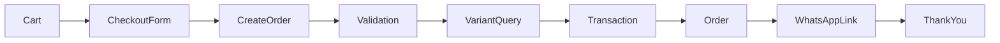

# Data flow, state, and cache

## Catalog

A store route loads `CatalogFilters` through
`loadCatalogFilters()` in `src/lib/store/filters.ts`, then calls
`listCatalog()` in `src/lib/store/catalog-listing.ts`. Client filter controls share
the parser definitions through nuqs, so changing a filter updates the URL and
requests a new server render.

The internal filter model is English. Existing links continue to use Spanish URL
keys and values such as `genero`, `presentacion`, `orden=destacados` (the default; `novedades` is newest only), and
`precio=hasta-100000`. The serializer/parser adapters are the compatibility
boundary.

## Cart

`src/lib/cart.ts` provides the persisted Zustand store under the `parfam-cart`
localStorage key. The prelaunch reset discarded carts under the previous key.

The cart reconciles through `validateCartAction` before checkout. The server
reads current variants and returns English reason values. The store updates
price, label, availability, or removes invalid
items without trusting persisted browser values.

## Checkout

`createOrder` validates the request, re-reads all selected variants, rejects
unpublished or inactive inventory, totals with `Prisma.Decimal`, and stores
the order snapshot in a transaction. The customer then navigates to the Spanish
thank-you page with the generated WhatsApp link.

## Admin updates and invalidation

Product actions revalidate the store root, catalog, relevant product and brand
pages, the sitemap tag, and the "Si te gusta, probá también" similar-products tag. Brand
actions invalidate affected product routes. Settings actions invalidate the
site-settings tag. The sitemap and similar-products ranking are both dynamic
but cache their database result with a tagged `unstable_cache`.

Use `revalidatePath` for rendered routes and `revalidateTag` for tagged data
cache entries. A modification that changes public data must invalidate every
public representation that reads it.

## Site settings

`getSiteSettings()` reads the singleton setting with a cache tag and applies
`siteDefaults` (`src/lib/site.ts`) when the row is unavailable or an optional
column is empty. The same defaults seed the row in `prisma/seed.ts`. Admin
editing uses the uncached admin query so the form always reflects the saved
values.
