# Despliegue

GitHub Actions buildea la imagen → GHCR → Dokploy la baja y la corre en una VPS
compartida (4 vCPU). La VPS **no compila**: sólo baja el artefacto ya hecho.

---

## Pipeline

```mermaid
flowchart LR
    P["push a main<br/>(paths-ignore: **.md)"] --> CI["GitHub Actions<br/>deploy.yml"]
    CI --> BX["docker buildx<br/>linux/amd64 · cache GHA"]
    BX --> GH["ghcr.io/mvalles02/parfam-mdq<br/>:sha  ·  :latest"]
    GH --> WH["POST $DOKPLOY_WEBHOOK_URL"]
    WH --> DK["Dokploy<br/>deploy start-first"]
    DK --> EP["docker-entrypoint.sh<br/>prisma migrate deploy"]
    EP --> SRV["node server.js"]
    SRV --> HC["HEALTHCHECK → /api/health"]
    HC -->|unhealthy ~70s| RB["rollback de Swarm"]
```



`concurrency: { group: deploy-main, cancel-in-progress: false }` — dos deploys
pisándose dejarían a Dokploy tirando de un `latest` a medio subir, así que se
encolan. `workflow_dispatch` permite reconstruir sin commit (necesario cuando
cambia un build arg).

---

## La imagen: 4 stages

`Dockerfile`, base `node:22-alpine` con corepack + pnpm.

| Stage          | Qué hace                                                                                                                                                                                                                                    |
| -------------- | ------------------------------------------------------------------------------------------------------------------------------------------------------------------------------------------------------------------------------------------- |
| **`deps`**     | Copia `package.json`, el lockfile, `pnpm-workspace.yaml`, `prisma.config.ts` y `prisma/` **antes** del install — el `postinstall` corre `prisma generate` y sin el schema falla. `pnpm install --frozen-lockfile` con cache mount del store |
| **`builder`**  | `COPY . .` + `pnpm build`. Falla explícitamente si falta `NEXT_PUBLIC_SITE_URL` o `R2_PUBLIC_URL`                                                                                                                                           |
| **`migrador`** | Instala **sólo** la CLI de Prisma (versión exacta leída de `devDependencies`) + `dotenv`. El output standalone no trae la CLI ni las migraciones, y arrastrar el `node_modules` del builder serían cientos de MB                            |
| **`runner`**   | `node:22-alpine` + `openssl` (lo pide el schema engine de Prisma en musl), usuario `nextjs:nodejs` (1001), el standalone, `.next/static`, `public`, `/app/migraciones` y el entrypoint                                                      |

### Build args

| Arg                                     | Real o placeholder        | Por qué                                                                                                                                                 |
| --------------------------------------- | ------------------------- | ------------------------------------------------------------------------------------------------------------------------------------------------------- |
| `NEXT_PUBLIC_SITE_URL`                  | **real**                  | Next lo inlinea en el bundle; los canonical dependen de él                                                                                              |
| `R2_PUBLIC_URL`                         | **real**                  | Alimenta `images.remotePatterns`, que queda serializado en el standalone                                                                                |
| `NEXT_PUBLIC_UMAMI_URL` / `_WEBSITE_ID` | real (vacíos por defecto) | Inlineados                                                                                                                                              |
| `DATABASE_URL_BUILD`                    | **placeholder**           | `src/lib/env.ts` valida al importarse (también en el build) y `prisma.config.ts` resuelve `env("DATABASE_URL")` apenas la CLI carga                     |
| `FIRMA_PLACEHOLDER_BUILD`               | **placeholder**           | Ídem para `AUTH_SECRET`. El nombre evita "SECRET"/"KEY"/"AUTH" a propósito: el linter de BuildKit avisa por ARG/ENV con nombres que suenan a credencial |

Los dos placeholders van **inline en cada `RUN`**, no como `ENV`, para que no
queden en el entorno de la imagen ni en sus metadatos. Nadie se conecta a esa
URL ni firma nada con ese secreto: si algún día el build volviera a necesitar la
base, fallaría con un `ECONNREFUSED` ruidoso, que es lo deseado.

### El build no necesita Postgres

Es una propiedad del código, no del Dockerfile: ninguna ruta consulta la base en
prerender, porque `obtenerConfiguracionSitio()` llama a `connection()` y el
sitemap es `force-dynamic`. Ver [`data-flow.md`](data-flow.md#connection-por-qué-el-build-no-necesita-postgres).

### Lo que cambiar obliga a rebuildear

`NEXT_PUBLIC_SITE_URL`, `R2_PUBLIC_URL` y las de Umami quedan **congeladas en la
imagen**. Cambiarlas en Dokploy no tiene efecto. Por eso existe el
`workflow_dispatch`.

---

## Runtime

`docker-entrypoint.sh` (`set -e`):

```sh
cd /app/migraciones
./node_modules/.bin/prisma migrate deploy
cd /app
exec node server.js
```

Las migraciones corren **acá y no en el build** por dos razones: la imagen se
buildea en CI, donde no hay base, y el mismo artefacto tiene que poder
promoverse a cualquier entorno. `prisma migrate deploy` es idempotente y toma un
advisory lock de Postgres, así que los dos contenedores que conviven durante un
deploy `start-first` no se pisan.

Todo lo de migraciones vive junto en `/app/migraciones` (CLI + `prisma.config.ts`

- `schema.prisma` + `migrations/`) porque `prisma.config.ts` resuelve
  `dotenv/config` y sus rutas relativas contra el cwd del entrypoint.

`server.js` hace `process.chdir(__dirname)`, así que el `process.cwd()` de
runtime es `/app` — de ahí resuelven las fuentes que leen
`src/assets/fonts/`, que entran al standalone por
`outputFileTracingIncludes` y no copiadas a mano.

---

## Healthcheck y rollback

```dockerfile
HEALTHCHECK --interval=10s --timeout=5s --start-period=40s --retries=3 \
  CMD node -e "fetch('http://127.0.0.1:'+(process.env.PORT||3000)+'/api/health')…"
```

`/api/health` hace un `SELECT 1` de verdad: un servidor que levanta pero no
llega a Postgres **tiene que dar rojo**, o el rollback no se dispara nunca.

**Los tiempos importan**: un contenedor roto queda `unhealthy` a los ~70 s
(40 s de `start-period` + 3 reintentos cada 10 s). El `Monitor` del update
config de Swarm tiene que ser **más largo** que eso, o el deploy se da por bueno
antes de que el healthcheck alcance a fallar. Swarm hereda este `HEALTHCHECK`,
así que **estos son los valores de verdad**; lo que se cargue en Dokploy tiene
que decir lo mismo.

---

## Entorno de producción

| Variable                                                                | Dónde se pone                                                                                           |
| ----------------------------------------------------------------------- | ------------------------------------------------------------------------------------------------------- |
| `DATABASE_URL`, `AUTH_SECRET`, `AUTH_TRUST_HOST`, `R2_*` (credenciales) | Dokploy, en runtime                                                                                     |
| `NEXT_PUBLIC_SITE_URL`, `R2_PUBLIC_URL`, `NEXT_PUBLIC_UMAMI_*`          | **Build args en CI** (variables del repo, no secrets) — y también en Dokploy si se quieren consistentes |

`AUTH_TRUST_HOST=true` es obligatoria detrás del Traefik de Dokploy: sin ella
Auth.js descarta la cookie de sesión y el login "entra" pero la navegación
siguiente rebota a `/admin/login`.

`.dockerignore` deja fuera `data/` (38 MB de CSV), `design`, `brand`, `.husky`,
`docker-compose.dev.yml`, `*.md` y **todos los `.env`** salvo `.env.example`.
La importación de las 69.948 fragancias corre **una vez** contra la base de
producción desde un clon del repo en la VPS, no desde el contenedor.

---

## Desarrollo local

```bash
pnpm db:up      # Postgres 17 en 127.0.0.1:5433 (evita chocar con el de Dokploy)
pnpm dev
pnpm db:studio  # Prisma Studio
pnpm db:down
```

Calidad: `pnpm typecheck`, `pnpm lint`, `pnpm format`. El hook `pre-commit`
(husky + lint-staged) corre `eslint --fix` + `prettier` sobre lo staged.
`HUSKY=0` en la imagen Docker para que no intente instalarse ahí.

---

## `public/`: por qué el builder la crea

El `runner` copia `public/` del builder, pero **el repo no la tiene**: la borró
el commit `2e8ef56 clean repo` (eran los cinco SVG del scaffold de Next) y
`next build` no la crea. Un `COPY` de BuildKit cuyo origen no existe **falla el
build**, así que el stage `builder` la garantiza:

```dockerfile
RUN mkdir -p public
```

Copiar `public/` es opcional en Next — el server standalone la sirve sólo si
existe (`node_modules/next/dist/docs/.../output.md`) — y hoy el proyecto no
tiene ningún estático ahí: el favicon lo genera `src/app/icon.tsx`, las fuentes
viven en `src/assets/` y las fotos salen de R2.

Se eligió el `mkdir` en vez de borrar el `COPY` para que un estático futuro
(un `robots.txt` a mano, un PDF) llegue a la imagen solo. Con el `COPY`
borrado, ese archivo se quedaría afuera en silencio.
