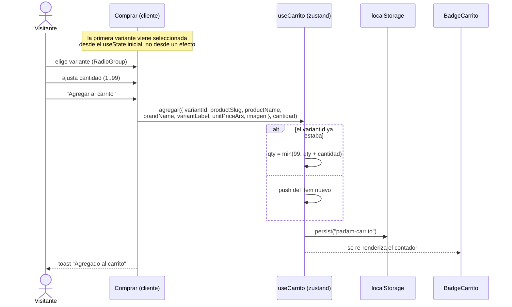
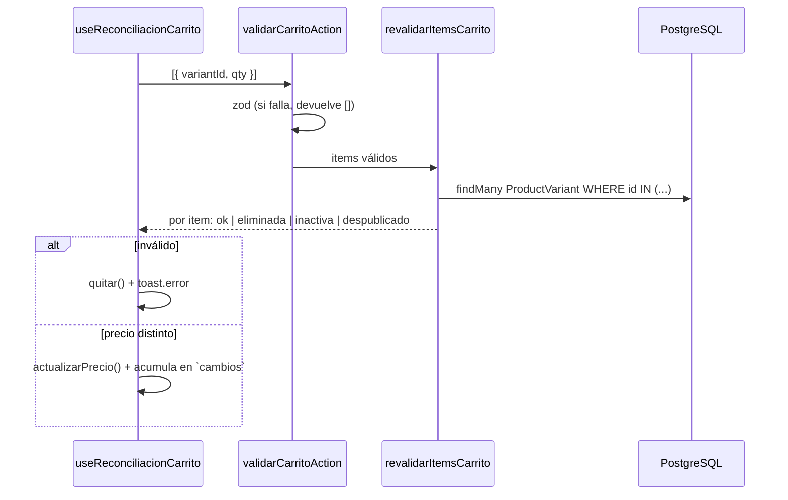

# Flujo · Agregar al carrito

## Objetivo

Que el visitante elija una presentación y una cantidad, y que eso sobreviva a
recargas y a cambios del catálogo sin mentirle sobre el precio.

## Actor

Visitante anónimo.

## Preconditions

- El producto está `PUBLISHED` y tiene al menos una variante `isActive`. Si no,
  la ficha muestra _"Consultanos el precio por WhatsApp"_ en vez del selector.
- JavaScript habilitado: el carrito es 100% cliente.

## Entry point

`/producto/[slug]` → componente `Comprar`
(`src/components/tienda/producto/comprar.tsx`).

---

## Pasos

`unitPriceArs` se guarda **como string** — el `Decimal` de Prisma ya viene
convertido por la capa de consultas — y nunca como float.

### Ver el carrito

Dos superficies con **los mismos componentes**:

| Superficie | Contenedor                                                                                                                                                   |
| ---------- | ------------------------------------------------------------------------------------------------------------------------------------------------------------ |
| Drawer     | `carrito-drawer.tsx`; el `<Sheet>` vive en `header.tsx` porque tiene **dos** triggers (chip de desktop y botón cuadrado de mobile) que abren el mismo drawer |
| `/carrito` | `contenido-carrito.tsx`                                                                                                                                      |

Ambos montan `ListaItems` + `ResumenCarrito`
(`src/components/tienda/carrito/`), así que el stepper, el borrado y el subtotal
no están duplicados.

### La reconciliación

`ListaItems` dispara `useReconciliacionCarrito()` al hidratar:

El efecto depende **sólo** de `hidratado`: si dependiera de `items`, cada
`+1`/`-1` del stepper repetiría el viaje a la base.

## Código involucrado

| Capa        | Archivo                                                                     |
| ----------- | --------------------------------------------------------------------------- |
| Selector    | `src/components/tienda/producto/comprar.tsx`                                |
| Store       | `src/lib/carrito.ts`                                                        |
| Badge       | `src/components/tienda/badge-carrito.tsx`                                   |
| Drawer      | `src/components/tienda/carrito-drawer.tsx` + `header.tsx`                   |
| Página      | `src/app/(tienda)/carrito/{page,_components/contenido-carrito}.tsx`         |
| Compartidos | `src/components/tienda/carrito/{lista-items,item-fila,resumen-carrito}.tsx` |
| Hook        | `src/lib/tienda/usar-reconciliacion-carrito.ts`                             |
| Acción      | `src/app/(tienda)/carrito/actions.ts`                                       |
| Servicio    | `src/lib/tienda/carrito-servidor.ts`                                        |

## Datos

**Entra** (desde la ficha, ya resuelto por el servidor): `variantId`,
`productSlug`, `productName`, `brandName`, `variantLabel` (de
`etiquetaVariante()`), `unitPriceArs` (string), `imagen` (URL o `null`).

**Sale hacia el servidor** en la reconciliación: sólo `{ variantId, qty }` —
nada de precios ni nombres.

**Vuelve**: `productName`, `brandName`, `variantLabel` y `precioArs` reales, o
la razón de invalidez.

## Persistencia

| Dónde          | Qué                                     |
| -------------- | --------------------------------------- |
| `localStorage` | `parfam-carrito` v1 — el carrito entero |
| PostgreSQL     | **Nada**: este flujo no escribe         |

## Integraciones

Ninguna.

## Resultado

Carrito persistido en el navegador, contador en el header, y —si se abrió el
carrito o el checkout— ya reconciliado contra la base.

---

## Alternativas

| Variación                             | Qué pasa                                                                                                                               |
| ------------------------------------- | -------------------------------------------------------------------------------------------------------------------------------------- |
| Producto sin variantes activas        | `Comprar` muestra el CTA _"Consultar por WhatsApp"_ con un mensaje prearmado, sin selector ni carrito                                  |
| Agregar el mismo `variantId` de nuevo | Se suma la cantidad, tope 99                                                                                                           |
| Variantes de tipo `TESTER` presentes  | Aparece el link a `/que-es-un-tester`, **fuera** del `<label>` del radio: adentro navegaría y además seleccionaría la variante de paso |
| Primer render / sin hidratar          | El badge muestra 0 y `ContenidoCarrito` no muestra el resumen                                                                          |
| Abrir el drawer estando en `/carrito` | Dos instancias de `ListaItems` → dos reconciliaciones ([`findings.md#f-16`](../findings.md#f-16))                                      |

## Errores

| Situación                                                   | Qué ve el visitante                                                                                                                             |
| ----------------------------------------------------------- | ----------------------------------------------------------------------------------------------------------------------------------------------- |
| Variante desactivada / producto despublicado / fila borrada | Toast _"Sacamos «X» del carrito — «Decant 10 ml» ya no está disponible"_ (o _"ya no existe"_ / _"ya no está a la venta"_), y el item desaparece |
| Precio cambiado                                             | El carrito se actualiza al precio real y, en `/checkout`, aparece una alerta con el precio viejo tachado; hay que confirmar para continuar      |
| La acción falla la validación de zod                        | Devuelve `[]`: no se toca nada del carrito                                                                                                      |

## Relacionado

- [`modules/carrito-checkout.md`](../modules/carrito-checkout.md)
- [`data-flow.md`](../data-flow.md#3-reconciliación-el-punto-donde-el-cliente-y-la-base-se-vuelven-a-mirar)
- [`flows/crear-pedido.md`](crear-pedido.md) — lo que sigue
