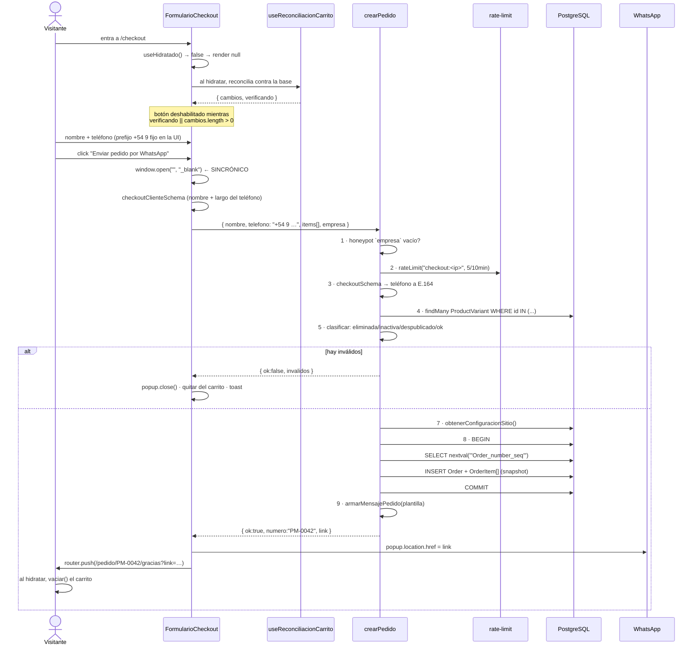

# Flujo · Cerrar el pedido por WhatsApp

El flujo más importante del sistema: es el único público que **escribe** en la
base y el único que produce ingresos.

## Objetivo

Convertir el carrito en un `Order` persistido con número propio, y abrir
WhatsApp con el pedido ya escrito.

## Actor

Visitante anónimo.

## Preconditions

- Carrito con al menos un item (máximo 50).
- Existe la fila `SiteSetting` con `whatsappNumber` y
  `whatsappMessageTemplate` (o los fallbacks del código).
- Menos de 5 intentos desde la misma IP en los últimos 10 minutos.

## Entry point

`/checkout` → botón _"Enviar pedido por WhatsApp"_.

---

## Pasos



## Código involucrado

| Paso                         | Archivo                                                                  |
| ---------------------------- | ------------------------------------------------------------------------ |
| Página (trae `shippingInfo`) | `src/app/(tienda)/checkout/page.tsx`                                     |
| Formulario y popup           | `.../checkout/_components/formulario-checkout.tsx`                       |
| Reconciliación previa        | `src/lib/tienda/usar-reconciliacion-carrito.ts`                          |
| Schemas                      | `src/lib/validations/checkout.ts`                                        |
| **La acción**                | `.../checkout/actions.ts`                                                |
| Rate limit                   | `src/lib/rate-limit.ts`                                                  |
| Config y plantilla           | `src/lib/configuracion.ts`                                               |
| Mensaje                      | `src/lib/tienda/mensaje-pedido.ts`                                       |
| Link                         | `src/lib/whatsapp.ts`                                                    |
| Secuencia                    | `prisma/migrations/20260917122409_numero_pedido_secuencia/migration.sql` |
| Gracias                      | `.../pedido/[number]/gracias/{page,_gracias-cliente}.tsx`                |

## Datos

**Entra**

| Campo      | Validación                                                      |
| ---------- | --------------------------------------------------------------- |
| `nombre`   | 2-120, `trim`                                                   |
| `telefono` | `"+54 9 " + <local>`; `isValidPhoneNumber(v, "AR")` → **E.164** |
| `items[]`  | 1-50; cada uno `{ variantId, qty: 1..99, precioMostrado }`      |
| `empresa`  | Honeypot: si viene lleno, rechazo genérico                      |

**Sale**: `{ ok: true, numero, link }` o un fallo con `mensaje`, `errores` por
campo y/o `invalidos`.

> `precioMostrado` es obligatorio en el schema y **el servidor nunca lo usa**
> → [`findings.md#f-19`](../findings.md#f-19).

## Persistencia

| Operación                              | Detalle                                                                                                                         |
| -------------------------------------- | ------------------------------------------------------------------------------------------------------------------------------- |
| `SELECT nextval('"Order_number_seq"')` | Dentro de la transacción. Atómica; dos checkouts en paralelo nunca sacan el mismo valor, y un rollback **no recicla** el número |
| `INSERT Order`                         | `number` `PM-%04d`, `customerName`, `customerPhone` (E.164), `totalArs` (`Decimal`), `status: PENDING`                          |
| `INSERT OrderItem[]`                   | **Snapshot**: `productName`, `variantLabel`, `unitPriceArs`, `qty`, más las FK opcionales `productId`/`variantId`               |

El total se suma con `Prisma.Decimal`:

```ts
lineas.reduce(
  (acc, l) => acc.plus(l.unitPriceArs.times(l.qty)),
  new Prisma.Decimal(0),
);
```

## Integraciones

WhatsApp, y sólo como URL: `https://wa.me/<dígitos>?text=<mensaje codificado>`.
No hay API ni token. El mensaje sale de
`SiteSetting.whatsappMessageTemplate` expandida con `{{marca}}`, `{{items}}`,
`{{total}}`, `{{nombre}}` y `{{numero}}`.

## Resultado

- Un `Order` en `PENDING` con su snapshot inmutable.
- Una pestaña con el chat de WhatsApp y el pedido escrito.
- El visitante en `/pedido/:numero/gracias`, con el carrito vacío.

---

## Las tres invariantes

1. **El precio nunca sale del cliente.** Se relee `ProductVariant.priceArs` en
   el paso 4 y se usa ese, siempre.
2. **Sólo se vende `isActive` de un producto `PUBLISHED`.**
3. **`OrderItem` guarda snapshot**: un cambio de precio futuro no puede tocar un
   pedido ya hecho.

## Dos trampas resueltas

**El popup.** `window.open("", "_blank")` ocurre **sincrónico con el click**,
antes de cualquier `await`. Si se abriera después de la Server Action, Safari y
Chrome en modo estricto lo bloquearían. Arranca en blanco y recibe destino
cuando vuelve el resultado; si el formulario es inválido o la acción falla, se
cierra.

**El vaciado del carrito** ocurre en `/gracias`, no en `/checkout`: si no, un F5
en el checkout mandaría el mismo pedido dos veces.

---

## Alternativas

| Variación                            | Qué pasa                                                                                                                                           |
| ------------------------------------ | -------------------------------------------------------------------------------------------------------------------------------------------------- |
| Carrito vacío                        | La página muestra un CTA a `/catalogo`, sin formulario                                                                                             |
| Precios cambiados al hidratar        | Alerta con el precio viejo tachado y _"Entendido, continuar"_; el botón queda deshabilitado hasta confirmar                                        |
| Algunos items inválidos              | Se guarda **nada**: la acción corta antes de la transacción y devuelve `invalidos` para que el cliente los saque                                   |
| Todos inválidos                      | _"Ninguno de los productos de tu carrito sigue disponible."_                                                                                       |
| El popup fue bloqueado igual         | `/gracias` muestra el botón _"Abrir WhatsApp"_ para el reintento manual — **no** reintenta `window.open` solo, porque ahí no hay gesto del usuario |
| Se llega a `/gracias` sin `link`     | Mensaje genérico + link `wa.me` con _"¡Hola! Quería consultar por mi pedido."_                                                                     |
| Se adivina `/pedido/PM-0043/gracias` | La página **nunca consulta la base**: muestra lo mismo para cualquier número, exista o no                                                          |

## Errores

| Situación                       | Mensaje                                                                                                                          | Dónde                           |
| ------------------------------- | -------------------------------------------------------------------------------------------------------------------------------- | ------------------------------- |
| Honeypot completado             | _"No pudimos procesar el pedido. Probá de nuevo."_ — el **mismo** genérico que cualquier otro fallo, para no darle pistas al bot | `actions.ts:71-73`              |
| 6º intento en 10 min            | _"Demasiados intentos. Probá de nuevo en N minutos."_                                                                            | `actions.ts:88-93`              |
| Teléfono no argentino válido    | _"Revisá el teléfono: no parece un número argentino válido."_, vía `setError("telefono")`                                        | `validations/checkout.ts:36-39` |
| Nombre corto                    | _"Poné tu nombre completo."_                                                                                                     | ídem                            |
| Carrito vacío al enviar         | _"Tu carrito está vacío."_                                                                                                       | ídem                            |
| Fallo de base en la transacción | La excepción sube sin capturar → error genérico de Server Action. **El pedido no queda a medias**: es una transacción            |

> La validación del teléfono es **sólo del servidor**: el cliente valida
> `min(6)` porque el input trae únicamente el número local (el `+54 9` es un
> prefijo fijo de la UI) y validarlo con región AR daría falso negativo siempre.

## Relacionado

- [`modules/carrito-checkout.md`](../modules/carrito-checkout.md)
- [`flows/gestionar-pedido.md`](gestionar-pedido.md) — el otro lado
- [`persistence.md`](../persistence.md#el-correlativo-de-pedido)
