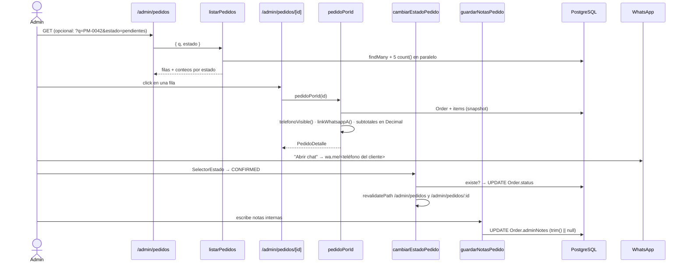

# Flujo · Atender un pedido

## Objetivo

Que el admin encuentre el pedido que le acaba de entrar por WhatsApp, verifique
qué pidió el cliente, coordine por chat y deje registrado el estado.

## Actor

Admin autenticado.

## Preconditions

- Existe al menos un `Order` (lo crea `crearPedido`, ver
  [`flows/crear-pedido.md`](crear-pedido.md)).
- Sesión válida.

## Entry point

`/admin/pedidos`, o la tarjeta _"Pedidos pendientes"_ del dashboard `/admin`.

---

## Pasos

## Código involucrado

| Capa            | Archivo                                                                                                                           |
| --------------- | --------------------------------------------------------------------------------------------------------------------------------- |
| Lista           | `src/app/admin/(panel)/pedidos/page.tsx`                                                                                          |
| Detalle         | `.../pedidos/[id]/page.tsx`                                                                                                       |
| Consultas       | `src/lib/admin/pedidos.ts`                                                                                                        |
| Acciones        | `.../pedidos/actions.ts`                                                                                                          |
| Componentes     | `.../pedidos/_components/{tabla-pedidos,tabs-estado-pedido,buscador-pedidos,chip-estado-pedido,selector-estado,notas-pedido}.tsx` |
| Teléfono y link | `src/lib/whatsapp.ts`                                                                                                             |
| Tiempo relativo | `src/lib/fecha.ts` → `hace()`                                                                                                     |

## Datos

**Entra**: `q` (número **o** nombre del cliente), `estado`
(`todos`/`pendientes`/`confirmados`/`entregados`/`cancelados`), `id`.

**Sale, en la lista**: número, nombre, teléfono formateado, estado, total,
cantidad de items (de `_count`, sin traer las líneas) y fecha.

**Sale, en el detalle**: además, el snapshot línea por línea
(`productName`, `variantLabel`, `unitPriceArs`, `qty`, `subtotal` en `Decimal`),
`adminNotes` y `linkChat`.

## Persistencia

| Operación                        | Dónde                          |
| -------------------------------- | ------------------------------ |
| Lectura de `Order` + `OrderItem` | `listarPedidos`, `pedidoPorId` |
| `UPDATE Order.status`            | `cambiarEstadoPedido`          |
| `UPDATE Order.adminNotes`        | `guardarNotasPedido`           |

**`OrderItem` nunca se toca**: el snapshot es inmutable por diseño.

## Integraciones

WhatsApp: `linkWhatsappA(pedido.customerPhone)` **sin mensaje** — abre el chat
con el cliente, en blanco. Es el único lugar del sistema donde el link apunta al
número del cliente y no al del negocio.

## Resultado

El pedido queda con su estado actualizado y, si hizo falta, con notas internas.
El cliente no recibe ninguna notificación del sistema: la coordinación pasa por
el chat.

---

## Estados

`PENDING` → `CONFIRMED` → `DELIVERED`, con `CANCELLED` como salida.

**No hay máquina de estados**: `SelectorEstado` ofrece los cuatro y
`cambiarEstadoPedido` acepta cualquier valor de `OrderStatus`. Cualquier
transición es válida, incluido volver atrás.

Chips: `PENDING` neutral · `CONFIRMED` y `DELIVERED` con los tokens `--success`
(`DELIVERED` sin borde, para distinguir _"ya se entregó"_ de _"confirmado,
todavía no retirado"_) · `CANCELLED` con `--destructive`.

## Alternativas

| Variación                             | Qué pasa                                                                                                                              |
| ------------------------------------- | ------------------------------------------------------------------------------------------------------------------------------------- |
| El producto del pedido fue borrado    | `item.productId` quedó en `null` (`SET NULL`): el nombre se muestra como texto plano en vez de link. **El pedido no pierde nada más** |
| El precio del producto cambió después | El pedido sigue mostrando `unitPriceArs` del momento de la compra                                                                     |
| Buscar por teléfono                   | **No funciona**: `whereBusqueda` sólo cubre `number` y `customerName`                                                                 |
| Notas vacías                          | Se guarda `null`, no `""` (`notas.trim()                                                                                              |     | null`) |
| Muchos pedidos                        | **No hay paginado**: se traen todas las filas que matchean el filtro                                                                  |

## Errores

| Situación                                  | Mensaje                                                  |
| ------------------------------------------ | -------------------------------------------------------- |
| Pedido inexistente al cambiar estado       | _"Ese pedido ya no existe."_                             |
| Pedido inexistente al guardar notas        | Ídem                                                     |
| `/admin/pedidos/[id]` inexistente          | `notFound()` → 404                                       |
| Teléfono que `libphonenumber-js` no parsea | `telefonoVisible()` cae al string crudo en vez de lanzar |

## Lo que este flujo **no** hace

- No notifica al cliente (no hay email, push ni webhook).
- No edita líneas ni totales.
- No exporta ni imprime.
- No registra quién cambió el estado (sólo queda `updatedAt`).

## Relacionado

- [`modules/admin-pedidos.md`](../modules/admin-pedidos.md)
- [`flows/crear-pedido.md`](crear-pedido.md) — de dónde viene el pedido
