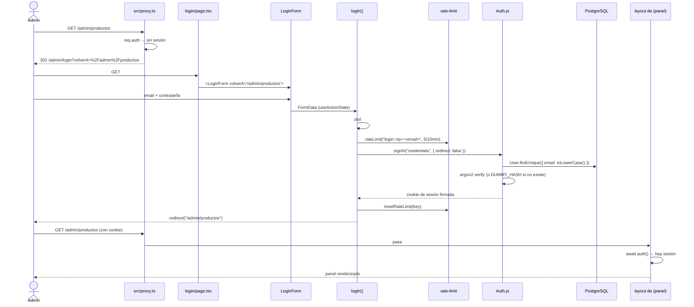

# Flujo · Entrar al panel

## Objetivo

Que el admin obtenga una sesión y llegue a la pantalla que quería.

## Actor

Admin (único usuario autenticado del sistema).

## Preconditions

- Existe una fila en `User` con ese email. **Sólo `prisma/seed.ts` la crea**: no
  hay registro ni recuperación de contraseña.
- `AUTH_SECRET` está seteada (≥ 32 chars) o Auth.js no puede firmar la cookie.
- En producción, `AUTH_TRUST_HOST=true`: detrás del Traefik de Dokploy, sin ella
  el login "entra" y la navegación siguiente rebota a `/admin/login`.

## Entry point

`/admin/login` — al que casi siempre se llega **rebotado** desde `src/proxy.ts`
con `?volverA=<ruta original>`.

---

## Pasos

## Código involucrado

| Paso                            | Archivo                                  |
| ------------------------------- | ---------------------------------------- |
| Redirección con `volverA`       | `src/proxy.ts:28-33`                     |
| Lectura de `volverA`            | `src/app/admin/login/page.tsx:11-13`     |
| Formulario (`useActionState`)   | `src/app/admin/login/login-form.tsx`     |
| Acción                          | `src/app/admin/login/actions.ts`         |
| Rate limit                      | `src/lib/rate-limit.ts`                  |
| Provider Credentials + argon2   | `src/lib/auth.ts`                        |
| Config de sesión (JWT, 30 días) | `src/lib/auth.config.ts`                 |
| Guard real                      | `src/app/admin/(panel)/layout.tsx:20-22` |

## Datos

| Entra                                   | Sale                                      |
| --------------------------------------- | ----------------------------------------- |
| `email`, `password`, `volverA` (hidden) | Cookie de sesión (JWT firmado) + redirect |

El JWT lleva `id`, `sub`, `name`, `email` y los claims estándar (`iat`, `exp`,
`jti`); la sesión expone `user.id`, `user.name` y `user.email`. **No hay rol**
en ninguno de los dos ([`findings.md#f-03`](../findings.md#f-03)).

## Persistencia

Una lectura: `User.findUnique`. **Ninguna escritura**: no hay tabla de sesiones
ni registro de último acceso.

## Integraciones

Ninguna. Auth.js v5 con provider local.

## Resultado

Cookie de sesión válida por 30 días y redirect a `volverA` o a `/admin`.

---

## Alternativas

| Variación                             | Qué pasa                                                                               |
| ------------------------------------- | -------------------------------------------------------------------------------------- |
| Ir a `/admin/login` ya logueado       | El proxy redirige a `/admin` (`:20-25`)                                                |
| Entrar directo sin `volverA`          | `destino = "/admin"`                                                                   |
| `volverA` apuntando fuera de `/admin` | Se ignora: sólo se acepta si `startsWith("/admin")`                                    |
| JavaScript deshabilitado              | El `<form action={formAction}>` de `useActionState` funciona igual — es un POST nativo |

## Errores

| Situación                                   | Mensaje                                                                                       | Dónde                                     |
| ------------------------------------------- | --------------------------------------------------------------------------------------------- | ----------------------------------------- |
| Email mal formado o contraseña vacía        | El primer issue de zod                                                                        | `actions.ts:31-33`                        |
| 6º intento en 10 min                        | _"Demasiados intentos. Probá de nuevo en N minutos."_                                         | `actions.ts:42-48`                        |
| Email inexistente                           | _"Email o contraseña incorrectos."_ — tras correr `verify(DUMMY_HASH)` para igualar el tiempo | `auth.ts:39-42`                           |
| Contraseña incorrecta                       | El mismo mensaje                                                                              | `auth.ts:44-45`                           |
| Cualquier otro error que no sea `AuthError` | Se **relanza**: un fallo de base no se disfraza de credencial incorrecta                      | `actions.ts:62-67`                        |
| `ADMIN_SEED_EMAIL` con mayúsculas           | Login imposible, sin pista de la causa                                                        | [`findings.md#f-08`](../findings.md#f-08) |

## Salir

`UserMenu` (pie del sidebar) → `cerrarSesion()` →
`signOut({ redirectTo: "/admin/login" })`.

## Relacionado

- [`authentication.md`](../authentication.md) — las tres capas de protección
- [`routes.md`](../routes.md#redirecciones-y-guards)
