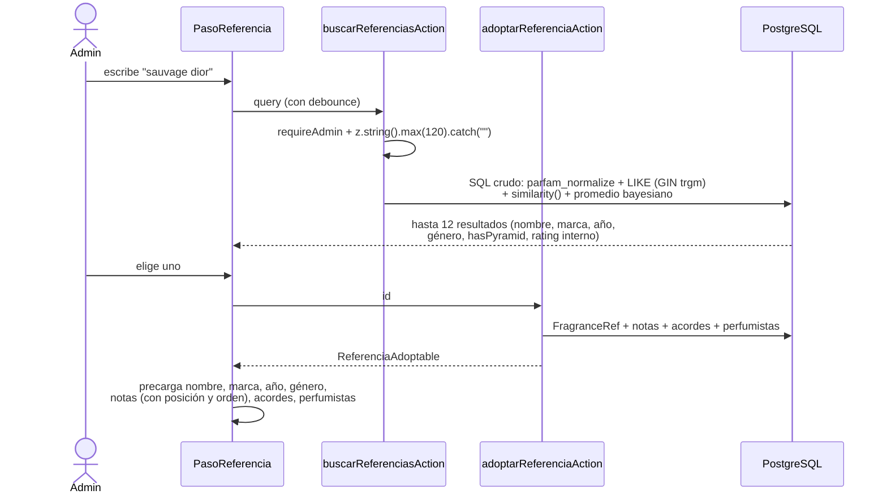
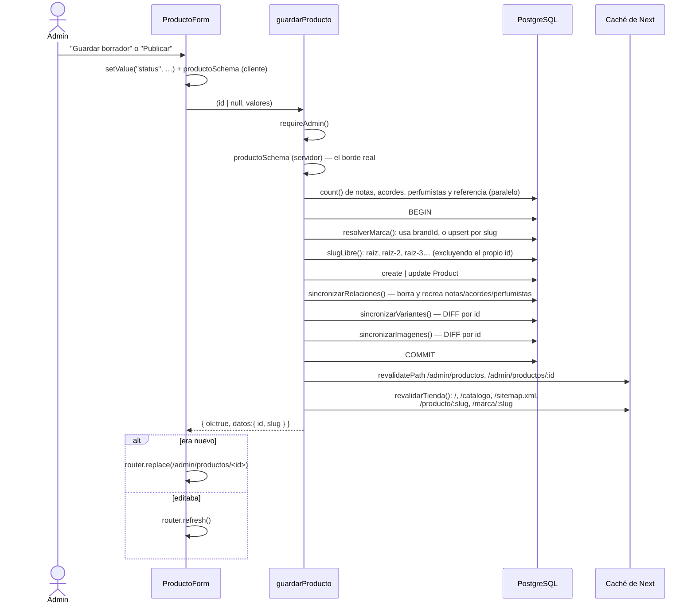

# Flujo · Crear y publicar un producto

## Objetivo

Convertir una fragancia de referencia (o una carga manual) en un producto
vendible: con descripción en español, fotos propias y al menos una presentación
activa con precio.

## Actor

Admin autenticado.

## Preconditions

- Sesión válida (`requireAdmin()` en cada acción).
- Para el paso 1: referencias importadas
  ([`modules/datos-referencia.md`](../modules/datos-referencia.md)). Si no hay,
  queda la carga manual.
- Para el paso 5: R2 configurado (`r2Configurado()`).

## Entry point

`/admin/productos/nuevo`, o `/admin/productos/[id]` para editar.

---

## Los seis pasos

### Paso 1 · Adoptar una referencia

Lo que **no** se copia: la descripción. La de Fragrantica está en inglés y nunca
se publica — se muestra en el panel como ayuda para redactar.

Alternativa: _"cargar a mano"_ (`onCargaManual`), que salta este paso. Ahí la
marca se tipea y el servidor la crea si no existe, y `sourceUrl` guarda el link
a Fragrantica si el admin lo pega.

Detalle del ranking: [`modules/admin-referencias.md`](../modules/admin-referencias.md).

### Paso 2 · Datos

Nombre, marca (`ComboboxRemoto` contra `buscarMarcasAction`), género,
concentración, año, **descripción en español**, slug (opcional: lo deriva el
servidor de `marca + nombre`), `seoTitle`, `seoDescription`.

### Paso 3 · Pirámide, acordes, perfumistas

| Control           | Estrategia                                                                                                                                                                      |
| ----------------- | ------------------------------------------------------------------------------------------------------------------------------------------------------------------------------- |
| `EditorPiramide`  | Tres columnas (salida/corazón/fondo). Notas vía `ComboboxRemoto` → `buscarNotasAction` (`take: 20`, por `usageCount desc`). `crearNotaAction` permite agregar una que no existe |
| `SelectorAcordes` | Los 93 vienen **enteros** del servidor y se filtran en el cliente. Cada uno con su color del diccionario                                                                        |
| Perfumistas       | `ComboboxRemoto` → `buscarPerfumistasAction` / `crearPerfumistaAction`                                                                                                          |

Las notas **no** llevan color: el diccionario sólo le puso color a los 93
acordes, e inventar uno por nota sería mostrar un dato que no existe.

### Paso 4 · Carácter

`BarraCaracter` × 3: duración, estela, intensidad. Son controles de cinco pasos
**fijados por el admin** — en esta tienda no se vota.

### Paso 5 · Fotos

→ [`flows/subir-imagen.md`](subir-imagen.md).

### Paso 6 · Variantes

`EditorVariantes`: presentación (`FULL_BOTTLE`/`TESTER`/`DECANT`), `sizeMl`,
`priceArs` y el switch `isActive`. Los tamaños típicos aparecen como `datalist`
de sugerencia.

> No hay campo para el SKU, aunque la columna y el schema lo aceptan →
> [`findings.md#f-23`](../findings.md#f-23).

---

## Guardar

### Por qué hay tres estrategias de sincronización

| Qué                         | Estrategia       | Motivo                                                                                                   |
| --------------------------- | ---------------- | -------------------------------------------------------------------------------------------------------- |
| Notas, acordes, perfumistas | borrar + recrear | Tablas de unión puras: no hay estado que perder                                                          |
| **Variantes**               | **diff por id**  | `OrderItem.variantId` las apunta; un delete lo pondría en `null` y rompería el link de pedidos ya hechos |
| Imágenes                    | diff por id      | Mismo criterio de estabilidad de ids                                                                     |

### Por qué el formulario se remonta

`/admin/productos/[id]` usa `key={producto.updatedAt.toISOString()}`. Cambia en
cada guardado y fuerza el remonte con los ids ya persistidos: sin eso el
formulario seguiría con variantes e imágenes sin `id` y **el próximo guardado
las duplicaría**.

---

## Código involucrado

| Capa       | Archivo                                                                                                                                       |
| ---------- | --------------------------------------------------------------------------------------------------------------------------------------------- |
| Páginas    | `.../productos/{nuevo/page,[id]/page}.tsx`                                                                                                    |
| Formulario | `.../productos/_components/producto-form.tsx`                                                                                                 |
| Pasos      | `.../_components/{paso-referencia,editor-piramide,selector-acordes,editor-variantes,panel-imagenes,barra-caracter,campo,combobox-remoto}.tsx` |
| Acciones   | `.../productos/actions.ts`, `imagenes-actions.ts`                                                                                             |
| Contrato   | `src/lib/validations/producto.ts`                                                                                                             |
| Consultas  | `src/lib/admin/productos.ts`, `referencias.ts`, `slug.ts`                                                                                     |

## Datos

**Entra**: el objeto completo de `productoSchema` (~25 campos + cuatro arrays).

**Sale**: `{ id, slug }`, o `{ ok:false, mensaje, errores }` con los errores
aplanados a `{ "variants.0.priceArs": [...] }`, que el formulario vuelca con
`setError` para que caigan al lado del control que los causó.

## Persistencia

Escribe `Product` y sus cinco tablas hijas; `upsert` de `Brand`, `Note` y
`Perfumer` cuando hacen falta. Lee `FragranceRef` y `Accord`.

## Integraciones

R2 (paso 5). Nada más.

## Resultado

Un `Product` en `DRAFT` o `PUBLISHED`. Si se publicó, aparece en el catálogo
apenas se revalidan las rutas.

---

## Las reglas para publicar

Del `superRefine` de `productoSchema`:

1. Al menos **una variante activa** (si no, la ficha se vería sin precio ni
   forma de comprar).
2. **Descripción** presente.
3. **Exactamente una** foto principal, si hay fotos.
4. Sin variantes duplicadas (`kind|sizeMl`): dos _"Decant 10 ml"_ serían
   indistinguibles y ambiguos en el mensaje de WhatsApp.

Las reglas 1 y 2 están **también** en `cambiarEstadoProducto()`, porque el
toggle de la tabla es otro camino hacia el mismo cambio de estado.

## Alternativas

| Variación                       | Qué pasa                                                                              |
| ------------------------------- | ------------------------------------------------------------------------------------- |
| Carga manual sin referencia     | `fragranceRefId: null`; `sourceUrl` opcional                                          |
| Marca que no existe             | `resolverMarca()` la crea con `upsert` por slug                                       |
| Nota o perfumista que no existe | `crearNotaAction` / `crearPerfumistaAction`, `upsert` por slug                        |
| Slug vacío                      | Se deriva de `"{marca} {nombre}"`                                                     |
| Slug ya tomado                  | `-2`, `-3`… (excluyendo el propio id al editar)                                       |
| Duplicar                        | Copia todo a un `DRAFT` con `" (copia)"`, sin SKU y **compartiendo** los `storageKey` |
| Publicar desde la tabla         | `cambiarEstadoProducto(id, true)`, con las mismas precondiciones                      |
| Despublicar                     | `cambiarEstadoProducto(id, false)` — sin precondiciones                               |
| Borrar                          | Cascada de hijas; `OrderItem` → `SetNull`, los pedidos conservan el snapshot          |
| R2 sin configurar               | El panel muestra el aviso y no deja subir; el resto del formulario funciona           |

## Errores

| Situación                                                         | Mensaje                                                                                        |
| ----------------------------------------------------------------- | ---------------------------------------------------------------------------------------------- |
| Publicar sin variante activa                                      | _"Para publicarlo necesitás al menos una presentación activa con precio."_                     |
| Publicar sin descripción                                          | _"Escribí la descripción antes de publicarlo."_                                                |
| Dos fotos principales (o ninguna)                                 | _"Marcá una (y sólo una) foto como principal."_                                                |
| Variante repetida                                                 | _"Ya cargaste Decant de 10 ml."_                                                               |
| Precio mal escrito                                                | _"Usá sólo números, con hasta dos decimales."_ / _"El precio tiene que ser mayor a cero."_     |
| Una nota/acorde/perfumista/referencia borrada mientras se editaba | _"Alguna de las notas ya no existe."_ (y equivalentes) — antes de la transacción               |
| Publicar desde la tabla sin cumplir                               | _"No tiene ninguna presentación activa: no se puede publicar."_ / _"Le falta la descripción…"_ |
| Borrar dos veces                                                  | Error genérico de Next, no un mensaje propio ([`findings.md#f-18`](../findings.md#f-18))       |

## Relacionado

- [`modules/admin-productos.md`](../modules/admin-productos.md)
- [`modules/admin-referencias.md`](../modules/admin-referencias.md)
- [`flows/subir-imagen.md`](subir-imagen.md)
