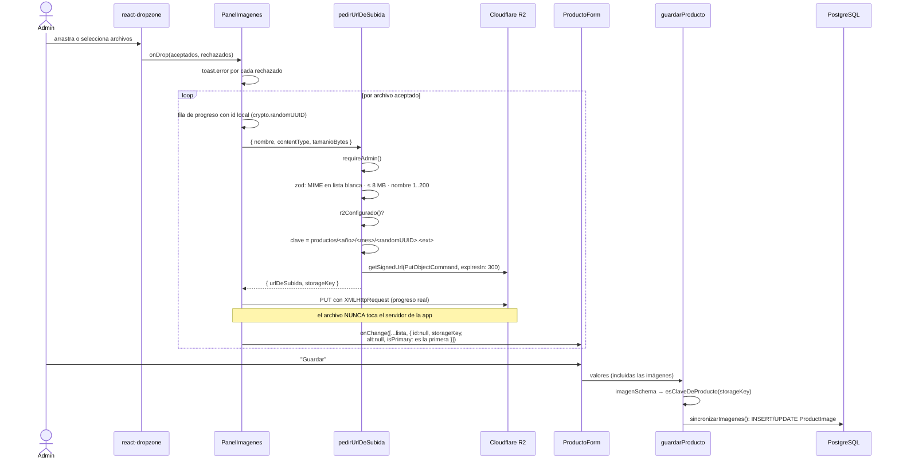

# Flujo · Subir una foto de producto

## Objetivo

Poner una foto propia en Cloudflare R2 y asociarla al producto, **sin que el
archivo pase por el servidor de la aplicación**.

## Actor

Admin autenticado.

## Preconditions

- Sesión válida.
- `r2Configurado()` — las cinco variables `R2_*` presentes. La página lo
  resuelve en el servidor y lo pasa como prop `r2Listo`.
- Archivo ≤ 8 MB y de tipo `image/jpeg`, `image/png`, `image/webp` o
  `image/avif`.

## Entry point

Paso 5 del formulario de producto → `PanelImagenes`
(`src/app/admin/(panel)/productos/_components/panel-imagenes.tsx`).

---

## Pasos

## Código involucrado

| Capa                                          | Archivo                                              |
| --------------------------------------------- | ---------------------------------------------------- |
| UI, dropzone, progreso, orden, alt, principal | `.../productos/_components/panel-imagenes.tsx`       |
| Acciones                                      | `.../productos/imagenes-actions.ts`                  |
| Cliente R2                                    | `src/lib/r2.ts`                                      |
| Validación de la clave                        | `src/lib/validations/producto.ts` → `imagenSchema`   |
| Persistencia                                  | `.../productos/actions.ts` → `sincronizarImagenes()` |
| Render público                                | `src/components/tienda/foto-producto.tsx`            |
| Host permitido                                | `next.config.ts` → `images.remotePatterns`           |

## Datos

| Dirección                       | Qué                                                          |
| ------------------------------- | ------------------------------------------------------------ |
| Cliente → servidor              | `nombre`, `contentType`, `tamanioBytes`. **No el archivo**   |
| Servidor → cliente              | `urlDeSubida` (presignada, 5 min) y `storageKey`             |
| Cliente → R2                    | El archivo, con ese `Content-Type`                           |
| Cliente → servidor (al guardar) | `storageKey`, `alt`, `isPrimary`, orden                      |
| Se persiste                     | Sólo `ProductImage.storageKey` + metadatos. **Nunca la URL** |

## Persistencia

`ProductImage`: `storageKey`, `alt`, `sortOrder` (el índice del array),
`isPrimary`. Y el objeto en el bucket de R2.

## Integraciones

Cloudflare R2 vía la API de S3: `PutObject` presignado y `DeleteObject`.

## Resultado

La foto vive en R2 y `ProductImage` guarda su clave. La tienda arma la URL con
`urlPublica()` y `next/image` la sirve.

---

## Las cuatro decisiones de seguridad

1. **La clave la genera el servidor.** Usar el nombre de archivo del navegador
   abriría path traversal y colisiones entre subidas.
2. **La lista blanca de MIME es seguridad, no cosmética.** La presigned URL se
   firma para un `Content-Type` **puntual**: el cliente no puede pedir que se
   firme para cualquier cosa.
3. **`esClaveDeProducto()`** valida toda clave que llegue del cliente (prefijo
   `productos/`, sin `..`, ≤ 512). Se aplica en `borrarImagenSubida` **y** en
   `imagenSchema` al guardar.
4. **La URL presignada expira en 5 minutos**: sólo sirve para la subida
   inmediata que la disparó.

## Alternativas

| Variación                       | Qué pasa                                                                                                                        |
| ------------------------------- | ------------------------------------------------------------------------------------------------------------------------------- |
| Primera foto del producto       | Queda `isPrimary` automáticamente                                                                                               |
| Varias en paralelo              | `valorRef` (un `useRef` sincronizado con `valor`) evita que se pisen la lista                                                   |
| Descartar antes de guardar      | `borrarImagenSubida(clave)` → `DeleteObject`. El objeto se limpia                                                               |
| **Quitar una foto ya guardada** | Se borra la fila de `ProductImage`, **no el objeto** → [`findings.md#f-06`](../findings.md#f-06)                                |
| Borrar el producto entero       | Cascada de `ProductImage`, **R2 intacto** → mismo hallazgo                                                                      |
| Duplicar el producto            | Las copias **comparten** el `storageKey`: borrar la copia no puede borrar el archivo del original                               |
| R2 sin configurar               | _"Cloudflare R2 todavía no está configurado. Avisale al equipo…"_; la tienda cae al placeholder de frasco                       |
| `R2_PUBLIC_URL` ausente         | `urlPublica()` devuelve `null` y `remotePatterns` queda vacío: `next/image` **rechaza** el host en vez de servir cualquier cosa |

## Errores

| Situación                            | Mensaje                                                                                            |
| ------------------------------------ | -------------------------------------------------------------------------------------------------- |
| Formato no permitido                 | _"Ese formato de imagen no está permitido."_                                                       |
| Más de 8 MB                          | _"La imagen no puede pesar más de 8 MB."_                                                          |
| Rechazado por el dropzone            | _"«archivo.gif» no se pudo agregar: <motivo>"_                                                     |
| Falla el PUT a R2                    | _"No pudimos subir «archivo.jpg». Probá de nuevo."_; la fila de progreso se limpia en el `finally` |
| Clave fuera del prefijo al borrar    | _"Esa imagen no es válida."_                                                                       |
| Dos (o ninguna) principal al guardar | _"Marcá una (y sólo una) foto como principal."_                                                    |

> La lista blanca está duplicada en el cliente a propósito: si se desalinean, el
> server action rechaza igual, pero repetirla evita subidas que el usuario ve
> "progresar" y fallan en el último paso.

## Relacionado

- [`modules/almacenamiento-imagenes.md`](../modules/almacenamiento-imagenes.md)
- [`integrations.md`](../integrations.md#cloudflare-r2)
- [`flows/publicar-producto.md`](publicar-producto.md)
