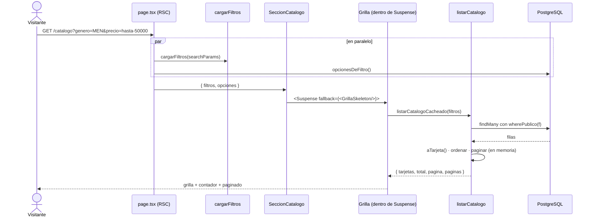
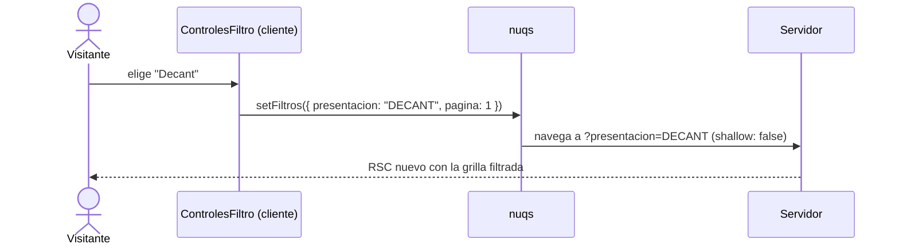
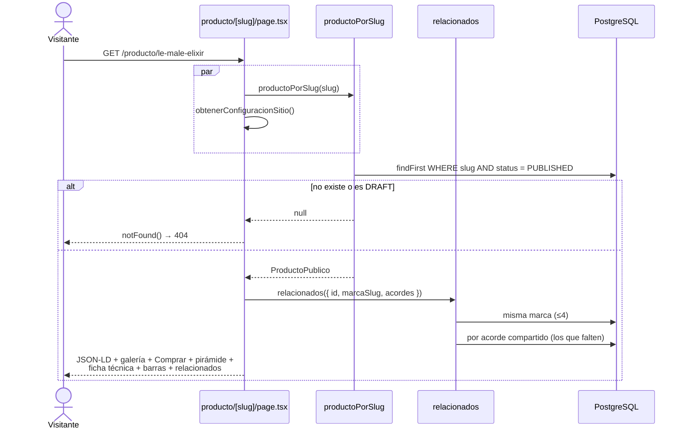

# Flujo · Explorar el catálogo

## Objetivo

Que el visitante encuentre un perfume: recorriendo la grilla, filtrando,
buscando por texto o entrando por una marca.

## Actor

Visitante anónimo.

## Preconditions

- Hay al menos un `Product` con `status: PUBLISHED` **y** una variante
  `isActive` (si no, la grilla queda vacía).
- Para que la foto se vea, R2 configurado; si no, placeholder de frasco.

## Entry points

| Ruta            | Diferencia                                         |
| --------------- | -------------------------------------------------- |
| `/`             | Hero + la misma grilla, con el título en `h2`      |
| `/catalogo`     | Grilla sola, con migas                             |
| `/marca/[slug]` | Grilla con el filtro de marca **fijo por la ruta** |

---

## Pasos

`FraseTotal`, `Grilla` y `Paginado` llaman las tres a `listarCatalogoCacheado`
con el mismo objeto `filtros`; `cache()` de React las colapsa en **una** consulta
(`src/components/tienda/catalogo/grilla.tsx:5-11`).

### Cambiar un filtro

Todo filtro resetea `pagina` a 1. `clearOnDefault` saca el parámetro cuando
vuelve a su default, así "limpiar filtros" deja una URL limpia y compartible.

El **buscador de texto** es el caso especial: el input queda en estado local y
empuja a la URL con un debounce manual. Atarlo directo al valor de la URL traba
al tipear, porque la URL tarda uno o dos renders en volver
(`catalogo/buscador.tsx:8-15`).

## Código involucrado

| Capa              | Archivo                                                                                           |
| ----------------- | ------------------------------------------------------------------------------------------------- |
| Rutas             | `src/app/(tienda)/{page,catalogo/page,marca/[slug]/page}.tsx`                                     |
| Parsers de la URL | `src/lib/tienda/filtros.ts`                                                                       |
| Consulta          | `src/lib/tienda/consultas.ts` → `listarCatalogo`, `opcionesDeFiltro`                              |
| Composición       | `src/components/tienda/catalogo/seccion-catalogo.tsx`                                             |
| Grilla + dedupe   | `.../catalogo/grilla.tsx`                                                                         |
| Controles         | `.../catalogo/{buscador,controles-filtro,drawer-filtros,panel-filtros,select-orden,paginado}.tsx` |
| Tarjeta           | `src/components/tienda/tarjeta-producto.tsx`, `foto-producto.tsx`                                 |

## Datos

**Entra**: los nueve query params (ver [`routes.md`](../routes.md#query-params-del-catálogo)).

**Sale**, por tarjeta: `slug`, `nombre`, `marca` + `marcaSlug`, `meta`
(`"EDP · 2021 · Especiado"`), `imagen` (URL ya armada o `null`), `desde`
(string), `etiqueta` (`NUEVO`/`DECANT`/`TESTER`/`null`) y `tamanios`.

Más los contadores: `total`, `pagina`, `paginas`.

## Persistencia

Sólo lectura: `Product`, `Brand`, `ProductVariant`, `ProductImage`,
`ProductAccord`+`Accord`, `ProductNote`+`Note`.

## Integraciones

`next/image` contra el host de R2. Nada más.

## Resultado

Grilla de hasta 12 tarjetas, con paginado y la URL reflejando el estado exacto.

---

## Ficha de producto

Desde una tarjeta se llega a `/producto/[slug]`:

Un producto en borrador da **404 aunque se conozca el slug**: `productoPorSlug`
ya filtra por `PUBLISHED`, por eso `notFound()` alcanza.

La ficha emite dos `<script type="application/ld+json">`: `Product` +
`AggregateOffer` y `BreadcrumbList`, ambos pasados por `jsonLd()`, que escapa
`<` para que un texto del admin con HTML no cierre el script
([`modules/seo.md`](../modules/seo.md)).

## Alternativas

| Variación                              | Qué pasa                                                                                                |
| -------------------------------------- | ------------------------------------------------------------------------------------------------------- |
| `?pagina=999`                          | Se acota a la última página real, no devuelve vacío                                                     |
| Filtro sin resultados                  | Grilla vacía; los selects sólo ofrecen valores que existen publicados                                   |
| `/marca/[slug]` con `?marca=otra`      | El param se ignora: la ruta manda (`{ ...filtrosUrl, marca: slug }`) y el select de marca no se muestra |
| Marca sin nada publicado               | `notFound()`                                                                                            |
| Producto publicado sin variante activa | No entra a la grilla; su ficha **sí** responde por URL                                                  |
| Sin `sizeMl` en ninguna variante       | La tarjeta no muestra tamaños                                                                           |
| Sin precio en ninguna activa           | `desde: null`; al ordenar por precio va al final                                                        |

## Errores

No hay errores de usuario en este flujo: es lectura pura. Si la base no
responde, la Server Component lanza y Next muestra su página de error.

## Relacionado

- [`modules/tienda-catalogo.md`](../modules/tienda-catalogo.md)
- [`flows/agregar-al-carrito.md`](agregar-al-carrito.md) — lo que sigue
