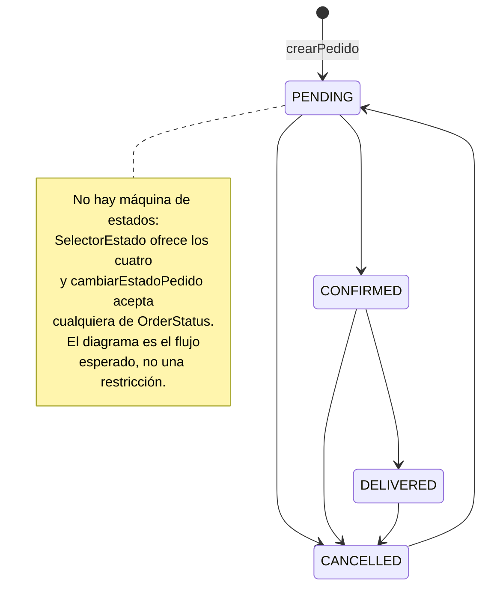

# Módulo · Pedidos (panel)

## Responsabilidad

La bandeja de trabajo del admin después de que entra un pedido: listar, buscar,
filtrar por estado, ver el detalle con el snapshot congelado, abrir el chat de
WhatsApp del cliente, mover el estado y dejar notas internas.

**No crea pedidos**: eso es `crearPedido`, del lado público
([`modules/carrito-checkout.md`](carrito-checkout.md)).

## Entry points

| Ruta / acción                              | Archivo                                  |
| ------------------------------------------ | ---------------------------------------- |
| `/admin/pedidos`                           | `src/app/admin/(panel)/pedidos/page.tsx` |
| `/admin/pedidos/[id]`                      | `.../pedidos/[id]/page.tsx`              |
| `cambiarEstadoPedido(id, estado)`          | `.../pedidos/actions.ts:26`              |
| `guardarNotasPedido(id, notas)`            | `.../pedidos/actions.ts:46`              |
| Tarjeta "Pedidos pendientes" del dashboard | `.../(panel)/page.tsx`                   |

## Archivos principales

| Archivo                                          | Rol                                             |
| ------------------------------------------------ | ----------------------------------------------- |
| `src/lib/admin/pedidos.ts`                       | `listarPedidos`, `pedidoPorId`, `ESTADO_PEDIDO` |
| `.../pedidos/_components/tabla-pedidos.tsx`      | La tabla                                        |
| `.../pedidos/_components/tabs-estado-pedido.tsx` | Filtro por estado (nuqs)                        |
| `.../pedidos/_components/buscador-pedidos.tsx`   | Búsqueda (nuqs)                                 |
| `.../pedidos/_components/chip-estado-pedido.tsx` | Badge con punto de color                        |
| `.../pedidos/_components/selector-estado.tsx`    | Cambio de estado                                |
| `.../pedidos/_components/notas-pedido.tsx`       | Notas internas                                  |

## API pública interna

```ts
listarPedidos({ q?, estado? })
  → { filas, pendientes, confirmados, entregados, cancelados, total }

pedidoPorId(id) → PedidoDetalle | null

ESTADO_PEDIDO: Record<OrderStatus, string>
// PENDING "Pendiente" · CONFIRMED "Confirmado"
// DELIVERED "Entregado" · CANCELLED "Cancelado"
```

## Dependencias

`lib/db` · `lib/whatsapp` (`linkWhatsappA`, `telefonoVisible`) ·
`lib/admin/guard` · `lib/catalogo` (`precioArs`) · `lib/fecha` (`hace`) ·
`Prisma.Decimal`.

## Entidades

`Order`, `OrderItem`. Lectura de `Product` sólo indirecta: `OrderItem.productId`
sirve para linkear a `/admin/productos/:id` **si todavía existe**.

## Persistencia

Dos escrituras, ambas sobre `Order`: `status` y `adminNotes`. Ninguna toca
`OrderItem` — el snapshot es inmutable por diseño.

---

## La lista

`listarPedidos()` dispara **seis consultas en paralelo**: las filas filtradas y
cinco `count()` (uno por estado + el total) para el encabezado y las tabs.
Ordena por `createdAt desc`.

Búsqueda: `number` **o** `customerName`, `contains` insensible. No busca por
teléfono ni por producto.

Cada fila trae:

| Campo           | Nota                                                         |
| --------------- | ------------------------------------------------------------ |
| `number`        | `PM-0042`                                                    |
| `customerName`  | —                                                            |
| `customerPhone` | Pasado por `telefonoVisible()`: E.164 → `+54 9 223 616 3910` |
| `status`        | Para el chip                                                 |
| `totalArs`      | `Decimal` → string                                           |
| `cantidadItems` | De `_count.items`, sin traer las líneas                      |
| `createdAt`     | Lo formatea `hace()` en la UI                                |

---

## El detalle

`pedidoPorId()` agrega:

- **`linkChat`**: `linkWhatsappA(pedido.customerPhone)` **sin mensaje** — abre el
  chat con el cliente, en blanco. Es el único lugar del sistema donde el link
  apunta al número del cliente y no al del negocio.
- **`subtotal` por línea**: `new Prisma.Decimal(unitPriceArs).times(qty)`, en
  `Decimal`.
- `adminNotes`, `updatedAt`.

La pantalla muestra el snapshot: `productName`, `variantLabel`, `unitPriceArs`,
`qty`. Si `item.productId` sigue existiendo, el nombre es un link a
`/admin/productos/:id`; si el producto se borró (`SET NULL`), es texto plano.
**Esa es toda la diferencia** — el pedido no pierde nada.

---

## Estados



`cambiarEstadoPedido` sólo comprueba que el pedido exista; no valida la
transición. **[Observado]** — cualquier estado puede ir a cualquier otro.

Colores del chip (`chip-estado-pedido.tsx`): `PENDING` neutral · `CONFIRMED` y
`DELIVERED` comparten los tokens `--success` (`DELIVERED` sin borde, para
distinguir "ya se entregó" de "confirmado, todavía no retirado") · `CANCELLED`
con `--destructive`.

---

## Un detalle de arquitectura que vale la pena

`SelectorEstado` recibe las etiquetas **como prop**:

```tsx
<SelectorEstado
  id={pedido.id}
  status={pedido.status}
  etiquetas={ESTADO_PEDIDO}
/>
```

No las importa de `@/lib/admin/pedidos` porque ese módulo también trae `prisma`,
y un Client Component no puede importarlo sin arrastrar el cliente de Prisma al
bundle del browser (`selector-estado.tsx:1-6`).

Por el mismo motivo `ESTADO_PEDIDO` vive ahí y no en `lib/catalogo.ts`: ese
archivo lo comparte la tienda pública, que no muestra estados de pedido.

---

## Lo que **no** hace

- No notifica: no hay email, push ni webhook. El admin se entera por el mensaje
  de WhatsApp que le manda el cliente.
- No edita líneas ni totales: el snapshot es inmutable.
- No exporta ni imprime.
- No registra quién cambió el estado ni cuándo (sólo queda `updatedAt`).
- No pagina: trae todas las filas que matchean el filtro.

## Flujos relacionados

- [`flows/gestionar-pedido.md`](../flows/gestionar-pedido.md)
- [`flows/crear-pedido.md`](../flows/crear-pedido.md) — de dónde viene el pedido
