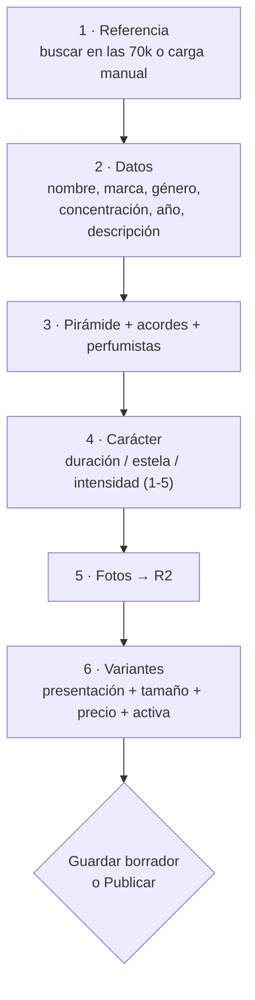

# Módulo · Productos (panel)

## Responsabilidad

Todo el ciclo de vida de un `Product`: adoptar una referencia o cargar a mano,
editar, subir fotos, definir variantes con precio, publicar, duplicar y borrar.
También los vocabularios que el formulario necesita (notas, perfumistas,
marcas) y la corrección de nombres de marca.

## Entry points

| Ruta                     | Archivo                                    |
| ------------------------ | ------------------------------------------ |
| `/admin/productos`       | `src/app/admin/(panel)/productos/page.tsx` |
| `/admin/productos/nuevo` | `.../productos/nuevo/page.tsx`             |
| `/admin/productos/[id]`  | `.../productos/[id]/page.tsx`              |
| `/admin/marcas`          | `.../marcas/page.tsx`                      |
| 11 Server Actions        | `.../productos/actions.ts`                 |
| 2 Server Actions         | `.../productos/imagenes-actions.ts`        |
| 1 Server Action          | `.../marcas/actions.ts`                    |

## Archivos principales

| Archivo                                                                                                             | Rol                                                      |
| ------------------------------------------------------------------------------------------------------------------- | -------------------------------------------------------- |
| `src/lib/admin/productos.ts`                                                                                        | `listarProductos`, `productoParaEditar`, `listarAcordes` |
| `src/lib/admin/slug.ts`                                                                                             | `aSlug`, `slugLibre`                                     |
| `src/lib/admin/marcas.ts`                                                                                           | `listarMarcas`                                           |
| `src/lib/validations/producto.ts`                                                                                   | `productoSchema` — el contrato único                     |
| `.../productos/_components/producto-form.tsx`                                                                       | 831 líneas: el formulario completo                       |
| `.../productos/_components/paso-referencia.tsx`                                                                     | Paso 1: buscar y adoptar                                 |
| `.../productos/_components/panel-imagenes.tsx`                                                                      | Dropzone + subida a R2                                   |
| `.../productos/_components/editor-variantes.tsx`                                                                    | Presentaciones y precios                                 |
| `.../productos/_components/editor-piramide.tsx`                                                                     | Notas en tres columnas                                   |
| `.../productos/_components/selector-acordes.tsx`                                                                    | Los 93 acordes, filtrados en el cliente                  |
| `.../productos/_components/combobox-remoto.tsx`                                                                     | Autocompletado contra el servidor                        |
| `.../productos/_components/{tabla-productos,fila-acciones,tabs-estado,buscador-productos,campo,barra-caracter}.tsx` | Tabla y controles                                        |

## API pública interna

```ts
// src/lib/admin/productos.ts
listarProductos({ q?, estado? }) → { filas, publicados, borradores, total }
productoParaEditar(id) → ProductoEditable | null
listarAcordes() → { id, nameEs, nameEn, color }[]

// src/lib/admin/slug.ts
aSlug(texto)
slugLibre(tx, base, excluirId) → string   // agrega -2, -3…

// src/lib/admin/marcas.ts
listarMarcas(q) → FilaMarca[]
```

Server Actions: ver [`api.md`](../api.md#del-panel-19-de-20-abren-con-requireadmin).

## Dependencias

`lib/db` · `lib/r2` · `lib/admin/guard` · `lib/admin/slug` ·
`lib/admin/referencias` · `lib/validations/producto` · `lib/catalogo` ·
`slugify` · `react-hook-form` · `zod` · `react-dropzone` · `sonner`.

## Entidades

`Product` + `ProductNote` / `ProductAccord` / `ProductPerfumer` /
`ProductImage` / `ProductVariant`; `Brand`, `Note`, `Perfumer`, `Accord`
(lectura y `upsert`); `FragranceRef` (sólo lectura).

---

## El formulario: seis pasos



Al adoptar una referencia se precargan nombre, marca, año, género, notas (con
su posición y orden), acordes y perfumistas. **No** se copia la descripción: la
de Fragrantica está en inglés y nunca se publica; se muestra en el panel como
ayuda para redactar. Ver [`modules/admin-referencias.md`](admin-referencias.md).

### Autocompletados

| Vocabulario     | Filas  | Estrategia                                                                                                                                                    |
| --------------- | ------ | ------------------------------------------------------------------------------------------------------------------------------------------------------------- |
| **Acordes**     | 93     | Se traen **enteros** del servidor y se filtran en el cliente: es instantáneo                                                                                  |
| **Notas**       | ~1.882 | `ComboboxRemoto` con debounce → `buscarNotasAction`, `take: 20`, ordenadas por `usageCount desc` (con 1.882 notas, el orden alfabético enterraría las obvias) |
| **Perfumistas** | ~1.355 | Ídem, alfabético                                                                                                                                              |
| **Marcas**      | ~1.748 | Ídem. Se puede tipear una que no existe: el servidor la crea                                                                                                  |

`crearNotaAction` y `crearPerfumistaAction` hacen `upsert` por slug. Una nota
creada desde el panel se guarda con `nameEn = nameEs = <lo que escribió el
admin>`, para no dejar `nameEn` vacío y que el fallback siga funcionando.

La búsqueda del `ComboboxRemoto` se dispara desde `onValueChange` con debounce,
**no** desde un `useEffect` (regla `react-hooks/set-state-in-effect` de React 19).

---

## `productoSchema`: el contrato único

`src/lib/validations/producto.ts`. Lo corre react-hook-form en el cliente
(feedback) y **lo vuelve a correr** la Server Action (el único borde real).

### Transformaciones

| Campo             | Transformación                                                                                                                   |
| ----------------- | -------------------------------------------------------------------------------------------------------------------------------- |
| Textos opcionales | `""` → `null` (`textoOpcional(max)`): un input vacío es "sin dato", no un string vacío guardado                                  |
| `priceArs`        | Quita puntos de miles y cambia coma decimal por punto (`1.234,50` → `1234.50`), después valida `^\d{1,8}(?:\.\d{1,2})?$` y `> 0` |
| `slug`            | `toLowerCase`, `""` → `null` (lo deriva el servidor), y si viene debe ser `^[a-z0-9]+(?:-[a-z0-9]+)*$`                           |
| `storageKey`      | `.refine(esClaveDeProducto)` — prefijo `productos/`, sin `..`, ≤ 512                                                             |

### Reglas del `superRefine`

1. **Sin variantes duplicadas**: la clave es `kind|sizeMl`. Dos "Decant 10 ml"
   serían indistinguibles para el cliente y ambiguos en el mensaje de WhatsApp.
2. **Para publicar hace falta una variante activa**: si no, la ficha se vería
   sin precio ni forma de comprar.
3. **Para publicar hace falta descripción**.
4. **Exactamente una foto principal** (si hay fotos): es la de la grilla.

Topes: 60 notas, 20 acordes, 10 perfumistas, 20 variantes, 12 imágenes.

> Las reglas 2 y 3 están **también** en `cambiarEstadoProducto()`
> (`actions.ts:441-476`), porque la tabla es otro camino hacia el mismo cambio
> de estado. Es duplicación deliberada, no accidental.

---

## `guardarProducto`: las tres estrategias de sincronización

| Qué                         | Estrategia                                         | Por qué                                                                                                                              |
| --------------------------- | -------------------------------------------------- | ------------------------------------------------------------------------------------------------------------------------------------ |
| Notas, acordes, perfumistas | **Borrar y recrear** (`deleteMany` + `createMany`) | Son tablas de unión puras, sin nada que las referencie: no hay estado que perder                                                     |
| **Variantes**               | **Diff por id**                                    | `OrderItem.variantId` las apunta; un `delete` lo pondría en `null` (`SetNull`) y rompería el link de navegación de pedidos ya hechos |
| Imágenes                    | **Diff por id**                                    | Mismo criterio de estabilidad de ids                                                                                                 |

En los `updateMany` de variantes e imágenes, el `where` incluye `productId`:
así un id de otro producto no entra por ahí.

Antes de la transacción se verifican todas las FK en paralelo (`count()` de
notas, acordes, perfumistas y referencia): los ids que manda el cliente son
datos, no verdad, y sin esto un `createMany` explotaría con un error de FK
ilegible.

### El `key` del formulario

`/admin/productos/[id]` monta `<ProductoForm key={producto.updatedAt.toISOString()}>`.
Cambia en cada guardado y **fuerza el remonte** con los ids ya persistidos: sin
eso el formulario seguiría con las variantes e imágenes sin `id` y el próximo
guardado las duplicaría.

Al crear, el cliente hace `router.replace(/admin/productos/<nuevo id>)`; al
editar, `router.refresh()`.

---

## Duplicar y borrar

**`duplicarProducto`** copia todo a un producto nuevo con `name + " (copia)"`,
`status: DRAFT`, `isFeatured: false`, y:

- **no copia el SKU** (es identificador único del original),
- **comparte los `storageKey`** con el original — mismo objeto en R2 — para que
  borrar la copia no pueda borrar el archivo del otro producto.

Nace en borrador porque duplicar suele ser el paso previo a editar.

**`eliminarProducto`** borra de verdad. Las hijas cascadean; `OrderItem` tiene
`SetNull`, así que los pedidos históricos conservan su snapshot. **No verifica
existencia** → [`findings.md#f-18`](../findings.md#f-18). **No borra los objetos
de R2** → [`findings.md#f-06`](../findings.md#f-06).

---

## Slugs

`slugLibre(tx, base, excluirId)` prueba `raiz`, `raiz-2`, `raiz-3`… hasta
encontrar uno libre. `excluirId` es el propio producto al editar: sin eso,
guardar sin cambiar el nombre chocaría consigo mismo y le sumaría un sufijo en
cada guardado.

La base por defecto es `"{marca} {nombre}"`, y `aSlug()` usa las mismas opciones
de `slugify` que el importador, para que marca y producto coincidan.

---

## La tabla

`listarProductos()` devuelve, por fila: foto principal (con la URL ya armada),
cantidad de variantes, cantidad de **activas**, y `desde` calculado **sólo sobre
las activas** — "desde" tiene que reflejar lo que el cliente puede comprar hoy.

Ordena por `updatedAt desc`. Filtros: `q` (nombre o marca, `contains`
insensible) y `estado` (`todos`/`publicados`/`borradores`). Los conteos globales
(`publicados`, `total`) se piden aparte, sin el filtro, para el encabezado.

---

## Marcas

`/admin/marcas` corrige el nombre que la tienda muestra: el dataset trae la
marca en formato slug (`lancome`, `jean-paul-gaultier`).

- **Sin `q`**: sólo marcas con productos — las que de verdad importan.
- **Con `q`**: busca en las 1.748 (nombre o slug), `take: 50`, para poder
  corregir una marca de referencia antes de cargarle el primer producto.

`marcaSchema` valida **sólo `name`**: el `slug` no se toca porque es la URL de
`/marca/[slug]` y ya está en el sitemap.

`revalidarMarca()` es el revalidador más caro del proyecto: `/`, `/catalogo`,
`/marca/:slug` y **una llamada por cada producto de la marca**. Iterar es más
simple que inventar otro mecanismo con este volumen.

---

## Flujos relacionados

- [`flows/publicar-producto.md`](../flows/publicar-producto.md)
- [`flows/subir-imagen.md`](../flows/subir-imagen.md)
- [`modules/admin-referencias.md`](admin-referencias.md)
- [`modules/almacenamiento-imagenes.md`](almacenamiento-imagenes.md)
