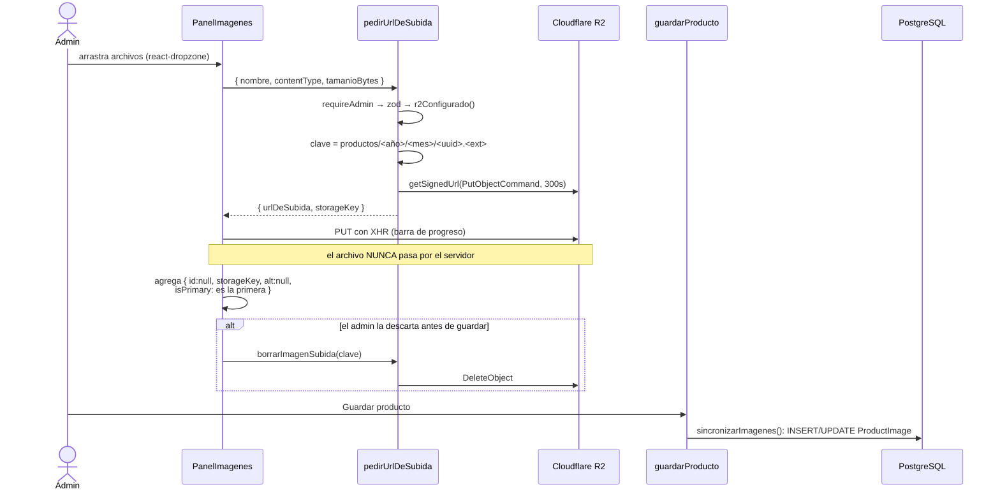

# Módulo · Almacenamiento de imágenes (Cloudflare R2)

## Responsabilidad

Guardar y servir las **fotos propias** de producto. Regla de negocio central:
las imágenes de Fragrantica no se muestran nunca — son referencia interna del
panel. Las fotos son propias y viven en R2.

El archivo **nunca pasa por el servidor de la aplicación**: el browser sube
directo a R2 con una URL presignada.

## Entry points

| Superficie                                                | Archivo                                                  |
| --------------------------------------------------------- | -------------------------------------------------------- |
| `pedirUrlDeSubida({ nombre, contentType, tamanioBytes })` | `src/app/admin/(panel)/productos/imagenes-actions.ts:49` |
| `borrarImagenSubida(clave)`                               | `.../imagenes-actions.ts:92`                             |
| UI de subida                                              | `.../productos/_components/panel-imagenes.tsx`           |
| Render público                                            | `src/components/tienda/foto-producto.tsx`                |

## Archivos principales

| Archivo                                        | Rol                                                                          |
| ---------------------------------------------- | ---------------------------------------------------------------------------- |
| `src/lib/r2.ts`                                | Cliente perezoso, presign, `urlPublica`, `esClaveDeProducto`, `borrarObjeto` |
| `.../productos/imagenes-actions.ts`            | Las dos Server Actions                                                       |
| `.../productos/_components/panel-imagenes.tsx` | Dropzone, progreso, orden, principal, alt                                    |
| `src/components/tienda/foto-producto.tsx`      | `next/image` con fallback                                                    |
| `src/components/frasco-placeholder.tsx`        | La silueta cuando no hay foto                                                |
| `next.config.ts`                               | `images.remotePatterns` derivado de `R2_PUBLIC_URL`                          |

## API pública interna

```ts
r2Configurado(): boolean                       // las cinco variables presentes
urlDeSubida({ clave, contentType }): Promise<string>   // presigned PUT, 5 min
urlPublica(clave): string | null               // null si no hay R2_PUBLIC_URL
esClaveDeProducto(clave): boolean
borrarObjeto(clave): Promise<void>
PREFIJO_PRODUCTOS = "productos/"
```

## Dependencias

`@aws-sdk/client-s3` · `@aws-sdk/s3-request-presigner` · `lib/env` ·
`node:crypto` (`randomUUID`) · `react-dropzone` (cliente).

## Entidades

`ProductImage` — sólo `storageKey`, `alt`, `sortOrder`, `isPrimary`.

---

## Cinco decisiones de diseño

### 1. El cliente es perezoso

Las credenciales son **opcionales** en `src/lib/env.ts`: el módulo tiene que
poder importarse sin romper el build ni el arranque aunque las cinco variables
estén vacías. El `S3Client` se crea en la primera llamada real
(`src/lib/r2.ts:51-64`), nunca al importar.

`credenciales()` centraliza el chequeo: si no lanza, las variables existen — por
eso las funciones de abajo pueden usar `!` sin mentirle a TypeScript.

### 2. La clave la genera el servidor

```
productos/<año>/<mes>/<randomUUID()>.<ext>
```

Usar el nombre de archivo que manda el navegador abriría path traversal y
colisiones entre subidas (`imagenes-actions.ts:72-78`).

### 3. La base guarda la **clave**, no la URL

Migración `imagenes_guardan_clave`: `ProductImage.url` → `storageKey`, con un
`RENAME` y no un `DROP`+`ADD` para no perder datos.

`urlPublica()` es **la única función que sabe cuál es el host público**. Cambiar
de `pub-xxxx.r2.dev` a un dominio propio es cambiar `R2_PUBLIC_URL` y nada más:
ninguna fila se reescribe.

Es **total**: devuelve `null` si R2 no está configurado, así las consultas
pueden pedirla sin chequear antes y la UI cae al placeholder de frasco.

### 4. La lista blanca de MIME es seguridad, no cosmética

```ts
const EXTENSION_POR_TIPO = {
  "image/jpeg": "jpg",
  "image/png": "png",
  "image/webp": "webp",
  "image/avif": "avif",
};
const OCHO_MB = 8 * 1024 * 1024;
```

La presigned URL se firma para un `Content-Type` **puntual**, así que el cliente
no puede pedir que se firme para cualquier cosa.

La misma lista está duplicada en `panel-imagenes.tsx` a propósito: si se
desalinean, el server action rechaza igual, pero repetirla evita subidas que el
usuario ve "progresar" y fallan en el último paso.

### 5. `esClaveDeProducto()` valida todo lo que llega del cliente

```ts
clave.startsWith("productos/") && !clave.includes("..") && clave.length <= 512;
```

Las claves viajan por el formulario, así que llegan como dato del cliente. Sin
este chequeo se podría pedir el borrado de cualquier objeto del bucket. Se
aplica en **tres** lugares: `borrarImagenSubida`, `imagenSchema` de
`validations/producto.ts`, y por extensión en `guardarProducto`.

---

## El ciclo de una foto



Notas:

- La primera foto subida queda `isPrimary` automáticamente.
- `valorRef` (un `useRef` sincronizado con `valor`) permite que varias subidas
  en paralelo no se pisen la lista.
- La vista previa se arma con `basePublica` (`env.R2_PUBLIC_URL`), que la página
  pasa como prop: el panel no adivina el host.
- `r2Listo={r2Configurado()}` también viaja como prop, para que el panel muestre
  _"Cloudflare R2 todavía no está configurado"_ en vez de fallar al subir.

---

## Del lado público

`FotoProducto` usa `next/image` con la URL de `urlPublica()` y cae a
`FrascoPlaceholder` cuando no hay foto.

`object-contain` y **no** `cover` a propósito: son frascos recortados sobre
fondo crema, y recortarlos les comería la tapa.

`next/image` sólo acepta hosts de `images.remotePatterns`, que `next.config.ts`
deriva de `process.env.R2_PUBLIC_URL`. Si la variable falta, la lista queda
**vacía** y `next/image` rechaza el host en vez de servir cualquier cosa.

> `remotePatterns` se evalúa **al construir el config**, no por request, y queda
> serializado en el output standalone: **cambiar el host obliga a rebuildear la
> imagen Docker**. No alcanza con tocar la variable en Dokploy
> (`next.config.ts:1-20`). Por eso el workflow tiene `workflow_dispatch`.

---

## El agujero: objetos huérfanos

`borrarObjeto()` tiene **dos** call-sites en todo el proyecto:
`borrarImagenSubida` y `scripts/seed-dev.ts`.

| Situación                                          | ¿Se borra el objeto de R2?                  |
| -------------------------------------------------- | ------------------------------------------- |
| Subís una foto y la descartás **antes** de guardar | ✅ `borrarImagenSubida`                     |
| Quitás una foto **ya guardada** y guardás          | ❌ `sincronizarImagenes` sólo borra la fila |
| Borrás el producto entero                          | ❌ cascada de `ProductImage`, R2 intacto    |
| `pnpm db:seed-dev --limpiar`                       | ✅ sólo para `productos/dev/`               |

No hay proceso de limpieza. Y `duplicarProducto` **comparte** los `storageKey`
con el original, así que cualquier GC futuro tendría que contar referencias.

Detalle: [`findings.md#f-06`](../findings.md#f-06).

---

## Configuración

| Variable                                                                                  | Falta alguna →                                                                                                     |
| ----------------------------------------------------------------------------------------- | ------------------------------------------------------------------------------------------------------------------ |
| `R2_ACCOUNT_ID`, `R2_ACCESS_KEY_ID`, `R2_SECRET_ACCESS_KEY`, `R2_BUCKET`, `R2_PUBLIC_URL` | `r2Configurado()` es `false`: no se puede subir; `urlPublica()` devuelve `null` y la tienda muestra el placeholder |

`.env.example` advierte que el token debe estar acotado **sólo** al bucket de
imágenes: no reusar el de los backups de la VPS, que es otro bucket y otro
alcance.

## Flujos relacionados

- [`flows/subir-imagen.md`](../flows/subir-imagen.md)
- [`flows/publicar-producto.md`](../flows/publicar-producto.md)
- [`integrations.md`](../integrations.md#cloudflare-r2)
