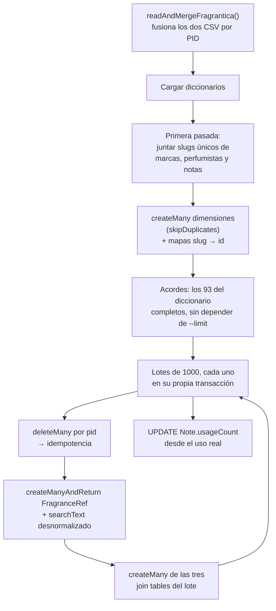

# Módulo · Datos de referencia (Fragrantica)

## Responsabilidad

Traer las **69.948** fragancias de dos CSV públicos de Kaggle (scrapeados de
Fragrantica) a la capa de referencia de Postgres, normalizando nombres, géneros,
notas y acordes, y aplicando los diccionarios de traducción al español que el
dataset no trae.

Es un módulo **offline**: corre por CLI, no desde la aplicación.

## Entry points

| Comando                                               | Script                          |
| ----------------------------------------------------- | ------------------------------- |
| `pnpm db:import-fragrantica`                          | `scripts/import-fragrantica.ts` |
| `pnpm db:seed`                                        | `prisma/seed.ts`                |
| `pnpm db:seed-dev`                                    | `scripts/seed-dev.ts`           |
| `pnpm exec tsx scripts/lib/fragrantica-parse.test.ts` | Aserciones, a mano              |

Flags del importador: `--limit N`, `--batch-size N` (default 1000),
`--data-dir <ruta>`.

## Archivos principales

| Archivo                                 | Rol                                                              |
| --------------------------------------- | ---------------------------------------------------------------- |
| `scripts/import-fragrantica.ts`         | El importador                                                    |
| `scripts/lib/read-fragrantica-csv.ts`   | `readAndMergeFragrantica()` — lee y fusiona los dos CSV por PID  |
| `scripts/lib/fragrantica-parse.ts`      | Los parsers                                                      |
| `scripts/lib/dictionaries.ts`           | `loadNoteAliases`, `loadAccordDict`, `loadNoteDict`              |
| `scripts/lib/fragrantica-parse.test.ts` | Tests de Vitest                                                  |
| `data/fragrantica/`                     | Los dos CSV (38 MB, versionados) + README                        |
| `data/dictionaries/`                    | `accords.es.json`, `notes.es.json`, `note-aliases.json` + README |

## Entidades

Escribe `Brand`, `Perfumer`, `Note`, `Accord`, `FragranceRef`,
`FragranceRefNote`, `FragranceRefAccord`, `FragranceRefPerfumer`.
**No toca** `Product`, `Order` ni `SiteSetting`.

---

## Las fuentes

| Archivo            | Filas  | Delimitador | Aporta                                                                                                           |
| ------------------ | ------ | ----------- | ---------------------------------------------------------------------------------------------------------------- |
| `fra_cleaned.csv`  | 24.063 | `;`         | Notas ya separadas en Top/Middle/Base, año (92%), país, perfumistas, 5 acordes ordenados. **Decimales con coma** |
| `fra_perfumes.csv` | 69.948 | `,`         | Los 70k perfumes, lista completa de acordes, descripción en inglés, rating                                       |

El **PID** (el número al final de la URL: `…/Afnan/9am-70706.html` → `70706`) es
la clave de join. `fra_cleaned` está **contenido dentro de** `fra_perfumes`: la
unión son 69.948 fragancias.

### Cobertura de notas

| Fuente                                    | Fragancias con pirámide |
| ----------------------------------------- | ----------------------- |
| `fra_cleaned` (campos Top/Middle/Base)    | 24.063                  |
| `fra_perfumes` (parseando la descripción) | 46.572                  |
| **Unión**                                 | **46.578 (67%)**        |
| Sin notas en ninguna fuente               | 23.370                  |

El parseo de la descripción usa el patrón fijo de Fragrantica:
`Top notes are A, B and C; middle notes are …; base notes are …`.

---

## Las trampas del dataset (y cómo se resuelven)

| Problema                     | Ejemplo                                                | Solución                                                                                                                          |
| ---------------------------- | ------------------------------------------------------ | --------------------------------------------------------------------------------------------------------------------------------- |
| Nombre y marca sucios        | `accento-overdose-pride-edition`, `9am Afnanfor women` | **La fuente buena es la URL**: `/perfume/<Marca>/<Nombre>-<pid>.html` → `parseFragranticaUrl()` + `titleCaseFromSlug()`           |
| Género inconsistente         | `women`, `for women`, `unisex`, `for women and men`    | `normalizeGenderCleaned()` y `normalizeGenderPerfumes()` — **dos** funciones, una por CSV                                         |
| Decimal con coma             | `1,42`                                                 | `parseDecimal()`                                                                                                                  |
| Acordes como lista de Python | `"['citrus', 'musky']"`                                | `parsePyStringList()`                                                                                                             |
| Listas en prosa              | `"A, B and C"`                                         | `splitProseList()`                                                                                                                |
| Año dentro de la descripción | —                                                      | `parseYearFromDescription()`                                                                                                      |
| Typos de notas               | `vanila`, `sandalowood`, `cardamon`                    | `note-aliases.json` normaliza a la forma canónica **antes** de crear la nota, para no duplicar el mismo ingrediente con dos slugs |

Lo que el dataset **no** trae: nada en español (va en `data/dictionaries/`) y
ningún color de acorde (paleta propia, no copiada de ningún tercero).

---

## Los diccionarios

| Archivo             | Contenido                                                                                 |
| ------------------- | ----------------------------------------------------------------------------------------- |
| `accords.es.json`   | Los 93 acordes: `slug`, `en`, `es`, `family` (sólo para elegir el color) y `color`        |
| `notes.es.json`     | Las ~500 notas más frecuentes (~97% de las apariciones): `slug`, `en`, `es`, `usageCount` |
| `note-aliases.json` | Typos → forma canónica                                                                    |

Tras la corrida completa quedaron **1.398 de 1.882** notas sin traducir: la cola
larga de ingredientes que aparecen en pocas fragancias. Se completan desde
`/admin/notas` a medida que hace falta.

> Los JSON son **la semilla inicial**. Una vez importados, lo que ve la tienda
> sale de las tablas `Note`/`Accord`: corregir el JSON después de importar no
> cambia nada ya cargado. El lugar para arreglar una traducción, antes o
> después, es `/admin/notas`.

---

## El algoritmo del importador

### Cuatro decisiones que vale la pena conocer

1. **Idempotente por `pid`**: cada corrida hace `deleteMany({ pid: { in: pids } })`
   antes de recrear el lote. Se puede re-ejecutar sin duplicar. La cascada de
   `FragranceRef` limpia sus join tables.
2. **Lotes de 1000 en transacciones separadas**, no una transacción gigante:
   70k filas con sus relaciones en una sola transacción sería inviable.
3. **`searchText` se escribe acá**, no en un trigger: es `"<nombre> <marca>"`, y
   es lo único que permite resolver `"sauvage dior"` con un solo índice GIN.
   Ver [`modules/admin-referencias.md`](admin-referencias.md).
4. **`usageCount` se recalcula al final** con un `UPDATE … FROM (SELECT count…)`:

   > _"el diccionario sólo trae el conteo de las ~500 notas que alguien tradujo,
   > así que tomarlo de ahí dejaba en cero las 1.398 sin traducir — justo las que
   > `/admin/notas` tiene que priorizar. Se recalcula del uso real, que es el
   > único dato verdadero."_

   Y `usageCount` es exactamente el orden de `Note_untranslated_idx` y del
   autocompletado de notas del formulario.

### Lo que se descarta silenciosamente

El importador cuenta `skippedNotes`, `skippedAccords` y `skippedPerfumers`
cuando un nombre no resuelve a un id, y lo informa al final. Una marca no
resuelta, en cambio, **lanza** (`marca no resuelta: … (pid …)`), porque
`FragranceRef.brandId` es obligatorio.

---

## Traducción desde el panel

`/admin/notas` es la contraparte en runtime.

| Acción                     | Efecto                                                          |
| -------------------------- | --------------------------------------------------------------- |
| `traducirNota(id, nameEs)` | `Note.nameEs = <2..80 chars>`                                   |
| `borrarTraduccion(id)`     | `Note.nameEs = null` — deshace una traducción cargada por error |

La pantalla pagina de a 50, ordena por `usageCount desc` (se traducen primero
las que más aparecen) y tiene dos tabs: `pendientes` (`nameEs: null`) y
`traducidas`. El filtro **tiene que** escribirse `nameEs: null` para que el
índice parcial `Note_untranslated_idx` lo cubra.

Toda la UI pública cae a `nameEs ?? nameEn` mientras la nota no esté traducida.

> Traducir una nota **no revalida la tienda** →
> [`findings.md#f-10`](../findings.md#f-10).

---

## El seed de desarrollo

`scripts/seed-dev.ts` crea **6 productos reales** adoptando referencias que ya
están en la base, para probar el panel y la tienda sin cargar nada a mano. Uno
queda en `DRAFT` **a propósito**, para verificar que un borrador no es
accesible desde la tienda.

- **Idempotente**: la clave es el `fragranceRefId` (no el slug, que en teoría
  podría cambiar). Antes de crear borra el producto que ya exista con esa
  referencia **y** sus objetos `productos/dev/` en R2. `--limpiar` hace sólo el
  borrado.
- Copia notas, acordes y perfumistas tal cual hace la adopción del panel.
- **La descripción se escribe de cero en español**: la de Fragrantica nunca se
  publica.
- Trae un **mini-encoder PNG propio** (cabecera + un `IDAT` con `deflateSync`,
  filtro "none", tabla CRC32 a mano) para generar las fotos placeholder sin
  agregar dependencias.

> Es el único lugar donde algo puede quedar con `isFeatured: true` →
> [`findings.md#f-22`](../findings.md#f-22).

---

## Tests

`scripts/lib/fragrantica-parse.test.ts` cubre los diez parsers con Vitest y
casos reales del dataset: `pnpm test`. El CI no lo corre — ver
[`findings.md#f-09`](../findings.md#f-09).

## Flujos relacionados

- [`modules/admin-referencias.md`](admin-referencias.md) — el consumidor
- [`persistence.md`](../persistence.md#semillas)
