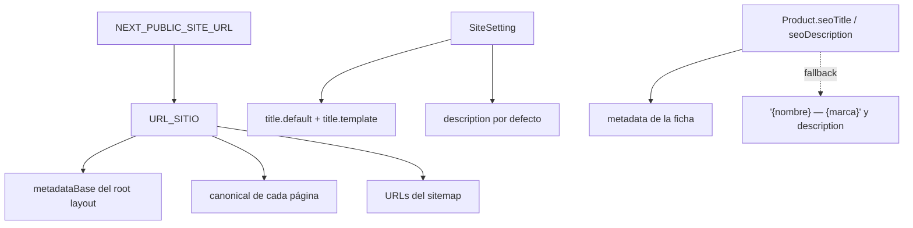

# Módulo · SEO y metadata

## Responsabilidad

Que cada página pública tenga título, descripción, canonical, Open Graph, datos
estructurados y entrada en el sitemap. Todo en es-AR, con el título/descripción
por defecto saliendo de `SiteSetting` (editable) y no del código.

## Entry points

| Superficie          | Archivo                                                       |
| ------------------- | ------------------------------------------------------------- |
| Metadata global     | `src/app/layout.tsx` → `generateMetadata()`                   |
| Metadata por página | `metadata` estática o `generateMetadata()` en cada `page.tsx` |
| `/robots.txt`       | `src/app/robots.ts`                                           |
| `/sitemap.xml`      | `src/app/sitemap.ts`                                          |
| Favicon             | `src/app/icon.tsx`                                            |
| OG image            | `src/app/(tienda)/opengraph-image.tsx` + 9 reexports          |

## Archivos principales

| Archivo                                 | Rol                                                                                       |
| --------------------------------------- | ----------------------------------------------------------------------------------------- |
| `src/lib/seo.ts`                        | `URL_SITIO`, `urlAbsoluta`, `metadataDePagina`, `jsonLd`, `productoJsonLd`, `migasJsonLd` |
| `src/lib/site.ts`                       | `siteDefaults` — fallbacks de marca                                                       |
| `src/lib/configuracion.ts`              | `SiteSetting`: título y descripción por defecto                                           |
| `src/assets/fonts/Outfit-ExtraBold.ttf` | La fuente de las imágenes generadas                                                       |

## API pública interna

```ts
URL_SITIO                                   // NEXT_PUBLIC_SITE_URL sin barra final
urlAbsoluta(ruta) → string
metadataDePagina({ titulo, descripcion, ruta }) → Metadata
jsonLd(dato) → string                       // JSON con `<` escapado
productoJsonLd(producto, urlImagenes)       // Product + AggregateOffer
migasJsonLd(migas) → BreadcrumbList
```

## Dependencias

`lib/env` (`NEXT_PUBLIC_SITE_URL`) · `lib/site` · `lib/catalogo`
(`GENERO`, `PRESENTACION`) · `lib/tienda/consultas` (tipo `ProductoPublico`) ·
`next/og`.

## Persistencia

Sólo lectura: `SiteSetting` (root layout) y `Product`/`Brand` (sitemap y JSON-LD).

---

## De dónde sale cada valor



**`URL_SITIO` sale de `NEXT_PUBLIC_SITE_URL`, no de `siteDefaults.url`**: en
local es `http://localhost:3000` y los canonical tienen que apuntar al entorno
donde corre, no siempre a producción (`src/lib/seo.ts:7-13`).

Con `metadataBase` puesto en el root layout, las rutas relativas de `openGraph`
y `canonical` se resuelven solas.

### El título

```ts
title: { default: config.seoDefaultTitle, template: `%s — ${config.brandName}` }
```

Una página que declara `title: "Carrito"` termina como
`"Carrito — ParfamMdq"`. Los tres campos salen de `SiteSetting`, no de
`siteDefaults`: son el título/descripción de **todo** el sitio, así que la única
fuente que tiene sentido es la editable.

---

## `metadataDePagina`

Lo que repite cada página: `title`, `description`, `alternates.canonical`,
`openGraph` (`type: website`, `url`, `siteName`, `locale: es_AR`, título y
descripción) y `twitter: { card: "summary_large_image" }`.

**A propósito no setea `openGraph.images`.** La imagen la ponen los archivos
`opengraph-image.tsx` (convención de Next). Si una página la declarara acá, la
explícita ganaría y la generada nunca se usaría — y la generada es la que tiene
la marca y sale en 1200×630, mientras que las fotos de producto son verticales
y las redes las recortan mal (`src/lib/seo.ts:21-29`).

### Quién lo usa

| Página                                                              | Cómo                                                    |
| ------------------------------------------------------------------- | ------------------------------------------------------- |
| `/`, `/catalogo`, `/que-es-un-tester`, `/como-comprar`, `/contacto` | `metadata` estática                                     |
| `/producto/[slug]`, `/marca/[slug]`                                 | `generateMetadata()` async                              |
| `/carrito`, `/checkout`, `/pedido/:n/gracias`                       | Sólo `{ title }` — no necesitan canonical ni OG propios |
| `/admin/login`                                                      | `{ title, robots: { index: false, follow: false } }`    |

---

## Datos estructurados (JSON-LD)

| Tipo                         | Dónde                                                    | Contenido                                                                                                                                    |
| ---------------------------- | -------------------------------------------------------- | -------------------------------------------------------------------------------------------------------------------------------------------- |
| `Product` + `AggregateOffer` | `/producto/:slug`                                        | Nombre, URL, descripción, imágenes, marca, `audience.suggestedGender`, `lowPrice`/`highPrice`/`offerCount` y una `Offer` por variante activa |
| `BreadcrumbList`             | ficha, `/contacto`, `/como-comprar`, `/que-es-un-tester` | Migas                                                                                                                                        |
| `Store`                      | `/contacto`                                              | Nombre legal, URL, teléfono, `areaServed`, `sameAs` (Instagram)                                                                              |

### El escape que importa

```ts
export function jsonLd(dato: unknown): string {
  return JSON.stringify(dato).replace(/</g, "\\u003c");
}
```

Es lo que evita que un texto escrito por el admin con HTML adentro cierre el
`<script>` y se convierta en XSS. Se aplica a **los tres** tipos, siempre antes
del `dangerouslySetInnerHTML`.

### Precios

`productoJsonLd` sale **sólo** de las variantes activas (las únicas comprables).
Si no hay ninguna, **no se publica oferta** en vez de inventar un precio:

```ts
...(precios.length > 0 ? { offers: { … } } : {})
```

Cada `Offer` lleva `availability: InStock` e `itemCondition: NewCondition` fijos
— el modelo no tiene stock.

> **[Observado]** hay un detalle raro: `manufacturer` se agrega **si hay
> perfumistas**, pero su valor es `{ "@type": "Organization", name: producto.marca }`
> — el nombre de la **marca**, no del perfumista. La condición y el valor no se
> corresponden. Impacto: ninguno visible; Google lee la marca, que es correcta.

---

## Sitemap

```ts
export const dynamic = "force-dynamic";
const urlsCacheadas = unstable_cache(urlsDelSitio, ["sitemap-urls"], {
  revalidate: 3600,
});
```

Contenido:

| Bloque              | Origen                             | `priority` | `changeFrequency` |
| ------------------- | ---------------------------------- | ---------- | ----------------- |
| `/`                 | fijo                               | 1          | daily             |
| `/catalogo`         | fijo                               | 0.9        | daily             |
| `/que-es-un-tester` | fijo                               | 0.7        | monthly           |
| `/como-comprar`     | fijo                               | 0.6        | monthly           |
| `/contacto`         | fijo                               | 0.5        | yearly            |
| `/producto/:slug`   | publicados **con variante activa** | 0.8        | weekly            |
| `/marca/:slug`      | marcas con algo publicado          | 0.4        | weekly            |

`/carrito`, `/checkout` y `/pedido/:n/gracias` **no entran**: no tienen valor
para un crawler.

### Por qué `force-dynamic`

Antes se usaba `export const revalidate = 3600`. El problema: con
`revalidate`, Next lo prerenderiza en `next build`, y era **la primera ruta que
hacía explotar un build sin Postgres** — que es justo el caso del build en CI.

La revalidación de una hora no se perdió, se bajó una capa: ahora la ruta se
resuelve por request y la consulta vive en `unstable_cache` con el mismo
`revalidate: 3600`. Para el crawler el resultado es el mismo; lo único que se
paga de más es armar el XML.

> `revalidatePath("/sitemap.xml")` desde el panel **no** invalida ese
> `unstable_cache` → [`findings.md#f-04`](../findings.md#f-04).

---

## `robots.txt`

Estático (no lee la base, así que no necesita `revalidate`):

```
User-agent: *
Allow: /
Disallow: /admin/
Disallow: /api/
Sitemap: <URL_SITIO>/sitemap.xml
Host: <URL_SITIO>
```

---

## Imágenes generadas

### La OG

`src/app/(tienda)/opengraph-image.tsx` — 1200×630, fondo `#F2EEE9`, **sólo el
logotipo** y la palabra `PERFUMERIA`.

El razonamiento está en el archivo (`:6-20`): el canal de venta es WhatsApp, y
WhatsApp **no** muestra la imagen 1200×630 en el chat — incrusta una miniatura
de ~200 px, recortada al cuadrado central y comprimida. Cualquier dato fino
(marca, concentración, precio) llegaba ilegible. Las dos medidas están atadas a
ese recorte:

- el logotipo entra en la banda central de 630 px (a cuerpo 112 mide ~590); más
  grande se le cortan la P y la q;
- nada baja de 36 px, que reducido ~3× queda en ~11 px y todavía se lee.

Los otros **nueve** segmentos tienen un archivo de 5 líneas que la reexporta: la
convención de archivo de Next **no se hereda** a rutas anidadas.

### El favicon

`src/app/icon.tsx` — 64×64, la "P" en Outfit ExtraBold sobre `#14120F`.
Reemplaza el `.ico` del scaffold (que pesaba 25 KB y mostraba el logo de Next).

### La fuente en runtime

Ambas leen `src/assets/fonts/Outfit-ExtraBold.ttf` del disco con
`join(process.cwd(), …)`. El trace de `@vercel/nft` no resuelve ese path armado
a mano, así que hay que pedirlo explícito:

```ts
outputFileTracingIncludes: { "/*": ["src/assets/fonts/*.ttf"] }
```

Sin eso, el standalone arranca sin la fuente y las OG revientan **recién cuando
alguien comparte un link**.

`readFile` se llama a nivel de módulo (no por request): la fuente no depende del
request.

---

## Verificación de propiedad

`src/app/layout.tsx:32-37` pone `verification.google` con un token. **No es un
secreto**: se publica en el HTML de todas las páginas, que es justo cómo Google
lo comprueba. Va en el root layout para que cubra también `/admin`.

## Flujos relacionados

- [`routes.md`](../routes.md#rutas-de-metadata)
- [`modules/configuracion-sitio.md`](configuracion-sitio.md)
