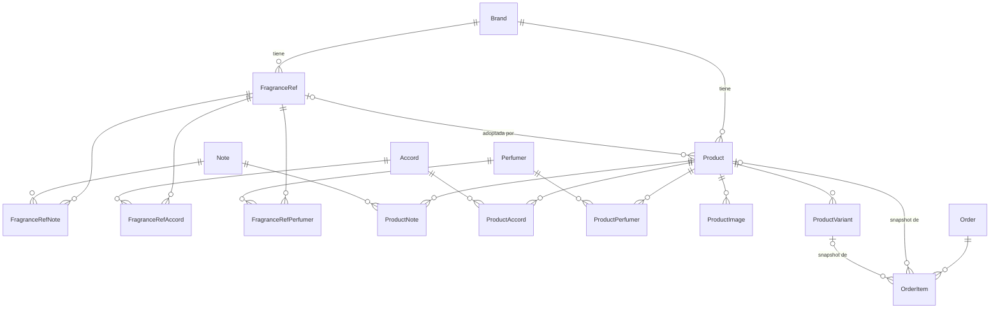

# Persistencia

PostgreSQL con **Prisma 7** y driver adapter `@prisma/adapter-pg` (pool `pg`).
Fuente: `prisma/schema.prisma` y las 4 migraciones de `prisma/migrations/`.

---

## Cómo se conecta

Prisma 7 sacó la URL del `schema.prisma`. Hoy hay **dos caminos**:

| Consumidor                           | De dónde saca la URL                                            | Archivo            |
| ------------------------------------ | --------------------------------------------------------------- | ------------------ |
| CLI (`migrate`, `studio`, `db push`) | `prisma.config.ts` → `env("DATABASE_URL")`, con `dotenv/config` | `prisma.config.ts` |
| Runtime de la app                    | `new PrismaPg({ connectionString: env.DATABASE_URL })`          | `src/lib/db.ts`    |

El cliente se genera en `src/generated/prisma` (gitignoreado) y se importa como
`@/generated/prisma/client` / `@/generated/prisma/enums`. `postinstall` corre
`prisma generate`.

`src/lib/db.ts` cachea el `PrismaClient` en `globalThis` fuera de producción:
sin eso, cada recarga en caliente de Next abriría un pool nuevo.

---

## Las tres capas del modelo

El propio `schema.prisma` las separa con comentarios.



### Capa 1 — Referencia (read-only en la app)

La siembra `scripts/import-fragrantica.ts`. **Nunca se muestra en la tienda.**

| Modelo                                       | Filas esperadas | Rol                                                                                                                                   |
| -------------------------------------------- | --------------- | ------------------------------------------------------------------------------------------------------------------------------------- |
| `FragranceRef`                               | 69.948          | Una fragancia del dataset. `pid` = clave del CSV. Campos internos: `ratingValue`, `ratingCount`, `descriptionEn`, `url`, `searchText` |
| `Brand`                                      | ~1.748          | **Compartida con la capa 2**: la misma fila sirve de marca de referencia y de marca de producto                                       |
| `Note`                                       | ~1.882          | Nota olfativa. `nameEs` puede ser `null` → la UI cae al inglés                                                                        |
| `Accord`                                     | 93              | Acorde con `nameEs` y `color` propios (del diccionario, no de un tercero)                                                             |
| `Perfumer`                                   | ~1.355          | Nariz. `name` tiene mayúsculas inconsistentes según de qué CSV vino                                                                   |
| `FragranceRefNote` / `…Accord` / `…Perfumer` | —               | Join tables. `Accord` guarda `rank` (orden de aparición, no porcentaje)                                                               |

### Capa 2 — Tienda (lo que edita el admin)

| Modelo                                              | Rol                                                                                                                                                                                                                                           |
| --------------------------------------------------- | --------------------------------------------------------------------------------------------------------------------------------------------------------------------------------------------------------------------------------------------- |
| `Product`                                           | Lo que ve el cliente. `slug` único, `status` (`DRAFT`/`PUBLISHED`), `isFeatured`, `sortOrder`, `seasons[]`, `occasions[]`, barras `longevity`/`sillage`/`intensity` (1-5, fijadas por el admin, **no** votación), `seoTitle`/`seoDescription` |
| `ProductVariant`                                    | `kind` (`FULL_BOTTLE`/`TESTER`/`DECANT`), `sizeMl`, **`priceArs Decimal(10,2)`**, `isActive`, `sku`. **Sin stock**: se activa/desactiva a mano                                                                                                |
| `ProductImage`                                      | **`storageKey`**: la clave del objeto en R2 (`productos/2026/09/<uuid>.jpg`), nunca una URL absoluta ni una imagen de Fragrantica. `isPrimary` marca la foto de la grilla                                                                     |
| `ProductNote` / `ProductAccord` / `ProductPerfumer` | Copias editables de la referencia adoptada                                                                                                                                                                                                    |

`Product.fragranceRefId` es opcional con `ON DELETE SET NULL`: el producto
sobrevive si la referencia desaparece. `Product.sourceUrl` guarda el link a
Fragrantica en las cargas manuales.

### Capa 3 — Operación

| Modelo        | Rol                                                                                                                            |
| ------------- | ------------------------------------------------------------------------------------------------------------------------------ |
| `Order`       | `number` único (`PM-0042`), `customerName`, `customerPhone` (E.164), `status`, `totalArs Decimal(10,2)`, `adminNotes`          |
| `OrderItem`   | **Snapshot**: `productName`, `variantLabel`, `unitPriceArs`, `qty`. Las FK `productId`/`variantId` son opcionales (`SET NULL`) |
| `SiteSetting` | **Singleton**: `id` con `@default("singleton")`. Todo lo editable del sitio                                                    |
| `User`        | Sólo el admin: `email` único, `passwordHash` (argon2), `name`, `role` (`UserRole` = un solo valor)                             |

---

## Reglas de integridad

### Comportamiento al borrar

| Relación                                                          | `onDelete`     | Consecuencia                                                                 |
| ----------------------------------------------------------------- | -------------- | ---------------------------------------------------------------------------- |
| `Product` → `ProductNote/Accord/Perfumer/Image/Variant`           | `CASCADE`      | Borrar un producto limpia todas sus hijas                                    |
| `FragranceRef` → sus tres join tables                             | `CASCADE`      | El importador puede borrar por `pid` y recrear                               |
| `Order` → `OrderItem`                                             | `CASCADE`      | —                                                                            |
| `OrderItem` → `Product` / `ProductVariant`                        | **`SET NULL`** | **Un pedido histórico nunca se rompe**: pierde el link, conserva el snapshot |
| `Product` → `FragranceRef`                                        | `SET NULL`     | —                                                                            |
| Todo lo demás (`Brand`, `Note`, `Accord`, `Perfumer` como padres) | `RESTRICT`     | No se puede borrar una marca/nota/acorde con referencias vivas               |

Esta combinación es lo que hace segura a `eliminarProducto()`: las variantes
cascadean, y el `SET NULL` de `OrderItem` preserva `productName`,
`variantLabel` y `unitPriceArs` de pedidos ya cerrados.

### Precios

**Siempre `Decimal(10,2)`, nunca `float`** (regla de `AGENTS.md`, verificada):

- En la base: `@db.Decimal(10, 2)` en `ProductVariant.priceArs`,
  `Order.totalArs`, `OrderItem.unitPriceArs`.
- En tránsito: `.toString()` en la capa de consultas, porque `Decimal` no es
  serializable hacia un Client Component.
- En los cálculos que importan: `Prisma.Decimal` (`checkout/actions.ts:179-182`,
  `lib/admin/pedidos.ts:149-151`).
- En la validación: un regex `^\d{1,8}(?:\.\d{1,2})?$` tras normalizar el
  formato argentino (`1.234,50` → `1234.50`) en `validations/producto.ts:37-46`.

**Única excepción**: los totales que se muestran en pantalla antes de enviar
(`formulario-checkout.tsx:75-78`, `resumen-carrito.tsx`) se suman con `Number`.
Es display-only — el total real lo recalcula `crearPedido`. Ver
[`F-15`](findings.md#f-15).

### Unicidad

`Brand.slug`, `Perfumer.slug`, `Note.slug`, `Accord.slug`, `Product.slug`,
`FragranceRef.pid`, `Order.number`, `User.email`.

`Product.slug` se deriva de `marca + nombre` y `slugLibre()` agrega `-2`, `-3`…
excluyendo el propio id al editar (`src/lib/admin/slug.ts`).

---

## Índices

### Del schema (migración `init`)

Todas las FK están indexadas. Además: `Brand.name`, `Perfumer.name`,
`Note.nameEn`, `FragranceRef.name`, `Product.status`, `Order.status`,
`Order.createdAt`.

### Escritos a mano (migración `busqueda_difusa_referencias`)

Prisma no puede declarar extensiones ni índices GIN con operator class, así que
esta migración es SQL manual:

| Objeto                                                                          | Para qué                                                                                                                                                                                               |
| ------------------------------------------------------------------------------- | ------------------------------------------------------------------------------------------------------------------------------------------------------------------------------------------------------ |
| `CREATE EXTENSION pg_trgm`, `unaccent`                                          | Búsqueda difusa                                                                                                                                                                                        |
| `parfam_normalize(text)`                                                        | Wrapper `IMMUTABLE` de `lower(unaccent(...))`. `unaccent()` es `STABLE` (depende del `search_path`) y Postgres no indexa funciones no inmutables; el wrapper fija el diccionario por nombre calificado |
| `FragranceRef.searchText`                                                       | Columna desnormalizada `"<nombre> <marca>"`. Existe porque el `OR` entre `FragranceRef` y `Brand` forzaba un seq scan de las 70k filas (medido: 293 ms)                                                |
| `FragranceRef_search_trgm_idx` (GIN `gin_trgm_ops`)                             | Hace que `LIKE '%algo%'` use índice                                                                                                                                                                    |
| `Brand_name_trgm_idx` (GIN)                                                     | La marca también se busca sola                                                                                                                                                                         |
| `Note_untranslated_idx` — parcial: `("usageCount" DESC) WHERE "nameEs" IS NULL` | Cubre exactamente la consulta de `/admin/notas`. Por eso el filtro **debe** escribirse `nameEs: null`                                                                                                  |

`FragranceRef_rating_idx` se creó en esa migración y se **borró** en la
siguiente: al pasar el orden a un promedio bayesiano, el `ORDER BY` es una
expresión y el planner ya no podía usarlo (verificado con `EXPLAIN` según el
comentario de la migración).

---

## Migraciones

| Timestamp        | Nombre                        | Qué hace                                                                                                                  |
| ---------------- | ----------------------------- | ------------------------------------------------------------------------------------------------------------------------- |
| `20260916034605` | `init`                        | Esquema completo: 17 tablas, 8 enums, índices, FK                                                                         |
| `20260916124255` | `busqueda_difusa_referencias` | `pg_trgm` + `unaccent` + `parfam_normalize()` + `searchText` + índices GIN + `Note_untranslated_idx`                      |
| `20260916145045` | `imagenes_guardan_clave`      | `ProductImage.url` → **`RENAME`** a `storageKey` (no `DROP`+`ADD`, para no perder datos). Borra `FragranceRef_rating_idx` |
| `20260917122409` | `numero_pedido_secuencia`     | `CREATE SEQUENCE "Order_number_seq" START WITH 1`                                                                         |

**Cómo se aplican**: en desarrollo `pnpm db:migrate` (`prisma migrate dev`).
En producción las corre el **entrypoint del contenedor**, no el build:
`docker-entrypoint.sh` hace `prisma migrate deploy` antes de `node server.js`.
Es idempotente y toma un advisory lock de Postgres, así que los dos
contenedores que conviven durante un deploy `start-first` no se pisan.
Ver [`deployment.md`](deployment.md).

### El correlativo de pedido

`Order.number` no sale de `count() + 1` ni de un `findFirst` ordenado: sale de
una `SEQUENCE`.

```sql
SELECT nextval('"Order_number_seq"') AS nextval   -- dentro de la transacción
```

→ `PM-${String(nextval).padStart(4, "0")}`

`nextval()` no es transaccional: un rollback **no** libera el número. El
comentario de la migración lo marca como deseado — un pedido fallido no recicla
su número.

> **[Inferido]** con `padStart(4)`, el pedido 10.000 pasaría a `PM-10000`
> (5 dígitos). No rompe nada: `number` es `String` y `@unique`.

---

## Semillas

| Comando                      | Script                          | Qué hace                                                                                                                    | Idempotente                                                                                                     |
| ---------------------------- | ------------------------------- | --------------------------------------------------------------------------------------------------------------------------- | --------------------------------------------------------------------------------------------------------------- |
| `pnpm db:seed`               | `prisma/seed.ts`                | Usuario admin (si hay `ADMIN_SEED_*`) + fila `singleton` de `SiteSetting`                                                   | Sí: el usuario sólo si no existe; `SiteSetting` con `upsert` y `update: {}` (no pisa lo editado desde el panel) |
| `pnpm db:import-fragrantica` | `scripts/import-fragrantica.ts` | Las 69.948 `FragranceRef` + `Brand`/`Note`/`Accord`/`Perfumer`                                                              | Sí: borra por `pid` y recrea el lote que procesa                                                                |
| `pnpm db:seed-dev`           | `scripts/seed-dev.ts`           | 6 productos adoptando referencias ya importadas (uno en `DRAFT` a propósito). Sube PNG placeholder a `productos/dev/` en R2 | Sí: la clave es `fragranceRefId`; `--limpiar` sólo borra                                                        |

`SiteSetting` **siempre existe** tras el seed — por eso `guardarConfiguracion()`
es siempre un `update` y `obtenerConfiguracionEditable()` usa
`findUniqueOrThrow`. `obtenerConfiguracionSitio()` igual tiene un fallback a
`siteDefaults` por si la fila faltara.

---

## Consultas notables

| Consulta                       | Dónde                            | Por qué es especial                                                                                                                                                  |
| ------------------------------ | -------------------------------- | -------------------------------------------------------------------------------------------------------------------------------------------------------------------- |
| `buscarReferencias()`          | `lib/admin/referencias.ts`       | **SQL crudo**: CTE + `parfam_normalize` + `similarity()` + promedio bayesiano. Ver [`modules/admin-referencias.md`](modules/admin-referencias.md)                    |
| `listarCatalogo()`             | `lib/tienda/consultas.ts`        | Filtra en SQL pero **ordena y pagina en memoria**: "precio desde" es el mínimo de una tabla hija y Prisma no lo expresa en `orderBy`. Ver [`F-13`](findings.md#f-13) |
| `revalidarItemsCarrito()`      | `lib/tienda/carrito-servidor.ts` | Una sola consulta para todos los items del carrito                                                                                                                   |
| Filtro combinado de variante   | `whereVariante()`                | Presentación **y** precio van en el mismo `some`: se pregunta si existe _una_ variante que cumpla las dos cosas                                                      |
| `relacionados()`               | `lib/tienda/consultas.ts`        | Dos consultas secuenciales (misma marca primero, después por acorde) para que la marca gane siempre                                                                  |
| `prisma.$queryRaw\`SELECT 1\`` | `api/health/route.ts`            | Healthcheck real, no un 200 fijo                                                                                                                                     |

---

## Lo que **no** hay

- Sin soft delete: `eliminarProducto()` borra de verdad.
- Sin auditoría: no hay tabla de historial ni `createdBy`. `Note.nameEs` se
  sobrescribe sin registrar quién ni cuándo.
- Sin control de stock: `ProductVariant.isActive` es manual.
- Sin tabla de sesiones: la sesión es un JWT.
- Sin replicación ni read replicas: un pool contra una base.
- Sin backups en el repo: **[No determinado]** — los maneja Dokploy/la VPS, no
  el código. `.env.example:22-23` menciona que el bucket de backups es otro,
  distinto del de imágenes.
