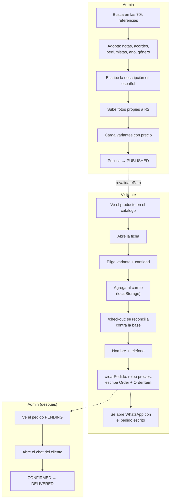

# Flujos de usuario

Índice de los casos de uso end-to-end. Cada uno tiene su documento con la
trazabilidad completa: UI → handler → acción → servicio → base.

| Flujo                                 | Actor     | Entry point                                       | Documento                                                    |
| ------------------------------------- | --------- | ------------------------------------------------- | ------------------------------------------------------------ |
| Explorar y filtrar el catálogo        | Visitante | `/`, `/catalogo`, `/marca/:slug`                  | [`flows/ver-catalogo.md`](flows/ver-catalogo.md)             |
| Agregar al carrito y reconciliarlo    | Visitante | Ficha de producto                                 | [`flows/agregar-al-carrito.md`](flows/agregar-al-carrito.md) |
| Cerrar el pedido por WhatsApp         | Visitante | `/checkout`                                       | [`flows/crear-pedido.md`](flows/crear-pedido.md)             |
| Entrar al panel                       | Admin     | `/admin/login`                                    | [`flows/login.md`](flows/login.md)                           |
| Crear / editar / publicar un producto | Admin     | `/admin/productos/nuevo` o `/admin/productos/:id` | [`flows/publicar-producto.md`](flows/publicar-producto.md)   |
| Subir una foto                        | Admin     | Paso 5 del formulario de producto                 | [`flows/subir-imagen.md`](flows/subir-imagen.md)             |
| Atender un pedido                     | Admin     | `/admin/pedidos`                                  | [`flows/gestionar-pedido.md`](flows/gestionar-pedido.md)     |

Flujos menores, sin documento propio:

| Flujo                              | Dónde está documentado                                                                 |
| ---------------------------------- | -------------------------------------------------------------------------------------- |
| Traducir una nota olfativa         | [`modules/datos-referencia.md`](modules/datos-referencia.md#traducción-desde-el-panel) |
| Corregir el nombre de una marca    | [`modules/admin-productos.md`](modules/admin-productos.md#marcas)                      |
| Editar la configuración del sitio  | [`modules/configuracion-sitio.md`](modules/configuracion-sitio.md)                     |
| Consultar por WhatsApp sin pedido  | [`integrations.md`](integrations.md#whatsapp)                                          |
| Importar el dataset de Fragrantica | [`modules/datos-referencia.md`](modules/datos-referencia.md)                           |

---

## El recorrido de la venta, de punta a punta

Los dos lados se comunican **sólo por la base**: no hay notificación, ni email,
ni push. El admin se entera del pedido por el mensaje de WhatsApp que le llega
del cliente, y el pedido queda guardado para consultarlo en el panel.

---

## Preconditions comunes

| Condición                                                    | Sin ella                                                                                                                                            |
| ------------------------------------------------------------ | --------------------------------------------------------------------------------------------------------------------------------------------------- |
| Hay una fila `SiteSetting` (`id: "singleton"`)               | `obtenerConfiguracionSitio()` cae a `siteDefaults`; `obtenerConfiguracionEditable()` **lanza** (`findUniqueOrThrow`) y `/admin/configuracion` rompe |
| Existe un `User`                                             | No hay forma de entrar al panel, y tampoco de crear uno desde la app                                                                                |
| R2 configurado (las cinco variables)                         | No se pueden subir fotos; la tienda muestra el placeholder de frasco                                                                                |
| Hay referencias importadas                                   | El paso 1 del formulario de producto no encuentra nada; queda la carga manual                                                                       |
| El producto está `PUBLISHED` y tiene una variante `isActive` | No aparece en la grilla (la ficha sí responde por URL sólo si está publicado)                                                                       |

---

## Errores transversales

| Situación                                          | Qué ve el usuario                                                                                                             | Dónde se decide                   |
| -------------------------------------------------- | ----------------------------------------------------------------------------------------------------------------------------- | --------------------------------- |
| Variante desactivada mientras estaba en el carrito | Toast _"Sacamos X del carrito — ya no está disponible"_ y se quita sola                                                       | `usar-reconciliacion-carrito.ts`  |
| Precio cambiado mientras estaba en el carrito      | Alerta con el precio viejo tachado y el nuevo; **hay que confirmar** para continuar                                           | `formulario-checkout.tsx:159-183` |
| Carrito entero inválido al enviar                  | _"Ninguno de los productos de tu carrito sigue disponible."_                                                                  | `checkout/actions.ts:159-166`     |
| Demasiados intentos (login o checkout)             | _"Demasiados intentos. Probá de nuevo en N minutos."_                                                                         | `lib/rate-limit.ts`               |
| Bot completa el honeypot                           | _"No pudimos procesar el pedido. Probá de nuevo."_ — el mismo mensaje genérico que cualquier otro fallo, para no darle pistas | `checkout/actions.ts:71-73`       |
| Credenciales incorrectas                           | _"Email o contraseña incorrectos."_ — no revela si el email existe                                                            | `login/actions.ts:20`             |
| Producto en borrador alcanzado por URL             | 404                                                                                                                           | `producto/[slug]/page.tsx:58`     |
| Server Action sin sesión                           | Error genérico de Next (`requireAdmin()` **lanza**, no devuelve `{ ok:false }`)                                               | `lib/admin/guard.ts`              |
| Errores de validación en un formulario             | Mensaje al lado del control, vía `setError()` de react-hook-form                                                              | `erroresPorCampo()` + `setError`  |
